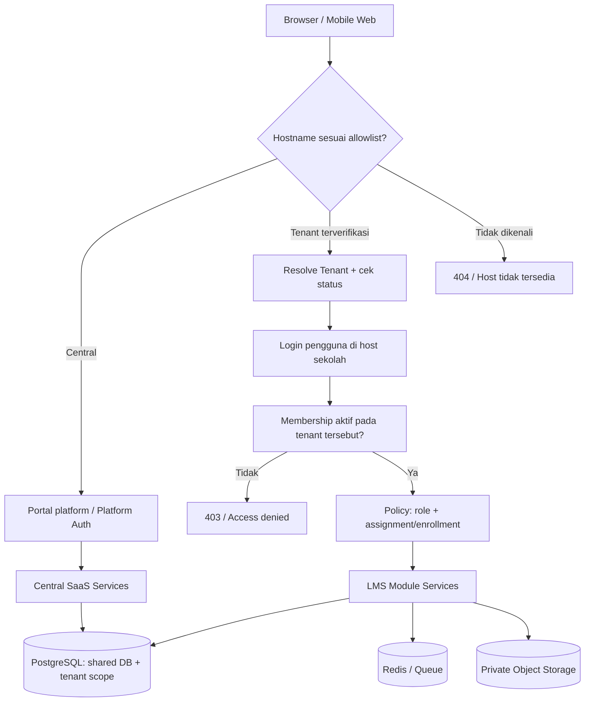

# ADR-001 — Multi-Tenancy & Identity Architecture

| Metadata | Nilai |
|---|---|
| Produk | LMS SaaS Multi-Sekolah |
| ID | ADR-001 |
| Versi | 1.0 |
| Tanggal | 5 November 2026 |
| Status | **Proposed baseline — untuk disetujui pemilik produk sebelum migrasi M1** |
| Dokumen induk | `PRD_Master_LMS_SaaS_Multi_Sekolah_v1.0.md` |
| Dokumen terkait | `ERD_Core_LMS_SaaS_v1.0.md` |
| Berlaku untuk | Milestone M0–M6, khususnya M1 (Tenancy & Identity) |

> **Konvensi status:** Keputusan bisnis yang **sudah dikonfirmasi** adalah produk SaaS untuk banyak sekolah sejak awal dan pengembangan dimulai lokal. Keputusan teknis di ADR ini adalah **rancangan yang direkomendasikan**; belum berarti telah disetujui, diimplementasi, atau diuji. Bila diubah, buat ADR pengganti, jangan mengubah diam-diam.

## 1. Konteks dan masalah

Platform melayani banyak sekolah dari satu codebase. Sekolah A dan B bisa memiliki username siswa sama, nama kelas sama, dan guru yang mengajar di kedua sekolah. Data pembelajaran bersifat privat, termasuk data anak, soal/jawaban ujian, dan nilai. Sistem juga memiliki operator SaaS pusat yang **tidak sama** dengan admin setiap sekolah.

Risiko utama adalah kebocoran data lintas tenant akibat query tanpa filter, URL yang ditebak, foreign key salah, job tertunda, cache, file, atau sesi yang berpindah konteks. Arsitektur harus membuat batas tenant eksplisit dan dapat diuji sejak pengembangan lokal.

### 1.1 Tujuan

1. Satu aplikasi Laravel untuk banyak sekolah, masing-masing berisi data dan administrasi akademik terisolasi.
2. Login siswa bisa memakai username sekolah tanpa email pribadi.
3. Satu identitas pengguna dapat menjadi guru di beberapa sekolah, dengan membership dan role berbeda.
4. Operator platform mengelola tenant/paket tanpa memiliki akses bawaan ke data pembelajaran siswa.
5. Model yang bisa diimplementasikan modular monolith dengan PostgreSQL dan Docker Compose.

### 1.2 Bukan tujuan fase ini

SSO lintas-domain, OAuth identitas sekolah, orang tua, multi-sekolah dalam satu yayasan, custom domain publik otomatis, database-per-tenant, RLS produksi tanpa proof-of-concept, aplikasi mobile native, dan provisioning billing otomatis.

## 2. Ringkasan keputusan (baseline direkomendasikan)

| ID | Keputusan | Alasan/konsekuensi |
|---|---|---|
| ADR-001-D01 | **Satu tenant = satu sekolah** (MVP). | Membatasi lingkup dan memudahkan administrasi. |
| ADR-001-D02 | **Modular monolith, shared PostgreSQL database, tenant-scoped tables**. | Lebih cepat dikembangkan, biaya operasional relatif rendah; isolasi harus diuji kuat. |
| ADR-001-D03 | **Hostname terverifikasi menentukan tenant**, bukan header/ID dari client. | Mengurangi impersonasi tenant. |
| ADR-001-D04 | `users` = identitas global; `tenant_memberships` = keanggotaan dan username sekolah; `membership_roles` = role pada tenant. | Mendukung guru lintas sekolah dan siswa tanpa email. |
| ADR-001-D05 | Login untuk MVP **per hostname sekolah**, sesi browser **host-only**, tanpa otomatis berbagi sesi antarsubdomain. | Lebih sederhana dan risiko kebocoran sesi lebih kecil; pengguna multi-sekolah login per portal. |
| ADR-001-D06 | **Platform staff dipisahkan** dari role sekolah. | Super Admin tidak otomatis boleh membaca isi data tenant. |
| ADR-001-D07 | Kebijakan otorisasi berbasis **tenant + membership + role + relasi resource**. | Role saja tidak cukup untuk akses course, pengumpulan, dan nilai. |
| ADR-001-D08 | Setiap tabel akademik menyimpan `tenant_id` dan memakai **composite FK** untuk relasi antar tabel milik tenant. | Integritas database ikut menolak relasi silang. |
| ADR-001-D09 | ID internal `BIGINT`, `public_ulid CHAR(26)` pada resource yang diekspos. | FK efisien; ULID tidak menggantikan authorization. |
| ADR-001-D10 | Semua file private, cache, queue, ekspor, dan audit membawa tenant context. | Perlindungan menyeluruh, tidak hanya HTTP/database. |
| ADR-001-D11 | Aplikasi menerapkan tenant-aware repository/scopes dan policies; **PostgreSQL RLS dievaluasi dalam spike M1 dan dituntaskan sebelum pemakaian data nyata bila dipilih sebagai lapisan DB**. | RLS menambah pertahanan tetapi membutuhkan disiplin koneksi/transaksi; jangan klaim aktif sebelum terbukti. |
| ADR-001-D12 | Paket berlangganan awal diatur manual oleh Platform Admin; pembayaran otomatis pasca-MVP. | Core SaaS dapat diuji tanpa integrasi gateway. |

## 3. Batas sistem dan domain aplikasi



### 3.1 Hostname dan domain

- Contoh **lokal**: `admin.platform.test`, `smpn10.platform.test`, `smpn05.platform.test`, `swastaa.platform.test`.
- `tenant_domains.hostname` wajib unik, normalized lowercase + punycode sesuai kebijakan, tanpa port. Hanya domain terdaftar dengan `status=active` yang boleh resolve tenant; domain kustom juga harus memiliki `verified_at` (domain default disahkan melalui provisioning internal). Domain default subdomain diprovision oleh platform, tetap dicatat dan diaktifkan secara internal; custom domain memerlukan verifikasi kepemilikan dan TLS kelak.
- Host pusat adalah konfigurasi eksplisit, bukan tenant. Host tak dikenal ditolak (404/421); jangan meneruskan ke tenant default.
- Gunakan `$request->getHost()` **setelah** konfigurasi trusted hosts/proxies yang benar. Jangan percaya `X-Forwarded-Host` dari proxy tak dikenal.
- Hostname boleh menentukan **tenant kandidat**, bukan mengesahkan identitas pengguna. Akses baru sah setelah pemeriksaan keanggotaan dan policy.
- Di Windows, file `hosts` tidak mendukung wildcard; masukkan hostname `.test` satu per satu, atau gunakan DNS resolver lokal. Konfigurasi web server juga harus menerima host-host ini.

### 3.2 Status tenant

| Status | Perilaku aplikasi |
|---|---|
| `pending` | Belum dapat dipakai guru/siswa; proses onboarding platform. |
| `active` | Login dan operasi berjalan sesuai membership, hak akses, dan entitlement. |
| `suspended` | Blokir operasi pembelajaran baru serta akses normal sesuai kebijakan; halaman informasi layanan tetap tersedia. Tidak menghapus data. |
| `archived` | Akses normal tertutup; retensi/ekspor/penghapusan lewat prosedur terotorisasi. |

Transisi status hanya melalui service pusat dengan transaksi, otorisasi operator, alasan, dan audit. Kebijakan masa tenggang/read-only saat suspend adalah **keputusan produk terbuka**; jangan mengandalkan asumsi untuk implementasi transaksi data.

## 4. Identitas: users vs memberships

### 4.1 Model akun

- `users`: `id`, `public_ulid`, `email` (opsional, unik bila tidak null setelah normalisasi), `password` **berisi hash** (konvensi Laravel), status akun, waktu verifikasi, dan metadata autentikasi minimum. **Tidak** menyimpan nama kelas, NIS/NISN, role tenant, atau tenant aktif permanen.
- `tenant_memberships`: `id`, `tenant_id`, `user_id`, `local_username`, `display_name`, `status`, `joined_at`. `(tenant_id,user_id)` unik; `(tenant_id,local_username_normalized)` unik. Username `andi07` **boleh** ada di dua sekolah.
- `roles`: katalog role sekolah (`school_admin`, `teacher`, `homeroom_teacher`, `student`); `membership_roles`: hubungan membership–role **di tenant itu**; `permissions` dan `role_permissions` sebagai katalog kebijakan server.
- `platform_staff`: mencatat staf platform (`user_id`, `role`, `status`); role platform **bukan** role sekolah. Tidak ada API 'masuk sebagai tenant apa saja' secara default.
- `student_profiles` dan `teacher_profiles`: profil khusus sekolah yang menunjuk membership dalam tenant sama. NIS/NIP/NISN tidak perlu dijadikan username autentikasi dan data sensitif yang tidak perlu tidak dikumpulkan.

### 4.2 Aturan identitas ganda lintas sekolah

Seorang guru yang sudah punya akun global boleh ditambahkan sebagai anggota sekolah lain **melalui undangan/penghubungan akun yang terverifikasi**. Saat impor data, jangan otomatis menggabungkan akun atas dasar nama, NIS/NISN, atau email yang belum diverifikasi. Jika belum ada proses link aman, buat akun baru atau tandai undangan tertunda sampai diverifikasi.

Keanggotaan dapat dinonaktifkan tanpa menghapus `users`, karena pengguna mungkin masih aktif di sekolah lain. Penonaktifan akun global membutuhkan otorisasi dan alasan berbeda dari penonaktifan membership.

### 4.3 Login pada host tenant

1. Resolve tenant dari hostname **sebelum** membaca username lokal.
2. Normalisasi identifier (trim/casefold sesuai kebijakan). Cari membership via `(tenant_id, local_username_normalized)`; jika menggunakan email terverifikasi, pilih user dan tetap **wajib** validasi membership untuk tenant target.
3. Verifikasi password pada `users` dengan hasher framework; tidak pernah membandingkan plaintext.
4. Pastikan user dan membership aktif, tenant aktif, dan credential tidak diblokir.
5. Regenerasi session ID. Bind sesi pada **hostname aktif dan tenant**, dengan pengecekan membership aktif pada setiap request penting.
6. Setelah login, susun `TenantContext(tenant_id, membership_id, user_id, permissions)` dari sumber server. Jangan mempercayai `tenant_id` dari form, querystring, route parameter, token tanpa validasi, atau JavaScript.
7. Terapkan rate limit berdasarkan IP + tenant + identifier hash dan log event tanpa mengekspos password/PII.

**Contoh:** guru bisa menggunakan akun `users.id=42` pada tenant A dan B, tetapi memegang membership berbeda. Role pada A tidak diwariskan ke B. Karena cookie host-only, login A tidak otomatis memberi sesi B di MVP.

### 4.4 Akun siswa tanpa email

- Admin sekolah membuat username lokal dan aktivasi terkendali. Password acak/tautan aktivasi disampaikan dengan kanal resmi sekolah; simpan hanya hash atau token hash yang kedaluwarsa dan **sekali pakai**.
- Pengguna wajib mengubah sandi awal jika kredensial sementara dipakai. Reset siswa tanpa email dilakukan oleh admin berwenang dengan pencatatan audit dan verifikasi identitas menurut prosedur sekolah; jangan membuat endpoint reset tanpa verifikasi.
- Admin tidak boleh membaca password siswa yang sudah ditetapkan. Hindari menaruh kredensial di laporan CSV jangka panjang, log, atau notifikasi tidak aman.
- **Risiko akun lintas sekolah:** karena password disimpan pada identitas global, admin sekolah **tidak boleh** mereset password global untuk pengguna yang memiliki membership di tenant lain. Pemulihan akun multi-tenant harus melalui identitas pemilik yang terverifikasi atau prosedur pemulihan platform yang terpisah dan diaudit. Reset berbantuan Admin Sekolah hanya diizinkan untuk akun **single-tenant** setelah pemeriksaan server-side; setelah ditambah sekolah lain, hak reset tersebut otomatis gugur.
- Untuk P1, pertimbangkan MFA bagi admin sekolah dan operator SaaS; untuk produksi direkomendasikan MFA operator sejak awal operasional.

### 4.5 Sesi dan cookie

- Gunakan host-only session cookie (`SESSION_DOMAIN` kosong/null di konfigurasi yang benar), `HttpOnly`, `Secure` ketika HTTPS, `SameSite=Lax` atau lebih ketat berdasarkan flow, dan CSRF protection.
- Jangan gunakan cookie `.platform.com` yang dibagikan otomatis ke seluruh sekolah pada MVP.
- Perubahan role/status membership memicu revokasi atau invalidasi sesi/otorisasi efektif. Bila cache permission digunakan, key harus memuat tenant, membership, dan versi permission; lakukan invalidasi ketika berubah.
- Logout hanya mengakhiri sesi pada host terkait; global logout lintas host adalah fitur lain yang memerlukan desain khusus.

## 5. Authorisation dan batas data

### 5.1 Prinsip izin berlapis

Sebuah operasi baru diperbolehkan bila **semua** kondisi relevan terpenuhi:

```text
allow(request, resource) =
  valid_tenant_host
  AND tenant_active
  AND authenticated_user_active
  AND active_membership_in_tenant
  AND role_has_permission
  AND resource.tenant_id == context.tenant_id
  AND (resource_relationship_allows_action)
```

Contoh relasi tambahan:
- Guru membuat/mengubah materi hanya untuk course yang tercantum di `course_teachers`.
- Siswa membuka course hanya bila `course_enrollments` aktif atau berhak membaca riwayatnya.
- Siswa mengumpulkan tugas/ujian hanya untuk course sendiri, pada jadwal yang sah, dan hanya untuk identitas dirinya.
- Wali kelas dapat memantau kelas yang ditugaskan tetapi **tidak otomatis** boleh mengubah materi/nilai bila bukan guru pengampu.
- Admin sekolah mengelola administrasi tenant tanpa membaca data sekolah lain.
- Super Admin hanya mengelola tenant dan agregat operasional; akses dukungan ke konten tenant, bila suatu hari perlu, harus memakai grant terpisah yang disetujui, sementara, terbatas, dan diaudit.

### 5.2 Matriks ringkas

| Operasi | Platform staff | School admin | Teacher | Homeroom | Student |
|---|---|---|---|---|---|
| Provision tenant, paket | Ya (pusat) | Tidak | Tidak | Tidak | Tidak |
| Kelola anggota sekolah | Tidak secara default | Ya (tenant aktif) | Tidak | Tidak | Tidak |
| Kelola tahun ajaran, rombel | Tidak | Ya | Tidak | Baca kelas sendiri | Tidak |
| Materi/course | Tidak | Administratif bila ditetapkan | Course yang diajar | Hanya bila juga pengampu | Course yang diikuti: baca |
| Tugas: buat & koreksi | Tidak | Hanya sesuai kebijakan | Course yang diajar | Tidak otomatis | Tidak |
| Tugas: kirim, kuis: mulai | Tidak | Tidak | Tidak | Tidak | Milik sendiri dan berhak |
| Nilai | Tidak | Pengawasan berizin | Course yang diajar | Monitoring terikat kelas | Hanya nilai terbit milik sendiri |

### 5.3 Middleware / service boundary

Urutan untuk tenant routes:

1. `VerifyTrustedHost` / trusted proxy configuration.
2. `ResolveTenantFromVerifiedHost`.
3. `EnsureTenantStatus` (dengan pengecualian terbatas untuk halaman layanan).
4. `Authenticate` (bisa login dengan lookup username tenant).
5. `EnsureActiveTenantMembership`.
6. `AuthoriseAction` (Laravel Gates/Policies + domain service checks).

Semua akses via route model binding wajib query menggunakan `tenant_id` dari context; gunakan 404 untuk resource tak terakses jika sesuai kebijakan agar tidak mengungkap keberadaan resource tenant lain. Endpoint POST/PUT/PATCH/DELETE, livewire actions, ekspor, download, dan jobs wajib melakukan authorization di backend meskipun tombol UI disembunyikan.

**Pola dilarang:** `Model::find($id)` untuk entitas tenant tanpa scoping; `where('tenant_id', $request->tenant_id)`; `withoutGlobalScopes()` tanpa jalur terotorisasi dan audit; aksi admin platform otomatis dibelokkan ke model siswa.

### 5.4 Contoh pseudocode Laravel (ilustratif, bukan copy-paste produksi)

```php
// Host telah divalidasi trusted proxy / trusted host.
$tenantDomain = TenantDomain::query()
    ->where('hostname', strtolower($request->getHost()))
    ->where('status', 'active')
    ->firstOrFail();

$tenant = Tenant::query()->findOrFail($tenantDomain->tenant_id);
abort_unless($tenant->status === 'active', 403);

// Untuk request yang sudah terautentikasi:
$membership = TenantMembership::query()
    ->where('tenant_id', $tenant->id)
    ->where('user_id', auth()->id())
    ->where('status', 'active')
    ->firstOrFail();

// TenantContext ditetapkan per request dan diverifikasi kembali dalam job.
app(TenantContext::class)->set($tenant, $membership);

$course = Course::query()
    ->where('tenant_id', app(TenantContext::class)->tenantId())
    ->where('public_ulid', $courseUlid)
    ->firstOrFail();
Gate::authorize('view', $course);
```

Pada halaman login, lookup membership adalah bagian dari credential resolution **sebelum** auth; middleware `EnsureActiveTenantMembership` baru dijalankan untuk route login-protected. Contoh di atas sengaja memisahkan kedua tahap itu.

## 6. Pilihan dan pertahanan database

### 6.1 Alternatif yang dipertimbangkan

| Model | Kelebihan | Kekurangan | Hasil |
|---|---|---|---|
| Shared database, shared tables, `tenant_id` | Sederhana untuk migrasi, satu deployment | Kebocoran bila query/scope salah; restore per tenant lebih sulit | **Dipilih untuk MVP**, dengan guardrails tegas |
| Schema PostgreSQL per tenant | Namespace lebih terpisah | Migrasi skema dan manajemen schema lebih kompleks | Ditunda |
| Database per tenant | Isolasi dan restore per sekolah potensial lebih mudah | Jumlah DB, provisioning, koneksi, monitoring, biaya meningkat | Ditunda; pertimbangkan tier khusus bila perlu |
| Microservices | Skalabilitas independen bila benar-benar diperlukan | Distribusi transaksi/operasi jauh lebih rumit | Ditolak untuk MVP |

### 6.2 Aturan wajib untuk shared DB

1. Setiap tenant-owned table memiliki `tenant_id BIGINT NOT NULL` yang FK ke `tenants.id`.
2. `UNIQUE (tenant_id, id)` tersedia pada parent tenant-owned bila direferensikan melalui `(tenant_id, foreign_id)`; index composite yang relevan disediakan.
3. Setiap FK antar tenant-owned tables membawa `tenant_id` yang **sama** (`FOREIGN KEY (tenant_id, course_id) REFERENCES courses(tenant_id,id)`, dll.).
4. `UNIQUE` lokal sekolah selalu memasukkan tenant dan konteks akademik, contoh `(tenant_id, academic_year_id, code)`.
5. Mutasi akademik menggunakan transaksi dan validasi resource relationship; materi ujian/grade tidak dihapus cascade sembarang.
6. Semua paths query, raw SQL, observer, seeders, factories, exports, jobs, dan admin utilities diklasifikasikan sebagai central atau tenant-scoped.
7. Release gate: test otomatis CRUD dan foreign key cross-tenant **harus gagal** untuk akses ilegal.

**Contoh PostgreSQL (skematik):**

```sql
ALTER TABLE courses
  ADD CONSTRAINT uq_courses_tenant_id UNIQUE (tenant_id, id);

ALTER TABLE assignments
  ADD CONSTRAINT fk_assignments_course_same_tenant
  FOREIGN KEY (tenant_id, course_id)
  REFERENCES courses (tenant_id, id)
  ON DELETE RESTRICT;
```

Aturan ini mengharuskan parent mempunyai unique/index kandidat yang benar; nama constraint final mengikuti convention migrasi.

### 6.3 PostgreSQL Row Level Security (RLS)

**Keputusan:** eksplorasi dan uji kelayakan di M1; tidak boleh disebut telah aktif tanpa migrasi/policy/test. Untuk produksi dengan data anak, tim harus memutuskan secara terdokumentasi apakah RLS menjadi lapisan wajib atau memilih mekanisme DB isolation lain yang setara. Mengandalkan global scope Eloquent saja adalah risiko yang harus diakui dan diuji.

Jika RLS dipilih:

- Pakai DB role request tenant yang **bukan superuser, bukan `BYPASSRLS`, dan bukan owner bypass**. Role migrasi/operasional terpisah.
- Aktifkan `ENABLE ROW LEVEL SECURITY` dan `FORCE ROW LEVEL SECURITY` untuk tabel tenant-owned; policy `USING` serta `WITH CHECK` menggunakan `tenant_id` dari konteks database yang terverifikasi.
- Untuk connection pooling, gunakan **transaction-local setting** (`SET LOCAL` atau `set_config(..., true)`) **di dalam transaksi yang mencakup query tenant**; jangan mewariskan tenant ID di session connection yang dipakai ulang.
- Test request A → B pada koneksi yang dipakai ulang; test `SELECT`, `INSERT`, `UPDATE`, `DELETE`, raw SQL, queue, dan export dengan DB role yang sama dengan produksi.
- Lakukan inventory dan uji cakupan policy setiap tabel baru. Query central yang sah memakai jalur dan grants terpisah, bukan bypass umum dari request biasa.

Contoh **ilustratif, tidak boleh ditempel langsung tanpa spike koneksi/transaction**:

```sql
ALTER TABLE learning_materials ENABLE ROW LEVEL SECURITY;
ALTER TABLE learning_materials FORCE ROW LEVEL SECURITY;

CREATE POLICY tenant_material_isolation ON learning_materials
  FOR ALL
  USING (tenant_id = NULLIF(current_setting('app.tenant_id', true), '')::bigint)
  WITH CHECK (tenant_id = NULLIF(current_setting('app.tenant_id', true), '')::bigint);

-- Jalankan di DALAM transaksi untuk request tenant terverifikasi:
SELECT set_config('app.tenant_id', '123', true);
```

Catatan: pemilihan nilai konteks `app.tenant_id` tetap tanggung jawab autentikasi aplikasi; RLS bukan pengganti validasi host/membership. Pengguna SQL dengan hak mengubah session settings membutuhkan mitigasi terpisah. `TRUNCATE` juga tidak dilindungi seperti operasi row DML normal; role request tidak boleh memiliki hak itu.

## 7. Media, cache, jobs, dan audit

### 7.1 Penyimpanan

- Semua lampiran tugas, jawaban ujian, dan materi yang tidak publik disimpan private. `uploaded_files` menyimpan metadata dan tenant.
- Object key contoh: `tenants/{tenant_public_ulid}/materials/{opaque-file-id}`; jangan membangun path dari nama file asli yang tidak disanitasi.
- Akses unduh/preview memerlukan izin resource sebelum streaming/pembuatan signed URL berumur pendek. Jangan membuat bucket/direktori semua sekolah bisa didaftar.
- Restore/ekspor per tenant membutuhkan prosedur seleksi data dan objek terotorisasi; jangan pernah restore snapshot seluruh DB di atas database produksi untuk memulihkan satu sekolah.

### 7.2 Cache dan queue

- Prefix cache tenant `tenant:{tenant_id}:...`; cache user/permission menambahkan membership/user/version bila relevan.
- Tenant jobs menyertakan `tenant_id` dari server saat enqueue; worker **memvalidasi ulang** tenant, status, dan target resource; context wajib di-reset pada `finally` agar tidak bocor ke job berikutnya.
- Retry/idempotency menyertakan tenant; jika membership berubah di antara enqueue dan eksekusi, kebijakan waktu eksekusi berlaku.
- Event/WebSocket/scheduler kelak tunduk pada batas yang sama. Redis dipakai sebagai infrastruktur bersama, **bukan** boundary keamanan.

### 7.3 Audit dan privasi

Catat `actor_user_id`, `actor_membership_id` jika ada, `tenant_id`, action, target type/id, waktu, request ID, dan metadata minimum. Audit pusat dan tenant dipisah secara logis. Jangan log password, token, jawaban esai penuh, NISN, berkas, atau data anak yang tidak perlu. Akses support atas tenant perlu persetujuan, ruang lingkup, masa berlaku, dan audit tersendiri.

## 8. Kontrak ERD dan peraturan integritas

Dokumen ERD yang menyertai ADR ini menerapkan:

- `tenant_memberships` berhubungan ke `users` dan `tenants`, dengan username lokal unik per sekolah.
- `student_profiles`/`teacher_profiles` mengikat membership yang terverifikasi pada tenant yang sama.
- Tahun ajaran → semester; rombel → tahun ajaran; course → mapel + rombel + semester **pada tahun yang sama**.
- `classroom_enrollments` dan `course_enrollments` terpisah: penempatan rombel tidak boleh diam-diam menghapus historis course.
- Tugas/pengumpulan/koreksi selalu terikat ke course dan identitas siswa/guru yang sah.
- Kuis, soal, opsi, attempt, jawaban, hasil menjaga relasi tenant, kuis, soal, dan attempt konsisten.
- Setiap perubahan grade memiliki audit, publikasi grade eksplisit; tidak boleh membocorkan hasil sebelum terbit.
- `onDelete(RESTRICT)` menjadi pilihan konservatif untuk rekam akademik; hard deletion produksi tidak dilakukan melalui cascade acak.

## 9. Pengujian wajib dan acceptance criteria

**Gate M1 (sebelum implementasi domain akademik):**

- [ ] Tiga sekolah dummy dapat diakses pada host `.test` berbeda dengan satu codebase.
- [ ] Host tak dikenal, disabled domain, dan tenant tidak aktif tidak bisa membuka aplikasi sekolah secara normal.
- [ ] Username siswa sama pada dua tenant diterima dan mengarah ke akun sesuai konteks sekolah.
- [ ] User guru mempunyai membership A dan B dengan role berbeda; login A tidak memberi hak akses B.
- [ ] Membership suspended atau user disabled ditolak meskipun password benar.
- [ ] Admin Sekolah A tidak dapat mereset password global milik guru yang juga menjadi anggota Sekolah B.
- [ ] Session ID diregenerasi saat login dan cookie tidak dibagi otomatis antarsubdomain.
- [ ] Platform staff tidak bisa membuka nilai siswa tanpa grant dukungan khusus (grant di luar MVP).
- [ ] Course/grade/file dari B tidak dapat GET/POST/PATCH/DELETE pada host A, termasuk via tebakan ULID.
- [ ] FK komposit database menolak penyisipan anak milik A yang mengacu parent B.
- [ ] Cache/jobs/exports pada tenant A tidak menyertakan konten B.
- [ ] Unit + feature + database integrity tests berjalan di CI.
- [ ] Jika RLS diaktifkan: DB role produksi tak dapat bypass RLS, coverage seluruh tabel, dan reuse connection A→B telah dites.

**Gate sebelum pilot data nyata:** threat modeling, kebijakan data anak dan perjanjian sekolah, backup-restore teruji, penanganan insiden, pembatasan admin, dan uji beban ujian serentak.

### 9.1 Contoh nama pengujian untuk Codex

```text
TenantResolverTest::rejects_unknown_host
TenantResolverTest::rejects_unverified_host
TenantAuthTest::same_local_username_resolves_per_tenant
TenantAuthTest::suspended_membership_cannot_login
TenantAuthTest::school_admin_cannot_reset_multi_tenant_user_password
TenantAuthTest::tenant_a_session_does_not_authorize_tenant_b
TenantPolicyTest::teacher_cannot_edit_another_teachers_course
TenantPolicyTest::student_cannot_download_other_students_submission
TenantPolicyTest::platform_admin_cannot_read_student_grades
TenantDatabaseConstraintTest::rejects_cross_tenant_course_fk
TenantDatabaseConstraintTest::rejects_cross_tenant_quiz_answer_fk
TenantJobTest::resets_context_between_jobs
TenantCacheTest::never_returns_another_tenants_value
```

## 10. Konsekuensi dan trade-off

**Keuntungan:** satu codebase, biaya awal relatif efisien, variasi username lokal, guru multi-sekolah, alur pembelajaran terstruktur, dan kebijakan isolasi yang dapat diverifikasi. **Biaya/risiko:** query harus tenant-aware, banyak composite FK dan index, shared DB sulit di-restore hanya untuk satu tenant, job/file/cache memerlukan context, dan RLS menambah kompleksitas koneksi. Tidak ada klaim keamanan absolut; kontrol harus diuji dan dipantau terus.

## 11. Keputusan terbuka (tidak boleh diam-diam diasumsikan Codex)

| Topik | Default rancangan sampai diputuskan | Pemicu keputusan |
|---|---|---|
| Library tenancy/permissions | Bangun contract interface sendiri; jangan kunci library sebelum compatibility spike | M0/M1 |
| Laravel/PHP | Rekomendasi Laravel 13 + PHP ≥8.3, verifikasi paket Livewire/tenancy sebelum lock | M0 |
| RLS | Spike & hasil evaluasi tertulis; jangan klaim production-ready sebelum pass tests | M1/pre-pilot |
| Akun siswa baru tanpa email | Username tenant + aktivasi sekali pakai oleh sekolah, tanpa student self-registration | M1 |
| Username/email identity linking | Link akun lintas sekolah hanya lewat undangan terverifikasi | M1 |
| Masa tenggang suspend | Tidak hapus data; read-only/grace period menunggu kebijakan bisnis/kontrak | M5 |
| Custom domain | Domain default sekolah dulu; ownership verification + SSL pasca-MVP | M6 |
| Data retention/backup | Kebijakan hukum dan kontrak ditetapkan sebelum pilot nyata | Pre-pilot |
| Input identitas siswa | NISN, tanggal lahir, nomor orang tua **tidak wajib** untuk Core LMS | M2 |
| Dukungan platform membaca konten | Default **ditolak**; flow grant tertulis bila kebutuhan muncul | Pasca-MVP |

## 12. Aturan untuk AI Codex (wajib)

1. Baca **PRD Master → ADR-001 → ERD** sebelum membuat/mengubah migration, model, policy, service, job, dan fitur LMS.
2. Jangan mengganti arsitektur menjadi database-per-tenant, microservices, atau auth global berbagi cookie tanpa ADR baru.
3. Jangan meletakkan `tenant_id` dari request sebagai source of truth; gunakan context tervalidasi.
4. Jangan membuat model tenant-owned tanpa deklarasi tenant, constraint, policy, tests, serta klasifikasi cache/file/job.
5. Jangan membuat route atau Livewire action yang melewati auth policy; UI bukan kontrol akses.
6. Jangan menambahkan role/platform admin implicit bypass atau menggabungkan akun otomatis berdasarkan nama/email tak terverifikasi.
7. Untuk penambahan tabel/relasi, revisi ERD dan test integritas sebelum migration.
8. Untuk sprint, berikan: daftar file terdampak, perubahan schema, acceptance criteria, negative cross-tenant tests, dan catatan keputusan baru.
9. Gunakan data sintetis di seed; jangan masukkan data murid sungguhan ke repo, log, prompt, screenshot, atau fixture.
10. Jangan mengubah keputusan terbuka menjadi fitur P0 secara diam-diam.

## 13. Referensi

- PRD Master internal `PRD_Master_LMS_SaaS_Multi_Sekolah_v1.0.md`.
- ERD pendamping `ERD_Core_LMS_SaaS_v1.0.md`.
- OWASP Multi-Tenant Security Cheat Sheet: https://cheatsheetseries.owasp.org/cheatsheets/Multi_Tenant_Security_Cheat_Sheet.html
- PostgreSQL Row Security Policies: https://www.postgresql.org/docs/current/ddl-rowsecurity.html
- Laravel 13 Release Notes: https://laravel.com/docs/13.x/releases

## 14. Riwayat perubahan

| Versi | Tanggal | Ringkasan |
|---|---|---|
| 1.0 | 2026-11-05 | Baseline D01–D12, identity, host resolution, RBAC, SQL tenancy integrity, opsi RLS, security gates, aturan Codex. |
