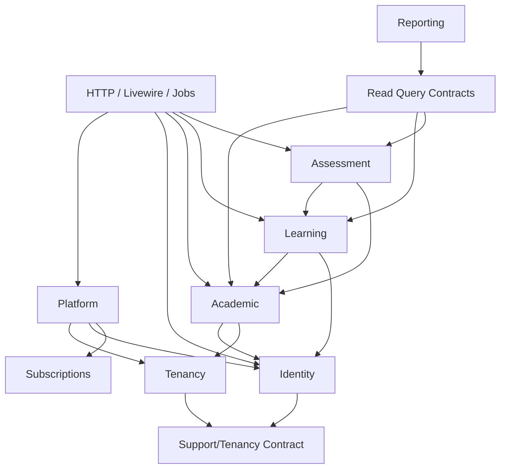

# ADR-002 — Application Architecture & Modular Structure

| Metadata | Nilai |
|---|---|
| Produk | LMS SaaS Multi-Sekolah |
| ID | ADR-002 |
| Versi | 1.0 |
| Tanggal | 5 November 2026 |
| Status | **Proposed — memerlukan persetujuan sebelum menjadi baseline implementasi** |
| Keputusan bisnis yang sudah dikonfirmasi | Produk SaaS untuk banyak sekolah sejak awal; development dimulai di komputer lokal |
| Keputusan terdahulu | ADR-001 — Multi-Tenancy & Identity Architecture v1.0 (Proposed) |
| Skema acuan terbaru | ERD Core LMS SaaS v1.1 (Proposed) |
| Modul produk | PRD Master v1.0; PRD Authentication & RBAC v1.0; PRD SaaS Central & Tenant Management v1.0 |
| Target | M0–M6; penguncian struktur kode sebelum M1 |

> **Sifat dokumen:** ADR ini adalah keputusan desain **yang diusulkan** dan kontrak implementasi setelah disetujui, bukan bukti bahwa perangkat lunak sudah dibuat. Seluruh dokumen sebelumnya juga masih berstatus Proposed. Jangan membuat migration M1 atau menerapkan perubahan schema berdasarkan klaim persetujuan yang belum ada. Untuk memilih dokumen yang sedang berlaku dalam repo, baca `docs/DOCUMENT_INDEX.md`.

## 1. Konteks

LMS akan menyediakan satu aplikasi untuk berbagai sekolah dan lima kelompok domain utama: platform SaaS, identitas dan keanggotaan, akademik, pembelajaran, serta penilaian. Fitur berikutnya (langganan, laporan, notifikasi) harus bisa ditambahkan tanpa mengubah konsep identitas global atau membocorkan data antarsekolah.

PRD Master v1.0 memberi ilustrasi direktori `app/Domains/*`, sedangkan dua PRD modul menawarkan `app/Modules/*`. Keduanya merupakan **contoh**, bukan implementasi yang disepakati. Tanpa penetapan struktur final, pengembangan bertahap via Codex berisiko menimbulkan kelas ganda, dependensi siklik, logika policy yang tersebar, query lintas tenant, dan mismatch migration–ERD.

### Masalah yang harus diselesaikan

1. Satu pola organisasi source code agar semua sprint konsisten.
2. Satu pemilik yang jelas untuk setiap tabel, aksi bisnis, dan aturan akses.
3. Kontrak lintas modul tanpa coupling tidak terkendali.
4. Tenant context valid pada request, Livewire action, job, scheduler, ekspor, dan file download.
5. Struktur sederhana yang mengikuti konvensi Laravel dan dapat diuji lokal dengan PostgreSQL sungguhan.
6. Penanda yang dapat dijalankan Codex mengenai dokumen dan batas scope.

## 2. Keputusan ringkas

| Kode | Keputusan | Mengikat setelah status Accepted |
|---|---|---|
| ADR-002-D01 | Gunakan **modular monolith**: satu Laravel application, satu repository, satu proses deployment web (worker/scheduler proses pendukung), satu PostgreSQL shared database. | Jangan memecah menjadi microservices atau DB-per-tenant tanpa ADR baru. |
| ADR-002-D02 | Struktur kanonis kode bisnis adalah **`app/Modules/<ModuleName>`**, bukan `app/Domains`. | Contoh `app/Domains` pada PRD Master dianggap historis/konseptual. |
| ADR-002-D03 | Cross-cutting internal ditempatkan pada **`app/Support`**, dan entry point pada `app/Http`, `app/Providers`, `routes`, serta `resources`. | Jangan membangun framework internal generik berlebihan. |
| ADR-002-D04 | Pisahkan modul **Tenancy, Identity, Platform, Academic, Learning, Assessment**. `Subscriptions` (M5), `Reporting`, `Notifications` menyusul saat diperlukan. | Kepemilikan data/tanggung jawab eksplisit. |
| ADR-002-D05 | API lintas modul menggunakan **public contracts, application actions/queries, dan events yang ditentukan**. | Tidak mengakses model milik modul lain secara bebas untuk write. |
| ADR-002-D06 | Controller, Livewire, dan job hanya **adapter tipis**: validasi input, authorize, panggil action/query, respons. | Orkestrasi dan transaksi pada application layer. |
| ADR-002-D07 | `TenantContext` immutable per operasi, diinisialisasi dari hostname tepercaya atau job payload server-side terverifikasi; gagal tertutup jika tidak tersedia. | Jangan mengandalkan `tenant_id` client sebagai identitas. |
| ADR-002-D08 | Validasi akses berlapis: trusted host → tenant resolution/status → auth/session → membership/status/versi → policy/relasi resource → data access. | UI hiding atau global scope saja tidak cukup. |
| ADR-002-D09 | Migrations tetap di **`database/migrations/`** memakai timestamp Laravel, ownership dijelaskan oleh dokumentasi dan struktur model. | Tidak membuat beberapa mekanisme migration custom pada M0/M1. |
| ADR-002-D10 | Event untuk efek samping harus setelah commit; retries/idempotency ditetapkan oleh action; external notification tidak boleh membuat transaksi half-provisioned. | M1 punya resending yang terotorisasi; outbox ditinjau sebelum skala produksi. |
| ADR-002-D11 | Perubahan arsitektur, dependency penting, dan kontrak publik wajib melewati review ADR dan indeks dokumen. | `AGENTS.md` tidak boleh mengubah keputusan ADR diam-diam. |
| ADR-002-D12 | Tests implementasi wajib mencakup batas modul, integritas PostgreSQL, keamanan lintas tenant, dan auth/session status. | Gate kualitas sebelum merge/ekspansi. |

## 3. Alternatif yang dipertimbangkan

| Alternatif | Keputusan | Alasan |
|---|---|---|
| Laravel monolit tanpa modul eksplisit | Ditolak | Di awal cepat tetapi domain saat banyak sekolah/ujian menjadi sulit dipisahkan. |
| Modular monolith dengan `app/Modules` | **Dipilih sebagai proposal** | Sederhana, namespace konsisten dengan PRD dua modul baru, memungkinkan boundary jelas tanpa infra ekstra. |
| Modular monolith dengan `app/Domains` | Tidak dipilih sebagai nama folder | Secara teknis setara; memilih dua pola sekaligus menambah biaya dan risiko inkonsistensi. |
| Composer package per modul | Ditunda | Overhead autoload, dependency, dan lifecycle belum bernilai pada MVP. |
| Microservices | Ditolak untuk MVP | Memperbesar beban observability, deployment, transaksi terdistribusi, dan biaya. |
| Database per tenant | Ditolak untuk baseline MVP | Tidak sesuai ADR-001; akan memerlukan keputusan, migrasi, dan operasional baru. |
| Frontend SPA terpisah + API publik sejak hari pertama | Ditunda | Kompleksitas keamanan/API tanpa kebutuhan yang terbukti; Blade/Livewire cukup untuk MVP. |

**Trade-off:** modul masih berbagi aplikasi dan database sehingga batas tidak otomatis dipaksakan runtime. Disiplin code review, static architecture tests, policy, constraints, dan CI wajib digunakan sebagai mekanisme penegakan batas.

## 4. Stack dan batas runtime

| Layer | Pilihan baseline | Catatan |
|---|---|---|
| Backend | Laravel **13 direkomendasikan** | Verifikasi kompatibilitas pada spike M0; jika perlu fallback, catat keputusan dan alasan, jangan diam-diam upgrade/downgrade. |
| Runtime | PHP **8.3+ direkomendasikan** | Pilih versi minor tepat saat M0; pin versi Docker/image dan paket melalui lockfile. |
| UI | Blade + Livewire + Alpine.js + Tailwind CSS | Javascript tambahan terisolasi untuk fitur ujian/autosave bila diperlukan. |
| Database | PostgreSQL | Shared database; composite FK dan partial unique indexes mengikuti ERD v1.1. |
| Cache/queue | Redis | Tidak menjadi sumber kebenaran nilai/hasil ujian. |
| Storage | Laravel filesystem abstraction | Local private untuk development, S3-compatible/R2 private untuk produksi setelah konfigurasi dan testing. |
| Auth | Laravel session-based auth, host-only cookies | Session/membership versions sesuai ERD v1.1; bukan token di localStorage. |
| Infra lokal | Docker Compose | Service app, web, PostgreSQL, Redis, queue worker, scheduler; mail catcher untuk pengujian. |
| Test | PHPUnit/Pest yang dipilih saat M0, PostgreSQL untuk integration | SQLite tidak menggantikan pengujian constraint PostgreSQL. |

**Tidak diputuskan oleh ADR ini:** package multi-tenancy/RBAC pihak ketiga, pilihan session backend final, RLS production, outbox transaksional, custom domain, sistem billing otomatis, dan API publik. Topik ini tetap keputusan terbuka dari ADR-001/ERD v1.1 sampai disahkan.

## 5. Struktur direktori kanonis

```text
lms-saas/
├── AGENTS.md                             # aturan Codex di root
├── app/
│   ├── Modules/
│   │   ├── Tenancy/
│   │   │   ├── Actions/                  # ActivateTenant, TransitionTenantStatus...
│   │   │   ├── Contracts/                # TenantReader, TenantWriter interfaces
│   │   │   ├── Data/                     # immutable DTO/value objects
│   │   │   ├── Models/                   # Tenant, TenantDomain, TenantSetting
│   │   │   ├── Queries/
│   │   │   ├── Services/                  # domain rules, host resolution
│   │   │   └── Events/
│   │   ├── Identity/
│   │   │   ├── Actions/                  # Login, InviteMember, ConsumeInvitation...
│   │   │   ├── Contracts/
│   │   │   ├── Data/
│   │   │   ├── Models/                   # User, TenantMembership, Role...
│   │   │   ├── Policies/
│   │   │   ├── Queries/
│   │   │   └── Events/
│   │   ├── Platform/
│   │   │   ├── Actions/                  # ProvisionTenant, central status flows
│   │   │   ├── Contracts/
│   │   │   ├── Data/
│   │   │   ├── Models/                   # PlatformStaff, ProvisioningRequest
│   │   │   ├── Policies/
│   │   │   ├── Queries/
│   │   │   └── Events/
│   │   ├── Academic/                     # M2
│   │   ├── Learning/                     # M3
│   │   ├── Assessment/                   # M4
│   │   ├── Subscriptions/                # M5: plans/entitlements
│   │   ├── Reporting/                    # M5: projections/read models
│   │   └── Notifications/                # on demand
│   ├── Support/
│   │   ├── Tenancy/                      # TenantContext, context lifecycle, invariants
│   │   ├── Audit/                        # audit writer, redaction, actor context
│   │   ├── Files/                        # authorized private file access
│   │   ├── Idempotency/                  # small reusable primitives, if needed
│   │   └── Clock/                        # optional time abstraction for test
│   ├── Http/
│   │   ├── Controllers/{Central,Tenant}/
│   │   ├── Middleware/                    # trusted host, tenant resolution, membership
│   │   └── Requests/{Central,Tenant}/
│   ├── Livewire/{Central,Tenant}/          # UI adapter; no business logic in view
│   ├── Providers/                          # register contracts, policies, route binding
│   └── Console/                            # optional scheduled commands
├── bootstrap/{app.php,providers.php}
├── routes/{web.php,central.php,tenant.php}
├── resources/views/{central,tenant,components}/
├── database/{migrations,seeders,factories}/
├── tests/{Unit,Feature,Integration,Architecture}/
├── docs/
│   ├── DOCUMENT_INDEX.md
│   ├── prd/
│   ├── adr/
│   ├── erd/
│   └── runbooks/
├── docker-compose.yml                     # name target; can use override per env
└── composer.json
```

**Penting:** folder yang belum diperlukan **tidak perlu dibuat kosong**. `app/Modules` adalah satu-satunya pola bisnis yang dipakai untuk kode baru. Struktur `app/Domains` pada PRD Master dan contoh modul lain adalah draft historis, bukan perintah membuat kedua lokasi. Namespace mengikuti PSR-4 standar `App\Modules\...`; service provider modern Laravel didaftarkan lewat `bootstrap/providers.php`; alias/priority middleware melalui `bootstrap/app.php` bila framework versi terpilih mendukung pola ini.

### Contoh skeleton modul minimal

```text
app/Modules/Identity/
├── Actions/ActivateInvitation.php
├── Contracts/MembershipReader.php
├── Data/ActivationInput.php
├── Models/TenantMembership.php
├── Policies/TenantMembershipPolicy.php
└── Queries/FindMembershipByLocalUsername.php
```

Jangan otomatis membuat setiap folder (`Repositories`, `Services`, `Interfaces`, `DTO`, `UseCases`, `Handlers`, dll.) sekaligus. Tambahkan kelas hanya jika ada requirement yang menggunakannya.

## 6. Pemilik modul dan data (single ownership)

| Modul | Memiliki bisnis/tabel (contoh) | Tanggung jawab dan batas |
|---|---|---|
| **Tenancy** | `tenants`, `tenant_domains`, `tenant_settings` | Host resolution, metadata tenant, status dan kebijakan akses tenant; *tidak* memverifikasi password siswa. |
| **Identity** | `users`, `tenant_memberships`, `roles`, `permissions`, `membership_roles`, `role_permissions`, `account_invitations`, `account_recovery_requests` | Credential global, autentikasi, membership, aktivitas role, recovery, security versions. |
| **Platform** | `platform_staff`, `tenant_provisioning_requests` | Otorisasi central dan orkestrasi provisioning, audit tindakan platform, dashboard pusat. Memanggil layanan Tenancy dan Identity melalui kontrak. |
| **Academic** (M2) | `academic_years`, `semesters`, `classrooms`, `classroom_enrollments`, `subjects`, `courses`, `student_profiles`, `teacher_profiles`, `course_teachers`, `course_enrollments` | Pengelolaan tahun ajaran, rombel, mapel, course, penempatan siswa dan guru. |
| **Learning** (M3) | `course_sections`, `learning_materials`, `material_attachments`, `assignments`, `assignment_attachments`, `assignment_submissions`, `submission_attachments`, `assignment_grades` | Materi, tugas, pengumpulan, dan penilaian tugas. Validasi enrollment/teacher assignment via kontrak Academic. |
| **Assessment** (M4) | `quizzes`, `quiz_questions`, `quiz_options`, `quiz_attempts`, `quiz_answers`, `quiz_grades` | Ujian, attempt, timing, finalization, penilaian kuis. |
| **Subscriptions** (M5) | `plans`, `plan_features`, `tenant_subscriptions`, `tenant_entitlements` (P1) | Entitlement, kuota, masa berlangganan; tidak memodifikasi status tenant melalui query langsung. |
| **Reporting** (M5) | Tidak memiliki tabel transaksi domain pada MVP | Membaca data via approved query contracts/read models; data siswa detail tidak boleh tersedia di dashboard pusat. |
| **Notifications** | Tidak membuat tabel baru pada MVP tanpa ERD | Pengiriman notifikasi setelah commit; hindari memuat token/PII di log. |
| **Support/Files** | `uploaded_files` dan mekanisme signed/private download | Metadata file, object-key tenant, cleanup/revocation; modul pemanggil tetap pemilik authorization konten. |
| **Support/Audit** | `platform_audit_logs`, `tenant_audit_logs` | Infrastruktur pencatatan dan redaksi; actor/context wajib eksplisit. |

`tenant_provisioning_requests` **milik Platform** karena berisi idempotency untuk operasi central; data `tenants` yang diciptakan tetap milik Tenancy. `tenant_settings` adalah milik Tenancy, bukan Platform, agar sekolah dapat mengelola branding melalui policy dengan batas jelas.

### Klasifikasi tabel dan batas akses

Setiap tabel baru dalam ERD wajib diklasifikasikan ke salah satu:

- `central_global`: data platform atau users global; tanpa tenant data context implisit (contoh `users`, `platform_staff`).
- `central_tenant_aware`: operasi pusat yang mungkin menyimpan `tenant_id` opsional/hasil (contoh `account_recovery_requests`, `tenant_provisioning_requests`).
- `tenant_owned`: data kepunyaan satu sekolah, wajib `tenant_id`/kunci komposit, scope, policy, audit, dan negative tests (contoh `tenant_memberships`, `courses`, `quiz_attempts`).

Klasifikasi nama ini mengikuti ERD v1.1; pengecualian di level skema harus didokumentasikan sebelum kode.

## 7. Aturan dependensi antarmodul

Arah dependensi untuk **perintah (write)** dibuat acyclic. Dependensi ke read-only interface dapat digunakan jika memang perlu, tetapi tidak boleh diam-diam melewati kontrak.



**Aturan yang wajib dipatuhi:**

1. **Tenancy tidak memanggil Identity/Platform.** Resolver hostname hanya menentukan tenant terdaftar dan status. Validasi membership dilakukan oleh middleware/Identity setelah context tenant tersedia.
2. **Identity tidak memanggil Platform.** Pengecekan platform staff ditangani adapter central/Platform; Identity tidak memberi super-admin bypass. Identity hanya memakai `TenantContext` pada Support dan kontrak Tenancy yang dibutuhkan untuk lookup valid.
3. **Platform mengorkestrasi Tenancy dan Identity**, tanpa membuat ulang tabel atau service milik keduanya. `Platform -> Subscriptions` hanya digunakan setelah modul M5 tersedia (optional dependency, jangan wajibkan di M1).
4. **Academic bergantung pada kontrak Identity dan Tenancy** untuk validasi membership/profil; jangan mengubah password pengguna dari Academic.
5. **Learning memanggil approved Academic query contract** untuk kursus/enrollment dan Identity policy; tidak menulis langsung tabel `course_enrollments`.
6. **Assessment membaca/mengecek enrollment dan course** lewat kontrak Academic/Learning yang disetujui; jangan mengubah assignment submission dari modul ujian.
7. **Reporting hanya membaca** melalui query contracts/projections; tidak menjadi bypass untuk authorization lain. Data global agregat harus menjaga privasi dan memenuhi otorisasi.
8. `Support/*` **tidak bergantung pada `Modules/*`**. Jangan menempatkan business rules tenant atau platform dalam utilitas bersama.
9. Interaksi lintas modul menulis data: utamakan orkestrasi use case di pemilik workflow; transaction satu DB diperlukan untuk invariant atomik. Domain events bukan pengganti transaksi yang membutuhkan atomisitas.
10. Import langsung model Eloquent milik modul lain di **aksi tulis** atau akses `$otherModuleModel::query()` di luar kontrak adalah pelanggaran. Refaktor menjadi read/query port atau action sesuai pemilik domain.

### Contoh kontrak dan pemanggilan

```php
<?php
// app/Modules/Academic/Contracts/CourseEnrollmentReader.php
namespace App\Modules\Academic\Contracts;

interface CourseEnrollmentReader
{
    public function isActiveStudent(
        int $tenantId,
        int $courseId,
        int $studentProfileId
    ): bool;
}
```

```php
<?php
// app/Modules/Learning/Actions/SubmitAssignment.php — ILUSTRASI, bukan implementasi penuh
namespace App\Modules\Learning\Actions;

use App\Modules\Academic\Contracts\CourseEnrollmentReader;

final class SubmitAssignment
{
    public function __construct(private CourseEnrollmentReader $enrollments) {}

    // Action sesungguhnya wajib memverifikasi TenantContext, policy,
    // FK tenant, deadline, idempotency, transaksi dan audit sebelum menyimpan.
}
```

Interface diterbitkan oleh **modul pemilik data** (Academic), lalu diimplementasikan di dalam modul itu dan di-*bind* dalam provider. Ini memungkinkan consumer (Learning) mengetahui kontraknya tanpa menjadi pemilik query/tabel Academic.

### Larangan sebagai lint rule/review

- `Modules/Tenancy` tidak mengimpor `Modules/Identity` atau `Modules/Platform`.
- `Modules/Identity` tidak mengimpor `Modules/Platform`.
- `Modules/Academic` tidak mengimpor `Modules/Learning` atau `Modules/Assessment`.
- `Modules/Learning` tidak mengimpor `Modules/Assessment` atau `Modules/Platform`.
- `Modules/Assessment` tidak melakukan update langsung pada model Academic/Learning.
- `Modules/Platform` tidak mengimpor model/grade/submission akademik.
- Tidak ada query global `withoutGlobalScopes()` untuk request umum dan tidak ada bypass berbasis atribut `is_super_admin` di model users.

## 8. Lapisan kode dalam satu modul

Untuk fitur yang baru, gunakan susunan **tipis, seperlunya**:

| Lapisan | Isi | Tidak boleh |
|---|---|---|
| Routes/Controller/Livewire | HTTP/UX, binding yang aman, FormRequest validation, memanggil action/query, mapping response | SQL bisnis, transaksi rumit, langsung membaca entitlements/role untuk bypass. |
| Actions | Satu perintah bisnis (buat tenant, undang member, nilai tugas), transaksi, audit dan domain invariants | Mempercayai `tenant_id` dari request, memanggil model milik modul lain sembarang. |
| Queries | Pembacaan domain yang scoped dan diotorisasi, bisa ditujukan oleh contract | Query tenant tanpa context, leaky global searches. |
| Models | Mapping tabel, casts/relations, query helpers terbatas | Menjadi service god-object; menyimpan current tenant statis yang survive antar-job. |
| Policies | Access rules berdasar actor, context, membership, ownership/enrollment | Admin platform otomatis boleh membuka konten murid. |
| Contracts/Data | Public interface dan DTO aman untuk dependensi | Mengekspos seluruh Eloquent collection private sebagai API lintas domain. |
| Events/Listeners/Jobs | Side-effect audit/notifications setelah commit; validasi context ulang | Mengirim secret/token ke log, konteks tenant ikut terbawa antar-job. |

**Transaksi:** transaksi dibuka pada action pemilik use case. Panggilan lintas modul yang harus atomik boleh berbagi database transaction; jangan membuat transaksi terpisah yang mengakibatkan setengah onboarding. Jika event digunakan, dispatch setelah commit untuk side effect. Catatan `tenant_provisioning_requests` dan invitation mengikuti detail ERD v1.1 §3.3 serta PRD SaaS Central §4 dan §7.

**Error & hasil:** errors domain terstruktur (not found/forbidden/conflict/validation) diubah menjadi HTTP pada adapter; jangan membocorkan keberadaan resource tenant lain (`404` untuk ID eksternal yang tidak accessible; `403` untuk aksi yang diketahui tetapi terlarang sesuai policy). Gunakan penanganan konsisten dan uji kebocoran metadata/PII.

## 9. Routing dan middleware

### 9.1 Pemisahan host pusat dan tenant

- **Portal pusat:** hostname eksplisit, contoh lokal `admin.platform.test`. `routes/central.php` berisi login platform, tenant directory, provisioning, audit. Tidak ada tenant resolver yang memberikan sekolah default ke portal ini.
- **Portal sekolah:** hostname didaftarkan di `tenant_domains` dan terverifikasi, contoh `smpn10.platform.test`. `routes/tenant.php` berisi login sekolah, aktivasi khusus, dashboard, akademik, pembelajaran, ujian.
- **Host tidak dikenal:** tolak (404/421); tidak dimasukkan ke portal pusat atau fallback tenant.
- Gunakan trusted proxies/hosts benar. `Host` dan `X-Forwarded-Host` dari request yang tidak tepercaya tidak boleh menentukan tenant.
- Domain lokal `*.test` adalah ilustrasi; file hosts Windows tidak mendukung wildcard.

`routes/web.php` menjadi bootstrap route minimal yang memuat route central dan tenant. Implementasi dapat mendaftarkan route files di `bootstrap/app.php` atau route provider dengan konfigurasi kompatibel Laravel yang dipilih, **tetapi** hindari group yang membuat middleware central dan tenant bercampur.

### 9.2 Urutan pemeriksaan yang harus dibuktikan melalui feature tests

```text
1. Trusted host/proxy check
2. Determine entry area (central / tenant / unknown)
3. For tenant: resolve verified tenant domain & check status/purpose
4. Start/read host-only session & authenticate user
5. Validate user.auth_version + tenant_memberships.auth_version
6. Ensure active membership (except explicitly allowlisted activation flow)
7. Authorize tenant policy + resource ownership/enrollment
8. Execute tenant-aware queries / writes with DB constraints
```

**Catatan teknis penting:** middleware Laravel `web` mencakup `SubstituteBindings`; jangan mengandalkan urutan visual route group bila implicit route binding bisa mengambil model sebelum tenant context. Gunakan middleware priority/configuration serta scoping route binding yang terbukti pada feature tests. Binding harus terikat tenant/authorization dan tidak boleh menjalankan query unscoped lebih dulu. Bila alur activation/pending tenant membutuhkan pengecualian, izinkan hanya route yang eksplisit dan berbasis purpose; bukan mem-bypass seluruh middleware.

### 9.3 Session dan policy

- `SESSION_DOMAIN=null` / host-only cookies; cookie `HttpOnly`, `Secure` pada HTTPS; `SameSite` sesuai threat modeling; CSRF aktif pada semua mutasi browser.
- Sesi tidak diwariskan antar-subdomain. Session server menyimpan user ID, membership ID, tenant ID dan snapshot `auth_version` hanya sebagai konteks, lalu **diverifikasi ulang terhadap data server** di tiap request penting.
- Central staff check `platform_staff` aktif dan izin `platform.*`; check terpisah dari membership tenant. Tidak ada global policy `before()` yang mengizinkan staf platform melihat seluruh model.
- Livewire actions, download, export, upload, route model binding, queue handlers, dan scheduled commands tetap berada di dalam kebijakan yang sama.

## 10. Worker, scheduler, cache dan file

| Kanal | Aturan |
|---|---|
| HTTP/Livewire | Ambil tenant dari host, regenerasi konteks per request/action, jangan percaya public component property `tenant_id`. |
| Job queue | Payload membawa identity tenant dari server/DB, diserialisasi sebagai ID/context minim; worker hydrate+verify tenant dan record di awal. Pada `finally`, reset tenant context/cache scoped sehingga tidak bocor ke job berikutnya. |
| Scheduled command | Bila memproses banyak tenant, iterasi tenant eksplisit dan reset context setiap perulangan; central/global jobs dibedakan dari tenant jobs. |
| Cache | Gunakan namespace `tenant:{tenantId}:...`; permission memasukkan `membership_id` dan `auth_version` bila relevan. Invalidate on role/suspend/status change. Redis key prefix bukan boundary keamanan. |
| File | Storage private, object key diturunkan dari tenant terverifikasi, authorization resource sebelum download/signed URL. Jangan buat public bucket untuk tugas/jawaban/grade. |
| Notifications | Kirim setelah commit; token undangan hanya lewat kanal terotorisasi dan tidak dicatat di log. M1 ada explicit resending/retry. |
| Audit | Actor global + membership jika tersedia, tenant, aksi, target, request ID, waktu; redaksi data siswa dan token. |

## 11. Database, migration dan schema ownership

1. **ERD v1.1 menjadi dokumen schema terbaru yang direkomendasikan**, tetapi masih Proposed. Jangan menafsirkan rekomendasi sebagai approval schema/migration M1.
2. Setiap migrasi baru harus menunjukkan modul pemilik, tabel, `tenant_id`/klasifikasi, FK komposit, unique/check/partial unique, index, kebijakan `ON DELETE`, serta negative test lintas tenant.
3. Tabel global hanya dimodifikasi lewat aksi domain pemiliknya. Tenant ID untuk tabel tenant_owned diset dari context, bukan dari form.
4. Foreign key ke `users` global tidak menggantikan composite FK ke membership dengan tenant yang benar.
5. PostgreSQL fitur seperti partial unique/constraint wajib diuji dengan PostgreSQL, bukan SQLite. Jangan membuat index/constraint yang berbeda diam-diam untuk memudahkan test.
6. `account_invitations`, `account_recovery_requests`, `tenant_provisioning_requests`, `tenant_settings` adalah delta wajib M1 **setelah v1.1 disetujui**. Usulan `provisioning_outbox`, `tenant_status_history`, dan lainnya tetap ditunda sebagaimana ERD §3.4.
7. Migrasi additive untuk data nyata, rollback/backfill yang disiapkan, dan larangan destructive `migrate:fresh` di staging/production.
8. RLS PostgreSQL masih spike/keputusan terbuka; jangan mengklaim aktif atau aman hanya karena ada middleware aplikasi.

### Contoh catatan change schema

```text
Schema change: account_invitations
Owner: Identity
Classification: tenant_owned
Source: ERD v1.1 §3.3A
Invariant: invitation membership & creator membership same tenant
DB constraints: composite FK (tenant_id, membership_id), token hash unique,
                creator xor, status/token lifecycle fields
Authorization: school_admin within tenant or central provisioning purpose
Tests: cross-tenant FK reject, single-use, expired, wrong-host, concurrent accept
Requires approval: ERD v1.1 accepted + migration plan reviewed
```

## 12. Kualitas, testing dan CI

**Minimal saat M0**:

- Framework & dependency compatibility spike; Docker Compose `up`, `migrate`, healthcheck, queue worker, scheduler, mail catcher; lockfile committed, secrets tidak masuk repo.
- Static/style/test runners (`composer test`, `php artisan test`, formatting command yang dipilih), environment test dengan PostgreSQL.
- `docs/DOCUMENT_INDEX.md`, `docs/adr/`, `docs/prd/`, `docs/erd/` terbaca; `AGENTS.md` di root.
- Skeleton contract/middleware dan simple architecture lint rules (jika alat tersedia; tidak harus membeli paket).

**Minimal saat M1**:

| Kategori | Acceptance test |
|---|---|
| Host isolation | Unknown/unverified host ditolak, central tidak bisa bertindak sebagai tenant. |
| Identity | Satu username lokal di dua tenant; user global multi-membership; role tidak bocor. |
| Session | Host A tidak login otomatis di B; auth_version user/membership dicabut efektif. |
| Platform | Staf pusat tidak bisa GET nilai/jawaban murid; school admin tidak bisa provisioning central. |
| Provisioning | Retry key sama tidak membuat 2 tenant; payload berbeda dengan key sama error; kegagalan tidak meninggalkan tenant parsial. |
| DB | Composite FK reject A→B; unique host/tenant scoped/permission scope diterapkan. |
| Invitation | Aktivasi single-use TTL, wrong tenant host ditolak, admin pertama perlu readiness gate. |
| Reset password | School-assisted tidak bisa reset akun multi-membership; versi auth naik; sesi lama ditolak. |
| Async | Job A lalu B context ter-reset; cache/file tenant A tidak mengembalikan B. |
| Boundary | Dependensi tidak siklik; no model direct writes across module owners; tidak ada bypass `withoutGlobalScopes` di kode user path. |

**CI gate minimal:** lint/format → unit tests → integration PostgreSQL → feature security/multi-tenant tests → schema/architecture check. Tanpa tes negatif tenant, pekerjaan multi-tenant **belum selesai** meskipun UI berfungsi.

## 13. Kontrak kerja Codex / PR checklist

Sebelum mengedit:

1. Baca root `AGENTS.md` lalu `docs/DOCUMENT_INDEX.md`.
2. Baca PRD Master, ADR-001, ADR-002, ERD v1.1, dan PRD fitur yang relevan sesuai indeks.
3. Catat status setiap dokumen (Proposed vs Accepted); jika blocker approval, jangan membuat migration final.
4. Nyatakan scope requirement (`AUTH-Sx`, `CENTRAL-Sx`, M0–M6), owner modul, daftar file yang diperkirakan berubah, dan acceptance tests.
5. Jangan mengganti versi dependency atau memakai library third party tanpa dokumentasi compatibility & trade-off.

Saat mengedit:

1. Letakkan source baru di `app/Modules` / `app/Support` sesuai ownership; jangan memakai `app/Domains`.
2. Semua request/job yang menyentuh tenant harus pakai `TenantContext` tervalidasi dan policy.
3. Pertahankan schema ERD atau buat proposal revisi sebelum migration.
4. Buat atau perbarui automated tests, terutama test negatif untuk rentan cross-tenant.
5. Tambahkan catatan keputusan jika benar-benar perlu mengubah boundary.

Saat menyerahkan:

```text
Requirement / milestone:
Documents consulted and their statuses:
Module owner + dependency impact:
Files changed:
Schema & migration impact:
Authorization & tenant isolation impact:
Tests run (command + result) / not run (reason):
Remaining risks / pending approvals:
```

Jangan menuliskan “semua tests pass” bila belum dijalankan. Jangan mengubah proposal menjadi Accepted sendiri.

## 14. Open decisions dan syarat acceptance

| Keputusan terbuka | Owner/trigger | Dampak |
|---|---|---|
| Persetujuan ADR-001/002 dan ERD v1.1 | Pemilik produk + technical review sebelum migration M1 | Tanpa ini, Codex boleh menyiapkan M0/skeleton tetapi jangan mengunci schema M1. |
| Laravel/runtime yang dipasang | M0 compatibility spike | Lock versi PHP, Laravel, Livewire; update ADR bila fallback. |
| Paket tenancy/RBAC eksternal | M0/M1 technical spike | Harus cocok dengan host-only session dan scoped membership; tidak boleh mengubah model data diam-diam. |
| Database session vs Redis session | M1 & pre-pilot | Revocation & concurrency tests wajib. |
| PostgreSQL RLS | M1 spike dan pre-pilot | Bila dipilih, butuh DB role/pooling/transaction tests. |
| Durable outbox notification | Sebelum produksi skala banyak sekolah | Risiko commit sukses tetapi email undangan tidak terkirim. |
| Kebijakan suspend/grace dan data retention | M5 / pre-pilot dengan sekolah | Tidak boleh menghapus atau mengunci akses data secara sepihak. |

### Acceptance ADR-002

- [ ] Root `AGENTS.md` menunjuk dokumen yang ada di `docs/` dan indeks dokumen.
- [ ] Seluruh implementasi baru memakai `app/Modules` (bukan dua struktur paralel).
- [ ] Ada peta owner tabel dan dependency antarmodul yang dipakai code review.
- [ ] Middleware tenant/central dipisah; binding tidak membuka query tenant sebelum context.
- [ ] Tenant-context lifecycle pada job/scheduler/file/cache dirancang dan diuji.
- [ ] Seluruh delta ERD v1.1 masuk backlog modul pemilik dan tidak diimplementasikan diam-diam sebelum approval.
- [ ] CI memuat test keamanan lintas tenant dan constraint PostgreSQL pada milestone relevan.

## 15. Referensi

**Dokumen proyek (repo-relative setelah paket disalin):**

- `docs/prd/PRD_Master_LMS_SaaS_Multi_Sekolah_v1.0.md`
- `docs/prd/PRD_Modul_Authentication_RBAC_v1.0.md`
- `docs/prd/PRD_Modul_SaaS_Central_Tenant_Management_v1.0.md`
- `docs/adr/ADR_001_Multi_Tenancy_Identity_Architecture_v1.0.md`
- `docs/erd/ERD_Core_LMS_SaaS_v1.1.md`
- `docs/DOCUMENT_INDEX.md`
- `AGENTS.md`

**Dokumentasi framework dan keamanan:**

- Laravel 13 Service Providers: https://laravel.com/docs/13.x/providers
- Laravel 13 Middleware: https://laravel.com/docs/13.x/middleware
- Laravel 13 Authorization: https://laravel.com/docs/13.x/authorization
- Laravel 13 Queues: https://laravel.com/docs/13.x/queues
- OWASP Multi-Tenant Security: https://cheatsheetseries.owasp.org/cheatsheets/Multi_Tenant_Security_Cheat_Sheet.html
- PostgreSQL RLS: https://www.postgresql.org/docs/current/ddl-rowsecurity.html

## 16. Riwayat perubahan

| Versi | Tanggal | Perubahan |
|---|---|---|
| 1.0 | 2026-11-05 | Memilih `app/Modules`, ownership/domain boundaries, dependency direction, routing, middleware, testing, Codex workflow. |
