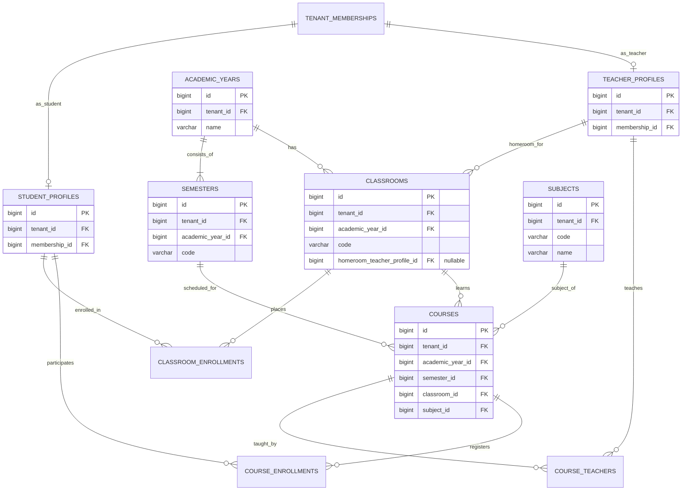
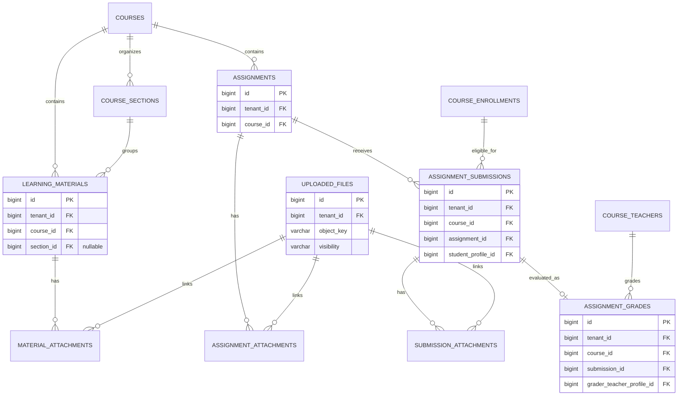
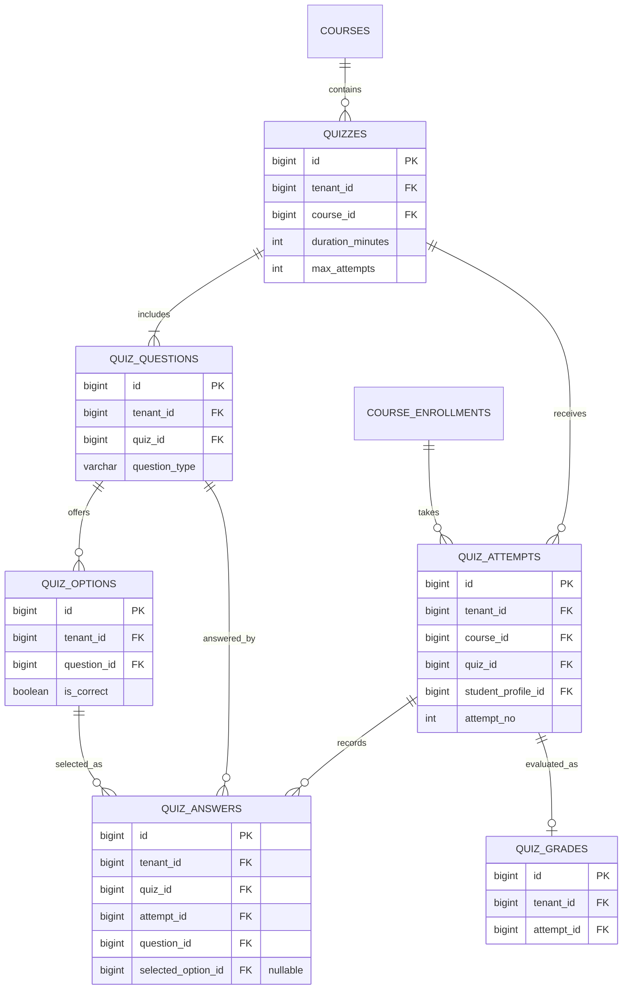

# ERD Core LMS SaaS Multi-Sekolah — v1.1

| Metadata | Nilai |
|---|---|
| Produk | LMS SaaS Multi-Sekolah |
| Versi | **1.1 — integrasi Authentication & RBAC + SaaS Central** |
| Tanggal | 5 November 2026 |
| Status | **Proposed — untuk disahkan sebelum implementasi migrasi** |
| Induk produk | `PRD_Master_LMS_SaaS_Multi_Sekolah_v1.0.md` |
| Arsitektur | `ADR_001_Multi_Tenancy_Identity_Architecture_v1.0.md` |
| Target | PostgreSQL, Laravel modular monolith, shared DB multi-tenant |
| Lingkup | SaaS Central, onboarding/provisioning, Authentication & RBAC, akademik, materi, tugas, kuis, grading, audit |
| Perubahan dari v1.0 | 4 tabel baru P0, 2 kolom versi sesi, penyesuaian akun pending, permission scope, dan aturan integritas tambahan |

> **Status dokumen: Proposed, menunggu persetujuan sebelum migration.** Ini adalah **ERD logis + kamus data dan kontrak integritas**, bukan migration siap eksekusi. Semua SQL adalah contoh PostgreSQL yang perlu diuji pada skema nyata. Jika ADR/PRD bertentangan, tandai konflik dan revisi sumber keputusan sebelum Codex melakukan perubahan.
>
> **Sumber yang digabungkan:** `PRD_Modul_Authentication_RBAC_v1.0.md` dan `PRD_Modul_SaaS_Central_Tenant_Management_v1.0.md`, selain PRD Master dan ADR-001. Versi v1.1 menambah desain *account invitation*, *recovery*, *tenant provisioning idempotent*, dan *tenant settings*, tetapi tidak mengubah batas domain akademik v1.0.

## 1. Tujuan dan model domain

Produk sejak awal melayani banyak sekolah. **Tenant = satu sekolah**, bukan satu kelas ataupun satu akun. Data siswa, guru, rombel, course, tugas, jawaban dan nilai berada dalam konteks tenant yang sama. Satu user global bisa punya membership di beberapa sekolah, tetapi **setiap membership dan profil sekolah berbeda**. Empat tabel tambahan M1 menangani undangan, pemulihan kredensial, provisioning sekolah, dan pengaturan tenant.

### 1.1 Konvensi skema

| Konvensi | Aturan |
|---|---|
| Primary key | `id BIGINT GENERATED BY DEFAULT AS IDENTITY` (atau `bigIncrements` Laravel), kecuali tabel pivot yang memakai composite PK bila disebutkan. |
| Public ID | `public_ulid CHAR(26)` unik pada tabel yang diekspos via URL/API; **bukan** mekanisme authorization. |
| Tenant scope | Seluruh tabel akademik/aktivitas siswa dan tabel asosiasi tenant memiliki `tenant_id BIGINT NOT NULL`. |
| Foreign key | Relasi tenant-owned → tenant-owned gunakan `(tenant_id, foreign_id) -> parent(tenant_id,id)`; untuk konsistensi course/year gunakan FK komposit lebih panjang yang dijelaskan. |
| Kolom unik referensi | Setiap parent tenant-owned menyediakan `UNIQUE(tenant_id,id)` meskipun `id` sudah PK agar memenuhi composite FK PostgreSQL. |
| Tanggal waktu | `TIMESTAMPTZ` (UTC di DB); tampilkan menurut `tenants.timezone` (default `Asia/Jakarta`). |
| Activation & recovery tokens | Token acak minimal 256-bit, simpan digest kriptografis saja (misalnya SHA-256 hex CHAR(64)); tidak ditaruh pada audit, URL analytics, atau log. |
| Revokasi sesi | `users.auth_version` global + `tenant_memberships.auth_version` tenant, diverifikasi pada setiap protected request dan setelah mutasi sensitif. |
| Tanggal akademik | `DATE` untuk awal/akhir tahun, semester, tanggal efektif. |
| Status | `VARCHAR` dengan `CHECK` / validasi eksplisit; jangan membiarkan string bebas. |
| Soft delete / arsip | **Jangan** cascade-delete histori pengumpulan/jawaban/nilai. Arsip/status per domain; hard delete melalui prosedur retensi terotorisasi. |
| Referential actions | Default `ON DELETE RESTRICT/NO ACTION` untuk data akademik; `CASCADE` hanya pivot katalog yang aman bila dinyatakan. |
| PII | Kumpulkan identitas minimum; `nisn`, tanggal lahir, orang tua tidak wajib pada Core MVP. |
| `created_at`, `updated_at` | Standar pada tabel mutable kecuali pivot/append-only yang dinyatakan lain; tidak ditulis berulang pada setiap daftar kolom. |

### 1.2 Penamaan dan prioritas

- **P0/M1** = tenant, provisioning, identity, invitation/recovery, dan RBAC; harus selesai sebelum model akademik.
- **P0/M2** = struktur akademik dan keanggotaan kelas/course.
- **P0/M3** = konten, tugas, penilaian.
- **P0/M4** = kuis/ujian.
- **P0/M5** = paket minimal/operasi audit.
- **P1/P2** = fitur lanjutan; tabel boleh ditunda tanpa merusak model P0.

## 2. Diagram hubungan utama

> Mermaid dapat dirender langsung oleh GitHub/Markdown viewer yang mendukung Mermaid. Diagram dibuat menjadi beberapa kelompok agar terbaca dan **bukan** berarti relasi antarkelompok terputus. Semua relasi detail ada di kamus tabel pada bagian 3–8.

### 2.1 Central SaaS & identity

```mermaid
erDiagram
    TENANTS ||--o{ TENANT_DOMAINS : resolves
    TENANTS ||--o| TENANT_SETTINGS : configures
    TENANTS ||--o{ TENANT_MEMBERSHIPS : contains
    USERS ||--o{ TENANT_MEMBERSHIPS : joins
    USERS ||--o| PLATFORM_STAFF : may_be
    TENANT_MEMBERSHIPS ||--o{ MEMBERSHIP_ROLES : has
    ROLES ||--o{ MEMBERSHIP_ROLES : assigns
    ROLES ||--o{ ROLE_PERMISSIONS : grants
    PERMISSIONS ||--o{ ROLE_PERMISSIONS : grants_tenant_scoped
    TENANTS ||--o{ ACCOUNT_INVITATIONS : hosts
    TENANT_MEMBERSHIPS o|--o{ ACCOUNT_INVITATIONS : activates
    TENANTS o|--o{ ACCOUNT_RECOVERY_REQUESTS : school_scope
    USERS ||--o{ ACCOUNT_RECOVERY_REQUESTS : recovers
    USERS ||--o{ TENANT_PROVISIONING_REQUESTS : requests
    TENANTS o|--o| TENANT_PROVISIONING_REQUESTS : created_by
    PLANS ||--o{ PLAN_FEATURES : contains
    PLANS ||--o{ TENANT_SUBSCRIPTIONS : selected_by
    TENANTS ||--o{ TENANT_SUBSCRIPTIONS : subscribes
    TENANTS ||--o{ TENANT_ENTITLEMENTS : overrides

    TENANTS {
      bigint id PK
      char public_ulid UK
      varchar slug UK
      varchar status "pending active suspended archived"
      varchar timezone
    }
    TENANT_DOMAINS {
      bigint id PK
      bigint tenant_id FK
      varchar hostname UK
      varchar status
    }
    TENANT_SETTINGS {
      bigint tenant_id PK,FK
      varchar logo_object_key "nullable"
      varchar accent_color "nullable"
      jsonb onboarding_json
    }
    USERS {
      bigint id PK
      char public_ulid UK
      varchar email_normalized UK "nullable"
      varchar password "nullable if pending"
      varchar status
      int auth_version
    }
    TENANT_MEMBERSHIPS {
      bigint id PK
      bigint tenant_id FK
      bigint user_id FK
      varchar local_username_normalized "unique per tenant"
      varchar status
      int auth_version
    }
    ACCOUNT_INVITATIONS {
      bigint id PK
      bigint tenant_id FK
      bigint membership_id FK "nullable"
      bigint proposed_role_id FK "nullable"
      char token_hash UK
      varchar purpose
      varchar status
      timestamptz expires_at
    }
    ACCOUNT_RECOVERY_REQUESTS {
      bigint id PK
      bigint tenant_id FK "nullable"
      bigint user_id FK
      char token_hash UK "nullable"
      varchar scope
      varchar status
    }
    TENANT_PROVISIONING_REQUESTS {
      bigint id PK
      bigint actor_user_id FK
      char idempotency_key_hash
      char payload_digest
      bigint tenant_id FK "nullable"
      varchar status
    }
    PLATFORM_STAFF {
      bigint user_id PK,FK
      varchar role
      varchar status
    }
    PERMISSIONS {
      bigint id PK
      varchar key UK
      varchar scope "tenant or platform"
    }
    ROLES {
      bigint id PK
      varchar key UK
    }
    ROLE_PERMISSIONS {
      bigint role_id FK
      bigint permission_id FK
      varchar permission_scope "always tenant"
    }
    PLANS {
      bigint id PK
      varchar code UK
    }
    TENANT_SUBSCRIPTIONS {
      bigint id PK
      bigint tenant_id FK
      bigint plan_id FK
    }
```



### 2.2 Identitas sekolah, tahun ajaran, rombel, mata pelajaran



### 2.3 Materi, tugas, pengumpulan, nilai, dan file



### 2.4 Kuis, soal, opsi, attempt, jawaban, hasil



### 2.5 Diagram terpisah dan visual pendamping

- `ERD_v1.1_01_Central_Identity.mmd` — central, user, membership, invitation, recovery, provisioning.
- `ERD_v1.1_02_Academic.mmd` — struktur akademik dan kelas (dipertahankan dari v1.0).
- `ERD_v1.1_03_Learning_Assignment.mmd` — materi dan tugas (dipertahankan dari v1.0).
- `ERD_v1.1_04_Quiz_Assessment.mmd` — ujian dan penilaian (dipertahankan dari v1.0).
- `ERD_v1.1_05_Provisioning_Identity_Workflows.mmd` — alur provisioning dan aktivasi.
- `ERD_v1.1_01_Central_Identity_Overview.png/.svg` — gambar ringkas identitas.
- `ERD_v1.1_02_Provisioning_Overview.png/.svg` — gambar ringkas control plane.

Gambar PNG/SVG hanya **overview**; definisi relasi lengkap dan kontrak constraint berada di Markdown dan Mermaid.

> Notasi `COURSE_ENROLLMENTS -> ASSIGNMENT_SUBMISSIONS/QUIZ_ATTEMPTS` menyatakan persyaratan FK `(tenant_id,course_id,student_profile_id)` dan validasi enrollment aktif. `COURSE_TEACHERS -> ASSIGNMENT_GRADES` adalah relasi `(tenant_id,course_id,grader_teacher_profile_id)` — tidak sekadar FK guru dengan tenant yang sama.

## 3. Kamus tabel — Central SaaS, Identity & Provisioning (M1/M5)

### 3.1 Core tenant, hostname, identitas dan RBAC (P0/M1)

| Tabel | Kolom domain utama (selain PK/timestamps) | Constraint/aturan |
|---|---|---|
| `tenants` | `public_ulid`, `slug`, `name`, `status`, `timezone`, `created_by_platform_user_id` nullable | `UNIQUE(public_ulid)`, `UNIQUE(slug)`; status `pending/active/suspended/archived`; kode slug dan domain default dihasilkan server. |
| `tenant_domains` | `tenant_id`, `hostname`, `kind`, `status`, `verified_at`, `is_primary` | `UNIQUE(hostname)` global; FK tenant; hanya 1 primary active domain per tenant; hostname tidak dipindah otomatis antar-tenant. |
| **`tenant_settings` (BARU)** | `tenant_id` PK/FK, `logo_object_key` nullable, `accent_color` nullable, `onboarding_json JSONB DEFAULT '{}'` | Satu pengaturan per tenant; `jsonb_typeof(onboarding_json)='object'`; hanya metadata onboarding non-PII; logo privat atau public asset yang diverifikasi. |
| `users` (REVISI) | `public_ulid`, `email` nullable, `email_normalized` nullable, `password` nullable **hanya saat pending**, `status`, `email_verified_at`, `must_change_password`, `password_changed_at`, **`auth_version INT NOT NULL DEFAULT 1`** | `UNIQUE(public_ulid)`, unique email normalized non-null; `CHECK(status <> 'active' OR password IS NOT NULL)`; password hanya hash. Status `pending/active/suspended`. |
| `platform_staff` | `user_id` PK/FK, `role`, `status`, `appointed_at` | Role platform `super_admin` (MVP), terpisah dari roles tenant; tidak bypass resource akademik. |
| `tenant_memberships` (REVISI) | `tenant_id`, `user_id`, `local_username`, `local_username_normalized`, `display_name`, `status`, `joined_at`, `left_at`, **`auth_version INT NOT NULL DEFAULT 1`** | `UNIQUE(tenant_id,user_id)`, `UNIQUE(tenant_id,local_username_normalized)`, `UNIQUE(tenant_id,id)`; status `invited/active/suspended/left`. |
| `roles` | `key`, `display_name`, `is_system` | `UNIQUE(key)`; hanya role sekolah (`school_admin`, `teacher`, `homeroom_teacher`, `student`), tidak ada `platform_super_admin` dalam membership. |
| `permissions` (REVISI) | `key`, `description`, **`scope`** | `UNIQUE(key)`, `UNIQUE(id,scope)`, `CHECK(scope IN ('tenant','platform'))`; katalog mencakup `platform.*`, tetapi hanya permission tenant boleh diberikan via membership role. |
| `role_permissions` (REVISI) | `role_id`, `permission_id`, **`permission_scope VARCHAR DEFAULT 'tenant'`** | PK `(role_id,permission_id)`; `CHECK(permission_scope='tenant')`; FK `(permission_id,permission_scope)` → `permissions(id,scope)`; mencegah role sekolah mendapat permission platform bahkan via SQL biasa. |
| `membership_roles` | `tenant_id`, `membership_id`, `role_id` | Composite PK `(tenant_id,membership_id,role_id)`; FK `(tenant_id,membership_id)` → membership tenant sama, FK role. |

**Keputusan identity:** akun `users` global, membership di banyak sekolah boleh, password hanya satu per user. `auth_version` global naik pada penggantian/reset password; `auth_version` membership naik pada perubahan role/status. Host-only session menyimpan versi ketika login dan wajib diverifikasi terhadap nilai server pada setiap request. `users.status='pending'` tidak dapat login biasa sampai aktivasi berhasil. `platform_staff` otorisasi pusat melalui Gate/Policy berbasis staff role, **bukan** keanggotaan sekolah.

**Email normalized:** buat `email_normalized` hanya ketika ada alamat email, gunakan normalisasi dan unique index global; jangan menganggap email belum terverifikasi sebagai bukti kepemilikan akun. Bila email calon anggota sudah terpakai oleh user existing, lanjutkan dengan jalur invitation *join existing* + verifikasi independen, bukan membuat user duplikat.

**Konsistensi role:** entri `permissions.scope='platform'` boleh ada di katalog untuk keterlacakan. Namun relasi `role_permissions` dilarang menunjuknya. `platform.*` diimplementasikan sebagai Gate pusat yang memeriksa `platform_staff.status='active'`, role, MFA, dan izin aksi, bukan lookup membership sekolah.

### 3.2 Paket dan langganan SaaS

| Tabel | Prioritas | Kolom domain utama | Constraint/aturan |
|---|---|---|---|
| `plans` | P0/M5 | `code`, `name`, `status`, `description` | `UNIQUE(code)`; status `active/retired`. |
| `plan_features` | P0/M5 | `plan_id`, `feature_key`, `is_enabled`, `limit_value` nullable | `UNIQUE(plan_id,feature_key)`; limit numeric nullable bermakna unlimited hanya bila kebijakan menyatakan demikian. |
| `tenant_subscriptions` | P0/M5 | `tenant_id`, `plan_id`, `status`, `starts_at`, `ends_at`, `assigned_by_platform_user_id` nullable | FKs tenant/plan, tanggal valid, satu subscription `active` per tenant (partial unique); transisi & perpanjangan diaudit. |
| `tenant_entitlements` | P1 | `tenant_id`, `feature_key`, `override_enabled` nullable, `override_limit` nullable, `reason` | `UNIQUE(tenant_id,feature_key)`; hanya platform staff terotorisasi; fallback ke plan_features. |

**Catatan:** integrasi invoice, pembayaran gateway, pricing, retry billing, dan metode pembayaran **belum** menjadi tabel P0. Status subscription tidak boleh dikontrol browser.

### 3.3 Empat tabel baru wajib (delta v1.1)

Klasifikasi skema: `account_invitations` dan `tenant_settings` adalah **tenant_owned**; `account_recovery_requests` adalah **central_tenant_aware** (scope global memiliki `tenant_id=NULL`); `tenant_provisioning_requests` adalah **central_global** dengan referensi tenant hasil provisioning. Semua query tenant-aware tetap memerlukan authorization, bukan mengandalkan FK saja.

Keempat tabel ini menghubungkan flow PRD Auth dan PRD SaaS Central. **Jangan membuat tabel undangan kedua hanya untuk provisioning**; `account_invitations` menjadi satu-satunya alur undangan sekolah dan admin awal.

#### A. `account_invitations` — P0/M1

| Kolom | Tipe / NULL | Tujuan |
|---|---|---|
| `id` | `BIGINT PK` | Identitas internal. |
| `public_ulid` | `CHAR(26) UNIQUE NOT NULL` | Referensi undangan aman untuk UI (bukan token). |
| `tenant_id` | `BIGINT NOT NULL` | Sekolah pemilik undangan; FK `tenants`. |
| `membership_id` | `BIGINT NULL` | Untuk akun baru dengan membership `invited` yang telah disiapkan; FK komposit `(tenant_id,membership_id)`. |
| `target_user_id` | `BIGINT NULL` | Hanya bila identitas user existing **sudah diverifikasi**; bukan hasil pencocokan nama/email otomatis. |
| `proposed_local_username`, `proposed_local_username_normalized` | `VARCHAR NULL` | Nama pengguna rencana untuk flow *join existing* tanpa membership prematur. |
| `proposed_role_id` | `BIGINT NULL` | Role tenant yang disepakati untuk join existing; FK `roles`, policy membatasi siapa boleh memilih. |
| `purpose` | `VARCHAR NOT NULL` | `activate_new`, `join_existing`, atau `bootstrap_admin`. |
| `token_hash` | `CHAR(64) UNIQUE NOT NULL` | Hash token kriptografis sekali pakai, bukan token asli. |
| `status` | `VARCHAR NOT NULL` | `pending`, `consumed`, atau `revoked`; expired dihitung dari `expires_at`. |
| `expires_at`, `consumed_at` | `TIMESTAMPTZ` | Masa berlaku dan waktu konsumsi; `consumed_at` nullable. |
| `created_by_membership_id` | `BIGINT NULL` | Pengundang admin sekolah; FK komposit tenant. |
| `created_by_platform_user_id` | `BIGINT NULL` | Pengundang platform untuk admin pertama; FK `platform_staff.user_id`. |
| `created_at`, `updated_at` | `TIMESTAMPTZ` | Audit lifecycle. |

**Mode aktivasi yang diusulkan untuk baseline (perlu persetujuan):**

1. **Akun baru (dengan/tanpa email):** buat `users.status='pending'` dengan `password=NULL`, `tenant_memberships.status='invited'`, role sekolah yang sesuai; `account_invitations.membership_id` mengacu ke baris tersebut. Setelah token diverifikasi dan calon pengguna menetapkan password, aktifkan user dan membership dalam satu transaksi.
2. **Akun existing:** buat invitation `purpose='join_existing'` atau `'bootstrap_admin'`, `membership_id=NULL`, `proposed_local_username_normalized` dan `proposed_role_id` wajib. **Belum** menautkan akun. Ketika token valid + user login ulang / membuktikan identitas secara independen, server membuat membership & roles dalam transaksi; `target_user_id` dapat diset dari identitas yang telah diverifikasi.
3. **Bootstrap admin:** undangan dari platform memakai `purpose='bootstrap_admin'` dan role `school_admin`. Bisa mengikuti jalur akun baru atau existing. Formulir activation hanya dibuka pada tenant `pending` melalui rute khusus; dashboard sekolah tetap diblokir sampai tenant `active`.
4. Undangan dengan role/username sama yang masih pending harus ditangani idempotent dan dibatasi service; pembatalan/expiry membatalkan token lama. `created_by_*` **tepat salah satu** terisi. Jika school admin dinonaktifkan sebelum token diterima, service menolak/meninjau ulang undangan yang dibuatnya (kecuali flow bootstrap staff platform).

**Constraint P0:** `UNIQUE(token_hash)`, `UNIQUE(public_ulid)`, FK tenant, FK `(tenant_id,membership_id)` dan `(tenant_id,created_by_membership_id)` ke membership; FK `target_user_id` ke users; FK `proposed_role_id` ke roles; CHECK waktu, status dan XOR actor. `CHECK` untuk flow tanpa membership: `membership_id IS NOT NULL OR (proposed_local_username_normalized IS NOT NULL AND proposed_role_id IS NOT NULL)`; CHECK tidak dapat menjamin seluruh ketentuan bisnis → service dan test wajib. Jangan menyimpan token plaintext dalam database/log/job/audit.

#### B. `account_recovery_requests` — P0/M1

| Kolom | Tipe / NULL | Tujuan |
|---|---|---|
| `id`, `public_ulid` | `BIGINT PK`, `CHAR(26) UNIQUE` | Identitas internal dan eksternal. |
| `tenant_id` | `BIGINT NULL` | Wajib untuk `school_assisted`; NULL untuk pemulihan identitas global. |
| `user_id` | `BIGINT NOT NULL` | User global yang passwordnya akan dipulihkan. |
| `initiated_by_user_id` | `BIGINT NULL` | Pemilik akun / operator yang memulai; nullable untuk guest flow. |
| `initiated_by_membership_id` | `BIGINT NULL` | Admin sekolah pemrakarsa bantuan; FK `(tenant_id,initiated_by_membership_id)` jika terisi. |
| `verified_by_user_id` | `BIGINT NULL` | Verifikator hasil proses yang sah (opsional, tidak menyimpan bukti rahasia). |
| `scope` | `VARCHAR NOT NULL` | `self_email`, `school_assisted`, `platform_manual`. |
| `purpose` | `VARCHAR NOT NULL` | `password_reset` untuk MVP. |
| `status` | `VARCHAR NOT NULL` | `requested`, `verified`, `token_issued`, `consumed`, `denied`, `revoked`; expiry dari waktu token. |
| `token_hash` | `CHAR(64) UNIQUE NULL` | NULL saat belum berhak menerbitkan token. |
| `verified_at`, `expires_at`, `consumed_at` | `TIMESTAMPTZ NULL` | Tahapan proses, token ber-TTL dan sekali pakai. |
| `created_at`, `updated_at` | `TIMESTAMPTZ` | Waktu audit. |

**Aturan kritis:** `school_assisted` hanya untuk user yang mempunyai **tepat satu membership yang pernah tercatat** (termasuk `invited/suspended/left` pada perhitungan total), bukan platform staff, dengan pemeriksaan identitas offline terotorisasi dan audit. School admin **tidak** mendapat akses ke password/token user. User dengan 2+ membership atau platform staff memakai jalur pemulihan global yang diverifikasi secara independen. Pada reset sukses: ubah hash password, increment `users.auth_version`, consume token secara atomik, tolak seluruh sesi lama di host manapun.

**Constraint P0:** `CHECK(scope <> 'school_assisted' OR tenant_id IS NOT NULL)`, `CHECK(scope = 'school_assisted' OR tenant_id IS NULL)` untuk baseline; `CHECK(initiated_by_membership_id IS NULL OR tenant_id IS NOT NULL)`; `CHECK(token_hash IS NULL OR expires_at IS NOT NULL)`; `UNIQUE(token_hash)` membolehkan banyak NULL pada PostgreSQL; FK user & actor; `initiated_by_membership_id` hanya dapat merujuk tenant yang sama. `expires_at > NOW()` adalah **aturan service saat verifikasi**, bukan CHECK dengan jam server yang berubah-ubah.

#### C. `tenant_provisioning_requests` — P0/M1

| Kolom | Tipe / NULL | Tujuan |
|---|---|---|
| `id` | `BIGINT PK` | Identitas proses. |
| `actor_user_id` | `BIGINT NOT NULL` | FK `platform_staff.user_id` untuk operator pusat. |
| `idempotency_key_hash` | `CHAR(64) NOT NULL` | Digest kunci submit; input mentah tidak dipersistenkan. |
| `payload_digest` | `CHAR(64) NOT NULL` | Hash payload kanonis untuk memastikan retry memakai isi yang sama; tidak menyimpan PII mentah. |
| `tenant_id` | `BIGINT NULL` | Hasil jika sukses; FK `tenants`; `UNIQUE` non-null untuk 1 request tercatat/tenant. |
| `status` | `VARCHAR NOT NULL` | `processing`, `succeeded`, `failed`. |
| `failure_code` | `VARCHAR NULL` | Kode error tersanitasi, bukan stacktrace atau token. |
| `created_at`, `updated_at`, `completed_at` | `TIMESTAMPTZ` | Lifecycle idempotency. |

**Aturan P0:** `UNIQUE(actor_user_id,idempotency_key_hash)`; retry dengan digest sama mengembalikan hasil proses yang sama; digest berbeda untuk key sama ditolak (`409`), bahkan saat proses sebelumnya gagal. Permintaan paralel harus di-*serialize* via uniqueness + transaksi / row lock. Jika sudah `succeeded`, **tidak boleh membuat tenant kedua**. Jika `processing`, berikan status/retry aman; jika `failed`, gunakan key baru untuk percobaan baru setelah pemeriksaan penyebab.

**Konsistensi transaksi:** claim idempotency dapat dicatat lebih dahulu secara aman; saat membuat tenant, lakukan **satu transaksi** untuk `tenants.status='pending'`, `tenant_domains` default verified, `tenant_settings`, user/membership/invitation bootstrap bila applicable, audit sukses, dan update `tenant_provisioning_requests(status='succeeded',tenant_id=...)`. Jika transaksi gagal, jangan tinggalkan tenant setengah jadi; tandai request gagal pada transaksi terpisah dengan kode aman. Pengiriman undangan terjadi setelah commit. Untuk M1, re-send terotorisasi menangani kegagalan dispatch; outbox durable wajib dipertimbangkan sebelum skala produksi.

#### D. `tenant_settings` — P0/M1

| Kolom | Tipe | Aturan |
|---|---|---|
| `tenant_id` | `BIGINT PK/FK NOT NULL` | `tenants.id` dengan `ON DELETE RESTRICT` (tenant archive bukan delete). |
| `logo_object_key` | `VARCHAR NULL` | Object key tanpa path traversal, di-namespace tenant, private by default; UI hanya mendapat URL signed/asset yang diizinkan. |
| `accent_color` | `VARCHAR(7) NULL` | Jika ada, format `#RRGGBB` melalui CHECK/validator. |
| `onboarding_json` | `JSONB NOT NULL DEFAULT '{}'` | Hanya flag onboarding non-PII ber-whitelist, tidak menyimpan token rahasia. |
| `created_at`, `updated_at` | `TIMESTAMPTZ` | Metadata standar. |

Tabel ini **bukan** tempat menyimpan konfigurasi pembayaran rahasia maupun seluruh data profil sekolah. Status otoritatif tenant tetap `tenants.status`; status onboarding otoritatif admin pertama berasal dari membership + invitation, bukan dari JSON yang bisa diubah klien.

### 3.4 Penundaan eksplisit (bukan bagian migration v1.1 M1)

| Usulan di PRD modul | Keputusan v1.1 | Alasan dan syarat evaluasi |
|---|---|---|
| `tenant_status_history` | **Ditunda** | `platform_audit_logs` mencatat transisi `from/to`, alasan, actor, timestamp untuk M1; buat tabel khusus jika ada kebutuhan pelaporan/rekonsiliasi kuat. |
| `provisioning_outbox` | **Ditunda, dengan risiko tercatat** | M1 memakai after-commit dispatch + manual re-send dan indikator delivery. Jika diperlukan jaminan durable at-least-once, tambahkan outbox transaksional sebelum produksi massal. |
| `account_security_events` | **Ditunda** | `tenant_audit_logs` dan `platform_audit_logs` memenuhi kebutuhan awal; evaluasi global security audit jika ada event tidak tepat berada pada salah satunya. |
| `feature_definitions` | **M5 review** | Plan features v1.0 cukup untuk batas sederhana; tambahkan metadata tipe/limit jika paket bertambah rumit. |
| `sessions` / `password_reset_tokens` Laravel | **Implementasi framework, belum otomatis tabel domain** | Jika session driver `database` dipilih, buat migration Laravel sesuai kebutuhan; jika Redis, tidak perlu tabel. Token recovery domain memakai `account_recovery_requests`, jangan buat dua alur reset aktif tanpa aturan sinkronisasi. |

### 3.5 SQL referensi untuk constraint penting (PostgreSQL, skematik)

```sql
-- Semua parent tenant-owned yang menjadi tujuan FK komposit wajib:
-- tenant_memberships: UNIQUE (tenant_id, id)
-- permissions: UNIQUE (id, scope)

ALTER TABLE account_invitations
  ADD CONSTRAINT fk_invitation_membership_same_tenant
  FOREIGN KEY (tenant_id, membership_id)
  REFERENCES tenant_memberships(tenant_id, id) ON DELETE RESTRICT;

ALTER TABLE account_invitations
  ADD CONSTRAINT fk_invitation_creator_same_tenant
  FOREIGN KEY (tenant_id, created_by_membership_id)
  REFERENCES tenant_memberships(tenant_id, id) ON DELETE RESTRICT;

ALTER TABLE account_recovery_requests
  ADD CONSTRAINT fk_recovery_initiator_same_tenant
  FOREIGN KEY (tenant_id, initiated_by_membership_id)
  REFERENCES tenant_memberships(tenant_id, id) ON DELETE RESTRICT;

ALTER TABLE permissions
  ADD CONSTRAINT uq_permissions_id_scope UNIQUE (id, scope);

ALTER TABLE role_permissions
  ADD CONSTRAINT chk_role_permission_tenant_only
  CHECK (permission_scope = 'tenant');
ALTER TABLE role_permissions
  ADD CONSTRAINT fk_role_permission_scope
  FOREIGN KEY (permission_id, permission_scope)
  REFERENCES permissions(id, scope) ON DELETE RESTRICT;

CREATE UNIQUE INDEX uq_provision_actor_idempotency_key
  ON tenant_provisioning_requests(actor_user_id, idempotency_key_hash);

CREATE UNIQUE INDEX uq_provision_tenant_nonnull
  ON tenant_provisioning_requests(tenant_id)
  WHERE tenant_id IS NOT NULL;

ALTER TABLE account_invitations
  ADD CONSTRAINT chk_invitation_creator_xor
  CHECK ((created_by_membership_id IS NOT NULL) <> (created_by_platform_user_id IS NOT NULL));

ALTER TABLE account_recovery_requests
  ADD CONSTRAINT chk_recovery_membership_context
  CHECK (initiated_by_membership_id IS NULL OR tenant_id IS NOT NULL);

ALTER TABLE users
  ADD CONSTRAINT chk_active_user_has_password
  CHECK (status <> 'active' OR password IS NOT NULL);

-- Tidak ada UPDATE tenants.status dari UI langsung; selalu gunakan
-- service transition dan audit terotorisasi.


-- CHECK masa berlaku vs now() tidak boleh dibuat karena waktu terus berubah.
-- Gunakan pemeriksaan saat token dikonsumsi di service transaction.
```

> **Catatan PostgreSQL:** composite FK dengan komponen nullable menggunakan semantik `MATCH SIMPLE`; ketika `membership_id` NULL, relasi belum dievaluasi. Itu memang diperlukan untuk undangan akun existing, **tetapi** service wajib memverifikasi semua field sebelum menautkan membership. Untuk `account_recovery_requests` `initiated_by_membership_id` hanya boleh terisi bila `tenant_id` tidak null (CHECK aplikasi/database); jangan mengandalkan FK nullable saja.

### 3.6 Kontrak workflow lintas modul

**Persyaratan pending:** `tenant_domains.status='active'` dan `verified_at` sudah valid sebelum aktivasi admin, tetapi `tenants.status='pending'` menutup login umum dan seluruh modul akademik. Route yang diizinkan hanya route aktivasi/recovery khusus dengan validasi `purpose` dan status; tidak ada tenant fallback.

**Provisioning M1:** central host dan permission `platform.tenants.create` → idempotency claim → create pending tenant/domain/settings/bootstrap invitation + audit dalam transaksi → commit → notifikasi → admin menerima invitation via rute aktivasi terbatas saat tenant pending → membership admin aktif → central validasi readiness → transition tenant `pending → active` eksplisit dan audit. Proses akademik baru dimulai setelah tenant aktif.

**Activation:** undangan satu tenant tidak dapat digunakan di host tenant lain; expiration/token consumption dicek dalam transaksi dan menggunakan lock pada invitation; status user, membership dan role dievaluasi lagi sebelum aktivasi; token dan status berubah atomik.

**Suspension:** transition di central menggunakan `SELECT ... FOR UPDATE` atau mekanisme optimistic concurrency; tenant `suspended/archived` menolak request sekolah, termasuk sesi yang lama; arsip tidak menghapus data, hostname tidak direcycle otomatis. Tenant dapat `pending`, `active`, `suspended`, `archived` hanya dengan transisi dalam PRD Central.

**Reset password:** reset satu akun global tidak boleh otomatis diotorisasi oleh sekolah mana pun hanya karena user punya satu membership aktif; gunakan hitungan seluruh membership yang pernah ada. Audit alasan, token single-use, increment version global dan invalidasi sesi.

**Authorization:** permission membership berasal dari role tenant, tetapi akses akhir masih membutuhkan hubungan resource (course teacher assignment, enrollment, published grade, dll.). `platform_staff` tidak otomatis melihat data akademik. Semua download, Livewire action, queue, export, dan signed URL harus melakukan tenant/permission validation.

---

## 4. Kamus tabel — Akademik dan keanggotaan kelas (M2)

| Tabel | Kolom domain utama | Constraint dan relasi wajib |
|---|---|---|
| `student_profiles` | `tenant_id`, `membership_id`, `nis` nullable, `status` | `UNIQUE(tenant_id,membership_id)`; FK ke membership dengan tenant sama; `nis` unik per tenant jika dipakai (partial unique non-null). Jangan wajibkan NISN. |
| `teacher_profiles` | `tenant_id`, `membership_id`, `employee_code` nullable, `status` | `UNIQUE(tenant_id,membership_id)`; FK membership tenant sama; employee_code optional, unik bila ada. |
| `academic_years` | `tenant_id`, `name` (`2026/2027`), `starts_on`, `ends_on`, `status` | `UNIQUE(tenant_id,name)`; partial unique tahun aktif per tenant; `starts_on < ends_on`. |
| `semesters` | `tenant_id`, `academic_year_id`, `code` (`odd`/`even`), `starts_on`, `ends_on`, `status` | `UNIQUE(tenant_id,academic_year_id,code)`; `UNIQUE(tenant_id,academic_year_id,id)`; FK `(tenant_id,academic_year_id)` → year; tanggal berada dalam rentang academic year (domain validator + test). |
| `classrooms` | `tenant_id`, `academic_year_id`, `code` (`7A`), `label`, `grade_level`, `homeroom_teacher_profile_id` nullable | `UNIQUE(tenant_id,academic_year_id,code)`; `UNIQUE(tenant_id,academic_year_id,id)`; FK year dan teacher profile tenant sama; `grade_level` MVP `7..9`, fleksibilitas jenjang P1. |
| `classroom_enrollments` | `tenant_id`, `academic_year_id`, `classroom_id`, `student_profile_id`, `joined_on`, `left_on` nullable, `status` | FK `(tenant_id,academic_year_id,classroom_id)` → classrooms; FK student; partial unique **satu penempatan aktif** `(tenant_id,academic_year_id,student_profile_id)`; simpan riwayat perpindahan. |
| `subjects` | `tenant_id`, `code`, `name`, `is_active` | `UNIQUE(tenant_id,code)`; nama mapel boleh sama antar tenant. |
| `courses` | `tenant_id`, `public_ulid`, `academic_year_id`, `semester_id`, `classroom_id`, `subject_id`, `title`, `status` | `UNIQUE(tenant_id,semester_id,classroom_id,subject_id)` (MVP); FK semester dan classroom **dengan academic_year_id yang sama**; FK subject tenant sama; `UNIQUE(tenant_id,id)` sebagai kandidat referensi FK komposit. |
| `course_teachers` | `tenant_id`, `course_id`, `teacher_profile_id`, `assignment_role`, `status`, `assigned_at` | `UNIQUE(tenant_id,course_id,teacher_profile_id)`; FK course dan teacher profile tenant sama; guru harus memiliki role/permission valid (policy). |
| `course_enrollments` | `tenant_id`, `course_id`, `student_profile_id`, `status`, `enrolled_at`, `withdrawn_at` nullable, `source_classroom_enrollment_id` nullable | `UNIQUE(tenant_id,course_id,student_profile_id)`; FK course dan student; source enrollment bila ada harus milik tenant & siswa yang sama, divalidasi dan diberi FK komposit seperti 4.1; histori tidak dihapus ketika pindah rombel. |

> Semua tabel bagian 4 adalah **P0/M2**, kecuali atribut/fitur yang secara eksplisit ditandai optional. Kolom status menggunakan enum nilai/check yang akan ditetapkan detailnya saat migration (minimum `active/inactive`, sesuai domain).

### 4.1 Integritas lintas tahun ajaran, kelas dan siswa

- `semesters` harus mempunyai candidate key `UNIQUE(tenant_id,academic_year_id,id)`.
- `classrooms` mempunyai candidate key `UNIQUE(tenant_id,academic_year_id,id)`.
- `courses` membawa **tiga** pengenal `academic_year_id`, `semester_id`, `classroom_id`, lalu 2 FK komposit berikut:

```sql
FOREIGN KEY (tenant_id, academic_year_id, semester_id)
  REFERENCES semesters (tenant_id, academic_year_id, id),
FOREIGN KEY (tenant_id, academic_year_id, classroom_id)
  REFERENCES classrooms (tenant_id, academic_year_id, id)
```

Dengan demikian sebuah course tidak bisa menggunakan semester 2026/2027 sambil memakai rombel yang dibuat di tahun 2025/2026.

- `classroom_enrollments` menyimpan `academic_year_id` untuk kunci unik satu rombel aktif per siswa **per tahun ajaran**. Gunakan partial unique `WHERE status='active'`; transaksi perpindahan mengubah status enrollment lama sebelum mengaktifkan yang baru.
- `course_enrollments` **bukan** alias `classroom_enrollments`. Setelah transfer siswa, sistem tidak boleh menghapus pengumpulan, attempt, dan nilai terdahulu; akses terhadap course lama bergantung kebijakan historis/withdrawn.
- Jika `source_classroom_enrollment_id` digunakan, perlu candidate key `(tenant_id,student_profile_id,id)` di `classroom_enrollments` lalu FK `(tenant_id,student_profile_id,source_classroom_enrollment_id)`; validasi bahwa classroom enrollment tersebut sesuai `courses.classroom_id` saat pendaftaran. Bila terlalu berat, simpan kolom source sebagai null pada M2 dan tambah di perubahan schema P1 — jangan buat FK yang hanya berdasar `id`.

## 5. Kamus tabel — Pembelajaran dan tugas (M3)

| Tabel | Kolom domain utama | Constraint dan relasi wajib |
|---|---|---|
| `course_sections` | `tenant_id`, `course_id`, `title`, `sort_order` | FK course; `UNIQUE(tenant_id,course_id,id)`; `UNIQUE(tenant_id,course_id,sort_order)` jika urutan stabil. |
| `learning_materials` | `tenant_id`, `public_ulid`, `course_id`, `section_id` nullable, `title`, `body_markdown` nullable, `external_url` nullable, `status`, `publish_at` nullable, `sort_order` | FK course; jika section diisi, FK `(tenant_id,course_id,section_id)` → course_sections; status `draft/published/archived`; jangan bocorkan draft. |
| `uploaded_files` | `tenant_id`, `public_ulid`, `uploader_membership_id`, `storage_disk`, `object_key`, `original_filename`, `mime_type`, `size_bytes`, `checksum` nullable, `visibility` | `UNIQUE(storage_disk,object_key)`; FK uploader membership tenant sama; `visibility='private'` default; file content tak disimpan di DB. |
| `material_attachments` | `tenant_id`, `material_id`, `file_id`, `sort_order` | FK `(tenant_id,material_id)` → materials dan `(tenant_id,file_id)` → uploaded_files; `UNIQUE(tenant_id,material_id,file_id)`. |
| `assignments` | `tenant_id`, `public_ulid`, `course_id`, `title`, `instructions_markdown`, `opens_at`, `due_at`, `allow_late`, `max_score NUMERIC(7,2)`, `status` | FK course; `UNIQUE(tenant_id,course_id,id)`; validasi `opens_at <= due_at` bila keduanya ada; max_score > 0. |
| `assignment_attachments` | `tenant_id`, `assignment_id`, `file_id` | Composite FK assignment + file; unik pair; lampiran instruksi privat. |
| `assignment_submissions` | `tenant_id`, `public_ulid`, `course_id`, `assignment_id`, `student_profile_id`, `answer_text`, `submitted_at`, `status` | FK `(tenant_id,course_id,assignment_id)` → assignments; FK `(tenant_id,course_id,student_profile_id)` → course_enrollments; `UNIQUE(tenant_id,assignment_id,student_profile_id)`; `UNIQUE(tenant_id,course_id,id)`; 1 pengumpulan per siswa (MVP). |
| `submission_attachments` | `tenant_id`, `submission_id`, `file_id` | Composite FK submission + uploaded_files; unique pair. |
| `assignment_grades` | `tenant_id`, `course_id`, `submission_id`, `grader_teacher_profile_id`, `score NUMERIC(7,2)`, `feedback_markdown`, `graded_at`, `published_at` nullable | `UNIQUE(tenant_id,submission_id)`; FK `(tenant_id,course_id,submission_id)` → submissions; FK `(tenant_id,course_id,grader_teacher_profile_id)` → course_teachers; score non-negative dan tidak melebihi assignment max (domain validation). |

> Semua tabel bagian 5 adalah **P0/M3**. Tugas yang belum dikumpulkan **tidak** memerlukan baris submission; status “belum mengirim” diturunkan dari enrollment dan tenggat. Untuk keterlambatan, server menghitung dari `submitted_at` dan `due_at`, bukan waktu browser. P1 revisi tugas memerlukan `submission_versions` atau desain histori eksplisit, bukan menimpa berkas tanpa audit.

### 5.1 Composite FK yang melindungi pengumpulan

```sql
-- Candidate key parent:
ALTER TABLE assignments
  ADD CONSTRAINT uq_assignments_tenant_course_id UNIQUE (tenant_id, course_id, id);
ALTER TABLE course_enrollments
  ADD CONSTRAINT uq_course_enrollments_tenant_course_student
  UNIQUE (tenant_id, course_id, student_profile_id);

-- Dua kontrol berbeda: tugas wajib pada course yang disebut,
-- dan siswa wajib terdaftar pada course yang sama.
ALTER TABLE assignment_submissions
  ADD CONSTRAINT fk_submission_assignment_context
  FOREIGN KEY (tenant_id, course_id, assignment_id)
  REFERENCES assignments (tenant_id, course_id, id) ON DELETE RESTRICT;
ALTER TABLE assignment_submissions
  ADD CONSTRAINT fk_submission_student_course_context
  FOREIGN KEY (tenant_id, course_id, student_profile_id)
  REFERENCES course_enrollments (tenant_id, course_id, student_profile_id) ON DELETE RESTRICT;
```

> SQL contoh harus dijalankan hanya setelah tabel dan kolom parent terbentuk. Candidate key yang sudah ditambahkan saat `CREATE TABLE` tidak boleh ditambahkan dua kali. FK menjamin relasi ada, **bukan** bahwa enrollment masih aktif atau jadwal masih dibuka; policy/service menangani aturan dinamis tersebut.

## 6. Kamus tabel — Kuis/ujian dan penilaian (M4)

| Tabel | Kolom domain utama | Constraint dan relasi wajib |
|---|---|---|
| `quizzes` | `tenant_id`, `public_ulid`, `course_id`, `title`, `instructions_markdown`, `opens_at`, `closes_at`, `duration_minutes`, `max_attempts`, `status`, `results_published_at` nullable | FK course; `UNIQUE(tenant_id,course_id,id)`; `duration_minutes > 0`, `max_attempts >= 1`, jadwal valid. |
| `quiz_questions` | `tenant_id`, `quiz_id`, `question_type`, `question_text`, `points NUMERIC(7,2)`, `position` | FK quiz; `UNIQUE(tenant_id,quiz_id,id)`; `UNIQUE(tenant_id,quiz_id,position)`; tipe `single_choice`, `short_text`, `essay`. |
| `quiz_options` | `tenant_id`, `question_id`, `option_text`, `position`, `is_correct` | FK question; `UNIQUE(tenant_id,question_id,id)`, `UNIQUE(tenant_id,question_id,position)`; untuk single choice maksimal satu `is_correct=true` via partial unique; wajib tepat satu benar saat publish (domain validator). |
| `quiz_attempts` | `tenant_id`, `public_ulid`, `course_id`, `quiz_id`, `student_profile_id`, `attempt_no`, `status`, `started_at`, `deadline_at`, `submitted_at` nullable | FK `(tenant_id,course_id,quiz_id)` → quizzes; FK `(tenant_id,course_id,student_profile_id)` → course_enrollments; `UNIQUE(tenant_id,quiz_id,student_profile_id,attempt_no)`; `UNIQUE(tenant_id,quiz_id,id)`; `attempt_no>=1`. |
| `quiz_answers` | `tenant_id`, `quiz_id`, `attempt_id`, `question_id`, `selected_option_id` nullable, `answer_text` nullable, `saved_at`, `awarded_points` nullable | FK `(tenant_id,quiz_id,attempt_id)` → attempts; FK `(tenant_id,quiz_id,question_id)` → quiz_questions; FK `(tenant_id,question_id,selected_option_id)` → quiz_options jika diisi; `UNIQUE(tenant_id,attempt_id,question_id)`; jawaban final terkunci. |
| `quiz_grades` | `tenant_id`, `quiz_id`, `attempt_id`, `auto_score NUMERIC(9,2)`, `manual_score NUMERIC(9,2)`, `total_score NUMERIC(9,2)`, `graded_at` nullable, `published_at` nullable, `graded_by_teacher_profile_id` nullable | `UNIQUE(tenant_id,attempt_id)`; FK `(tenant_id,quiz_id,attempt_id)` → quiz_attempts; grader harus guru sah di course (policy + optional composite join pada implementasi). |

> Semua tabel bagian 6 adalah **P0/M4**. Ketika kuis mulai dikerjakan, soal, opsi, bobot, dan jawaban kunci harus **immutable untuk attempt yang berlangsung**; MVP menerapkan **larangan mengedit struktur kuis setelah attempt pertama**, termasuk answer key. Perubahan soal yang lebih kompleks membutuhkan versioning P1, bukan mengubah hasil historis.

### 6.1 Ketelitian kuis yang tidak boleh dilupakan

1. **Waktu server** sebagai sumber kebenaran. `deadline_at` disimpan saat mulai sebagai `LEAST(started_at + duration, closes_at)` (perlakukan batas `closes_at` nullable sesuai aturan).
2. **Autosave idempotent:** upsert jawaban berdasarkan `(tenant_id,attempt_id,question_id)` saat attempt `in_progress`; autosave untuk attempt `submitted/expired` ditolak.
3. **Attempt paralel:** saat membuat attempt, kunci/transaction memastikan jumlah percobaan tidak melebihi `max_attempts`; unique constraint attempt_no mencegah duplikasi nomor yang sama.
4. **Jawaban silang:** `quiz_answers` menyertakan `quiz_id` agar attempt dan question pasti dari kuis sama, dan selected option pasti dari question yang sama.
5. **Pilihan tunggal:** hanya satu opsi benar, tetapi validasi “minimal dua opsi dan tepat satu benar” diterapkan sebelum publish, bukan sekadar UI.
6. **Keamanan kunci jawaban:** API/Livewire siswa tidak pernah menerima `is_correct`, skor jawaban, atau hasil yang belum dipublikasikan.
7. **Esai:** manual scoring oleh guru pengampu; total tidak diterbitkan sebelum seluruh penilaian yang diperlukan selesai.
8. **Perubahan nilai:** catat peristiwa audit dan alasan; hasil milik siswa lain tidak boleh terbuka.

### 6.2 FK untuk konsistensi jawaban

```sql
-- Parent candidate keys:
-- quiz_attempts UNIQUE (tenant_id, quiz_id, id)
-- quiz_questions UNIQUE (tenant_id, quiz_id, id)
-- quiz_options   UNIQUE (tenant_id, question_id, id)

ALTER TABLE quiz_answers
  ADD CONSTRAINT fk_answer_attempt_same_quiz
    FOREIGN KEY (tenant_id, quiz_id, attempt_id)
    REFERENCES quiz_attempts (tenant_id, quiz_id, id) ON DELETE RESTRICT;

ALTER TABLE quiz_answers
  ADD CONSTRAINT fk_answer_question_same_quiz
    FOREIGN KEY (tenant_id, quiz_id, question_id)
    REFERENCES quiz_questions (tenant_id, quiz_id, id) ON DELETE RESTRICT;

ALTER TABLE quiz_answers
  ADD CONSTRAINT fk_answer_option_same_question
    FOREIGN KEY (tenant_id, question_id, selected_option_id)
    REFERENCES quiz_options (tenant_id, question_id, id) ON DELETE RESTRICT;
```

**Wajib:** `selected_option_id` nullable hanya untuk tipe yang tidak membutuhkan opsi; validasi tipe jawaban dilakukan oleh server. Dengan default `MATCH SIMPLE`, FK nullable untuk opsi memang tidak dievaluasi bila `selected_option_id` null, sesuai kebutuhan esai/isian.

## 7. Tabel audit dan fitur lanjutan

| Tabel | Prioritas | Kolom penting | Aturan |
|---|---|---|---|
| `tenant_audit_logs` | P0/M1–M4 | `tenant_id`, `actor_user_id` nullable, `actor_membership_id` nullable, `action`, `target_type`, `target_id` nullable, `request_id`, `metadata_json`, `created_at` | Append-only; actor membership harus tenant sama jika terisi; metadata sensitif diminimalkan; perubahan nilai dan membership dicatat. |
| `platform_audit_logs` | P0/M1/M5 | `actor_user_id`, `tenant_id` nullable, `action`, `target_type`, `target_id`, `request_id`, `metadata_json`, `created_at` | Akses hanya operator pusat, tidak berisi isi jawaban/PII siswa. |
| `notifications` | P1 | `tenant_id`, `recipient_membership_id`, `type`, `payload_json`, `read_at`, `created_at` | Composite FK membership; payload minim PII; hanya penerima bisa baca. |

**Catatan v1.1:** `tenant_status_history` tidak ditambahkan; peristiwa state transition harus dicatat pada `platform_audit_logs` dengan `from_status`, `to_status`, `reason_code`, dan actor yang tersanitasi. Rekam invitation dan reset tidak boleh menyertakan token/hash token dalam audit.

**Catatan data retensi:** kebijakan penghapusan akun/sekolah, ekspor, arsip nilai, dan pemulihan data nyata perlu keputusan hukum/kontrak sebelum pilot. Hindari menghapus baris `tenants` untuk melakukan offboarding.

## 8. Daftar constraint yang wajib dibangun (checklist migrasi)

### 8.1 Katalog parent composite keys

Untuk setiap tabel tenant-owned yang dijadikan parent, selalu ada `UNIQUE(tenant_id,id)`; tambahan kunci konseptual:

| Parent | Candidate key tambahan | Dipakai oleh |
|---|---|---|
| `tenant_memberships` | `(tenant_id,user_id)`, `(tenant_id,local_username_normalized)` | Login tenant, role, profil, invitation, recovery initiator |
| `permissions` | `(id,scope)` | `role_permissions` hanya menerima scope tenant |
| `account_invitations` | `UNIQUE(token_hash)`, `UNIQUE(public_ulid)` | Token aktivasi dan join |
| `tenant_provisioning_requests` | `(actor_user_id,idempotency_key_hash)` | Idempotensi provisioning |
| `semesters` | `(tenant_id,academic_year_id,id)` | `courses` |
| `classrooms` | `(tenant_id,academic_year_id,id)` | `courses`, classroom enrollment |
| `course_sections` | `(tenant_id,course_id,id)` | `learning_materials` |
| `courses` | `(tenant_id,academic_year_id,semester_id,classroom_id,subject_id)` tidak wajib unik; **gunakan** `(tenant_id,semester_id,classroom_id,subject_id)` sebagai unique MVP | Semester dan rombel |
| `course_teachers` | `(tenant_id,course_id,teacher_profile_id)` | `assignment_grades`, policy teacher |
| `course_enrollments` | `(tenant_id,course_id,student_profile_id)` | Submission, quiz attempt |
| `assignments` | `(tenant_id,course_id,id)` | Submission |
| `assignment_submissions` | `(tenant_id,course_id,id)` | Assignment grade |
| `quizzes` | `(tenant_id,course_id,id)` | Quiz attempt |
| `quiz_attempts` | `(tenant_id,quiz_id,id)` | Quiz answers/grade |
| `quiz_questions` | `(tenant_id,quiz_id,id)` | Quiz answers |
| `quiz_options` | `(tenant_id,question_id,id)` | Quiz answer selected option |

**Catatan skema:** pada PostgreSQL, composite FK harus merujuk kolom unik/PK yang cocok pada parent. `UNIQUE(tenant_id,id)` memang redundan terhadap `id PK` untuk keunikan, namun diperlukan sebagai kandidat eksplisit FK komposit. Tambahkan indeks child sesuai query dan FK.

### 8.2 Partial unique indexes (PostgreSQL)

```sql
-- Hanya satu tahun ajaran aktif per sekolah
CREATE UNIQUE INDEX uq_active_academic_year_per_tenant
  ON academic_years (tenant_id)
  WHERE status = 'active';

-- Hanya satu penempatan rombel aktif per siswa pada tahun ajaran
CREATE UNIQUE INDEX uq_active_classroom_per_student_year
  ON classroom_enrollments (tenant_id, academic_year_id, student_profile_id)
  WHERE status = 'active';

-- Contoh satu domain primer aktif per sekolah
CREATE UNIQUE INDEX uq_primary_active_domain_per_tenant
  ON tenant_domains (tenant_id)
  WHERE is_primary = TRUE AND status = 'active';

-- Maksimal satu opsi benar per soal (wajib tepat satu saat publish)
CREATE UNIQUE INDEX uq_one_correct_option_per_question
  ON quiz_options (tenant_id, question_id)
  WHERE is_correct = TRUE;

-- Maksimal satu subscription aktif per tenant
CREATE UNIQUE INDEX uq_active_subscription_per_tenant
  ON tenant_subscriptions (tenant_id)
  WHERE status = 'active';

-- Satu undangan pending per membership dan purpose, jika membership sudah ada
CREATE UNIQUE INDEX uq_pending_invitation_per_membership_purpose
  ON account_invitations(tenant_id, membership_id, purpose)
  WHERE status = 'pending' AND membership_id IS NOT NULL;

-- Nomor username pada invitation join_existing akan diperiksa ulang
-- saat accept di bawah UNIQUE(tenant_id,local_username_normalized)
-- tenant_memberships; reservation sementara dapat memakai peraturan
-- service/locking tambahan bila kebutuhan bisnis mengharuskannya.
```

### 8.3 Indeks baca/performa minimal

- `(tenant_id,status)` pada tenant-owned yang sering difilter status.
- `course_enrollments(tenant_id,student_profile_id,status)` untuk dashboard siswa.
- `course_teachers(tenant_id,teacher_profile_id,status)` untuk dashboard guru.
- `assignments(tenant_id,course_id,due_at)` untuk daftar deadline.
- `assignment_submissions(tenant_id,assignment_id,submitted_at)` untuk koreksi guru.
- `quiz_attempts(tenant_id,quiz_id,student_profile_id,status)` untuk mengambil attempt dan memeriksa batas.
- `tenant_audit_logs(tenant_id,created_at)` untuk audit scoped, dengan retensi/partisi nanti saat diperlukan.
- `tenant_domains(hostname)` unik untuk resolusi host tanpa query full table.
- `account_invitations(tenant_id,status,expires_at)` untuk aktivasi/revoke/expired lookup tanpa menaruh token plaintext pada log.
- `account_recovery_requests(user_id,status,created_at)` untuk rate-limit dan audit pemulihan; `token_hash` unik untuk lookup setelah hashing.
- `tenant_provisioning_requests(actor_user_id,created_at)` untuk dashboard operasi; unique idempotency key sudah menghasilkan indeks.
- `platform_audit_logs(tenant_id,created_at)` untuk jejak transisi tenant dan provisioning.

Jangan membuat indeks duplikat yang sudah tercakup unique constraint; verifikasi query plan berdasarkan data seed.

### 8.4 Enum/check konseptual minimum

```text
tenants.status                  = pending | active | suspended | archived
users.status                    = pending | active | suspended
platform_staff.status           = active | suspended
permissions.scope               = tenant | platform
account_invitations.purpose     = activate_new | join_existing | bootstrap_admin
account_invitations.status      = pending | consumed | revoked
account_recovery_requests.scope = self_email | school_assisted | platform_manual
account_recovery_requests.status = requested | verified | token_issued | consumed | denied | revoked
tenant_provisioning_requests.status = processing | succeeded | failed
tenant_domains.status           = pending | active | revoked
tenant_memberships.status      = invited | active | suspended | left
student_profiles.status        = active | inactive
teacher_profiles.status        = active | inactive
academic_years.status          = draft | active | closed
semesters.status               = draft | active | closed
course_enrollments.status      = active | withdrawn
course_teachers.status         = active | inactive
learning_materials.status      = draft | published | archived
assignments.status             = draft | published | closed
quizzes.status                 = draft | published | closed
quiz_attempts.status           = in_progress | submitted | expired | grading | graded
```

Nilai status lain harus ditambah **bersamaan** pada dokumentasi, check constraint, service, dan test. Status domain spesifik seperti keterlambatan submission dapat dihitung dari timestamp dan tidak harus disimpan sebagai state permanen yang mudah tidak sinkron.

## 9. Transaksi dan aturan bisnis yang tidak cukup diwakili FK

- Ketersediaan course untuk siswa bergantung `course_enrollments.status`, bukan sekadar FK ke student profile.
- Guru yang menilai perlu `course_teachers.status=active` saat menilai; FK menyatakan assignment pernah ada, bukan izin terkini.
- Batas tenggat, batas waktu ujian, unlock, publikasi nilai, dan akses draft perlu policy/service.
- Saat memindahkan siswa ke rombel lain, pertahankan histori grade dan attempt lama; jangan `DELETE` lalu membuat ID baru untuk submission.
- Registrasi massal siswa harus dalam transaction/chunk dengan audit, validasi username unik per tenant, serta review konflik.
- Materi/soal setelah publish/attempt harus mengikuti aturan immutability agar penilaian tidak berubah diam-diam.
- Penyimpanan jawaban server harus idempotent dan menangani request paralel; DB unique constraint adalah salah satu lapisan.
- Penyimpanan file membutuhkan validasi ukuran/MIME/checksum, aturan object key private, dan orphan cleanup setelah transaksi gagal.
- Status dan entitlement tenant diperiksa **di server** untuk tindakan menulis, upload, ujian, dan kuota — jangan hanya menyembunyikan menu.
- Pada provisioning, idempotency key hash yang sama dengan payload digest berbeda harus ditolak; dan invitation delivery gagal tidak menciptakan tenant baru.
- Pada activation, validasi timebound token dan membership/user state serta host-bound purpose, dilakukan dalam transaksi dengan row lock untuk mencegah double-consume.
- Pada global password reset, hitung semua membership historis termasuk suspended/left sebelum keputusan `school_assisted`; jangan pakai hitungan status active saja.
- Setiap perubahan password global menaikkan `users.auth_version`; setiap role/status membership berubah menaikkan `tenant_memberships.auth_version`. Increment harus atomic agar sesi yang lama ditolak.
- Central `permissions.scope='platform'` tidak dapat diikat ke role sekolah karena composite FK dan CHECK; central Gate memakai `platform_staff` yang sah.

## 10. Test matrix minimum (migrasi + policy)

| Kategori | Test wajib | Hasil yang diharapkan |
|---|---|---|
| Tenant integrity | Course tenant A mencoba `subject_id` milik B | Database menolak insert/update. |
| RBAC platform | Sisipkan `platform.tenants.create` pada `role_permissions` guru via SQL | CHECK + FK scope menolak. |
| Invitation tenant | Token undangan sekolah A digunakan pada host B | Validasi server menolak; tidak terjadi side effect. |
| Invitation replay | Dua request aktivasi serentak dengan token sama | Tepat satu berhasil, token consumed sekali. |
| Invitation pending | Membership existing tanpa verifikasi independen | Tidak dibuat link akun; undangan tetap pending/ditolak. |
| Recovery cross-school | Admin sekolah reset user dengan dua membership (termasuk left) | Ditolak sekalipun hanya satu membership aktif. |
| Password reset sessions | Reset password global lalu memakai sesi tenant lama di dua host | Kedua sesi gagal karena `users.auth_version`. |
| Role changed sessions | Cabut role membership A lalu pakai sesi lama di A/B | A gagal, B mengikuti versinya sendiri, tanpa role leakage. |
| Provisioning idempotency | Dua request identik dan konkuren dari actor sama/key sama | Satu tenant tercipta; hasil dipakai ulang. |
| Provisioning collision | Key sama, payload digest berbeda atau slug bertabrakan | Ditolak 409/validasi; tidak ada half-tenant. |
| Tenant state | Admin pertama aktivasi ketika tenant pending | Hanya activation route boleh; dashboard menolak sebelum active. |
| Settings isolation | Admin A mencoba ubah `tenant_settings` tenant B | Policy dan database constraint menolak akses. |
| Academic year | Course semester A tahun X tetapi classroom A tahun Y | Database menolak FK komposit. |
| Membership | `student_profiles.tenant_id=A` menunjuk membership B | Database menolak FK. |
| Classroom | Siswa mendapat dua `classroom_enrollments` aktif dalam tahun sama | Partial unique menolak. |
| Course roster | Submission tenant A/course X menggunakan student bukan anggota course X | Database menolak FK meski profil satu tenant. |
| Assignment | Submission course X mengacu assignment di course Y | Database menolak FK. |
| Grade | Grade menunjuk teacher tidak terdaftar di course submission | Database menolak FK / authorization menolak aksi. |
| Quiz | Answer attempt quiz X memakai question quiz Y | Database menolak FK. |
| Choice integrity | Answer memilih option dari question berbeda | Database menolak FK. |
| Attempt limit | Dua request start-attempt simultan | Tidak ada nomor attempt ganda; max_attempts tidak terlampaui. |
| Visibility | Siswa B membuka nilai atau file siswa A | HTTP 403/404, tanpa data. |
| Tenant access | Guru A memanggil endpoint data tenant B | HTTP 403/404, tanpa data. |
| Suspended | Member/tenant nonaktif mencoba aksi baru | Ditolak; event diaudit. |
| Global identity | Admin Sekolah mencoba reset password pengguna yang punya membership di sekolah lain | Ditolak; gunakan recovery terverifikasi yang terpisah. |
| File isolation | File id/path tenant B diunduh via tenant A | Ditolak, termasuk signed URLs. |
| PII | Seed dan test fixtures | Hanya identitas sintetis. |

**Release blocker:** minimal semua test silang tenant dan konsistensi FK di atas lulus pada PostgreSQL (bukan hanya SQLite/in-memory). CI harus menguji dua atau lebih tenant berbeda menggunakan data simultan.

## 11. Contoh alur data end-to-end

1. Platform membuat `tenant_provisioning_requests` (idempotency) → `tenants` pending + `tenant_domains` + `tenant_settings` + `users` pending/`tenant_memberships` invited + `account_invitations` + audit; admin menerima undangan dan mengaktivasi membership, lalu operator mengaktifkan tenant.
2. Admin Sekolah membuat `academic_years` → `semesters`, `student_profiles`, `teacher_profiles`, `classrooms`, `classroom_enrollments`, dan `subjects`.
3. Admin membuat `courses` (mapel + rombel + semester dalam tahun yang sama), `course_teachers`, dan `course_enrollments`.
4. Guru membuat `course_sections` dan `learning_materials` (+ `uploaded_files`/`material_attachments`).
5. Guru membuat `assignments`; siswa yang termasuk course membuat `assignment_submissions` (+ file), guru menambahkan `assignment_grades` dan memublikasikannya.
6. Guru membuat `quizzes` → `quiz_questions` → `quiz_options`; siswa mengambil `quiz_attempts` dan menyimpan `quiz_answers`; hasil di `quiz_grades` baru bisa dilihat jika sudah dipublikasikan.
7. `tenant_audit_logs` merekam aksi sensitif, dan semua query tetap dibatasi host tenant + membership + policy.

## 12. Rencana migration & dependensi (diperbarui v1.1)

Urutan adalah **dependency plan**, bukan nama file migration otomatis. Untuk migration awal baru, v1.1 menjadi sumber kebenaran; untuk DB yang sudah memuat v1.0, gunakan migration additive dan penanganan data lama. Jangan mengganti migration yang sudah dipakai production.

| Batch | Urutan implementasi | Catatan constraint/tes |
|---|---|---|
| M1-A | `users` (termasuk `auth_version`, nullable pending password, email_normalized), `tenants`, `platform_staff`, `tenant_domains` | FK actor tenant ke platform staff setelah keduanya tersedia; jika cyclical dependency buat tabel lebih dulu, FK kemudian. |
| M1-B | `tenant_memberships` (`auth_version`), `roles`, `permissions` (`scope`), `role_permissions` (`permission_scope`), `membership_roles` | Composite FK, catalog seed idempotent; platform.* tidak grantable ke role tenant. |
| M1-C | `tenant_settings`, `tenant_audit_logs`, `platform_audit_logs` | Tenant owned settings dan audit tersedia sebelum provisioning UI berjalan. |
| M1-D | `account_invitations`, `account_recovery_requests`, `tenant_provisioning_requests` | Token hash unique, nullable FK, service flows, concurrency tests. |
| M1-E | Seed role/permission, provisioning service, tenant resolver, activation/recovery, platform policy | Jalankan 3 sekolah dummy dan negative cross-tenant tests sebelum M2. |
| M2-A | `student_profiles`, `teacher_profiles`, `academic_years`, `semesters`, `subjects` | Parent candidate key komposit dulu. |
| M2-B | `classrooms`, `classroom_enrollments`, `courses`, `course_teachers`, `course_enrollments` | Validasi konsistensi semester dan kelas satu tahun. |
| M3-A | `course_sections`, `learning_materials`, `uploaded_files`, `material_attachments` | File privat, FK scoped. |
| M3-B | `assignments`, `assignment_attachments`, `assignment_submissions`, `submission_attachments`, `assignment_grades` | Grade ownership dan FK siswa course. |
| M4 | `quizzes`, `quiz_questions`, `quiz_options`, `quiz_attempts`, `quiz_answers`, `quiz_grades` | Concurrency/immutability test. |
| M5 | `plans`, `plan_features`, `tenant_subscriptions` | Entitlement manual dan satu subscription aktif. |
| P1 | `tenant_entitlements`, `notifications`, **versioning soal/pengumpulan** | Tambah hanya dengan user story dan review ADR. |

**Catatan migrasi ulang:** pada local-only dengan fixture sintetis, `migrate:fresh` boleh untuk test; pada staging/production berdata nyata, gunakan alter table/backfill/check constraint melalui migration additive yang telah diuji rollback/backup. `auth_version` harus diisi 1 untuk existing active accounts/memberships; `users.password` jangan dilonggarkan tanpa CHECK active account. Jika sudah ada data `permissions`, lakukan backfill `scope='tenant'` kecuali key `platform.*`, lalu larang binding yang melanggar.

## 13. Perubahan schema dan aturan Codex

1. Prioritaskan nomenklatur di sini untuk migrations/models, bukan membuat nama alternatif seperti `school_id`, `institution_id`, atau `class_id` tanpa keputusan.
2. Setiap tabel baru wajib diklasifikasikan: `central_global`, `central_tenant_aware`, atau `tenant_owned`; semua tenant-owned harus memiliki guardrails lengkap.
3. Tulis checklist `tenant_id`, composite FK, unique, indexes, policy, tests, cache/file/job untuk tabel tenant baru.
4. Jangan membuat cascade delete terhadap submission, attempts, answers, grades, atau audit.
5. Jangan menyimpan `tenant_id` dari request tanpa resolusi context.
6. Tambahkan migrasi additive, rollback yang aman, serta perbarui Mermaid dan tabel dictionary pada perubahan schema.
7. Jelaskan konsekuensi perubahan data lama sebelum mengganti constraint, status, atau tipe identifier.
8. Jangan aktifkan library tenancy/RBAC atau mengganti major Laravel secara diam-diam tanpa ADR/persetujuan.
9. `account_invitations`, `account_recovery_requests`, `tenant_provisioning_requests`, dan `tenant_settings` adalah **wajib M1**; tabel opsional pada §3.4 tidak boleh dibuat secara diam-diam.
10. Ubah referensi `ERD_Core_LMS_SaaS_v1.0.md` pada dokumen PRD/AGENTS.md menjadi v1.1 **setelah approval**; revisi ADR bila keputusan identitas atau pemulihan berubah.
11. Jangan mengklaim `auth_version` dapat menghapus semua cookie browser secara fisik; desain menjamin penolakan request server-side setelah versi berubah.

## 14. Pertanyaan bisnis tersisa sebelum production

- Apakah sekolah membutuhkan custom domain sendiri atau cukup subdomain platform?
- Bagaimana prosedur identitas/linking bagi guru yang bekerja di beberapa sekolah?
- Siapa yang dapat menghapus/memperbaiki data siswa, dengan retensi apa, dan bagaimana pencatatan persetujuan?
- Apakah course harus dapat menggabungkan beberapa rombel atau guru team teaching di luar model MVP? Untuk MVP `course` = satu mapel satu rombel satu semester.
- Apakah sekolah membutuhkan Kelas 1–6, SMA, atau yayasan multi-unit? Skema grade_level dan organisasi perlu ADR baru saat ekspansi.
- Apakah batas jumlah siswa/storage menjadi hard limit atau soft limit dan bagaimana offboarding data?
- Untuk go-live multi sekolah: pilih session backend/revocation invalidation yang final; uji RLS pada PostgreSQL dengan pool/worker atau nyatakan alternatif secara eksplisit.
- Apakah outbox transaksi wajib untuk undangan admin pertama sebelum onboarding production banyak sekolah? Risiko hilang notifikasi setelah commit belum sepenuhnya hilang pada after-commit dispatch.
- Tetapkan SOP verifikasi identitas siswa tanpa email dan guru existing lintas sekolah; jangan otomatis join akun berdasarkan data sekolah.

## 15. Referensi

- ADR-001 dan PRD Master proyek.
- OWASP Multi-Tenant Security Cheat Sheet: https://cheatsheetseries.owasp.org/cheatsheets/Multi_Tenant_Security_Cheat_Sheet.html
- PostgreSQL Row Security Policies: https://www.postgresql.org/docs/current/ddl-rowsecurity.html
- PostgreSQL Foreign Keys / Constraints: https://www.postgresql.org/docs/current/ddl-constraints.html
- Laravel 13 Release Notes: https://laravel.com/docs/13.x/releases

## 16. Riwayat perubahan

| Versi | Tanggal | Ringkasan |
|---|---|---|
| 1.0 | 2026-11-05 | Baseline tenant + identity + akademik + learning + assessment. |
| **1.1** | **2026-11-05** | Integrasi PRD Auth & RBAC v1.0 + PRD SaaS Central v1.0; tambah 4 tabel M1, auth versions, pending accounts, permission scopes, idempotency, invitation/recovery workflows, constraints dan tests. |

## 17. Daftar perubahan eksplisit v1.0 → v1.1

| Elemen | Perubahan | Keputusan |
|---|---|---|
| `users` | Tambah `auth_version`, `email_normalized`, allow password NULL khusus pending, status pending | Wajib M1 |
| `tenant_memberships` | Tambah `auth_version` | Wajib M1 |
| `permissions` | Tambah `scope` (`tenant/platform`) | Wajib M1 |
| `role_permissions` | Tambah `permission_scope` + composite FK/ CHECK | Wajib M1 |
| `tenant_settings` | Tabel tenant branding/onboarding | Wajib M1 |
| `account_invitations` | Tabel activation, join-existing, bootstrap admin | Wajib M1 |
| `account_recovery_requests` | Tabel recovery user global | Wajib M1 |
| `tenant_provisioning_requests` | Tabel idempotent tenant creation | Wajib M1 |
| `tenant_status_history` | Tidak dibuat: pakai `platform_audit_logs` | Ditunda |
| `provisioning_outbox` | Tidak dibuat M1; perlu evaluasi durable delivery | Ditunda dengan risiko |
| `account_security_events` | Tidak dibuat; gunakan audit yang sudah ada | Ditunda |
| Akademik, materi, tugas, kuis, grade | Struktur logis sama dengan v1.0 | Dipertahankan |

## 18. Acceptance checklist persetujuan schema

- [ ] ADR-001 tetap sesuai: `users` global + membership per tenant, host verified, tanpa cross-tenant permission inheritance.
- [ ] `users` pending tidak bisa login normal; login aktivasi hanya dengan token tenant-bound.
- [ ] `tenant_domains` default verified bisa digunakan pada tenant pending **hanya** untuk aktivasi.
- [ ] 4 tabel baru memiliki kolom/FK/CHECK/index final yang telah diterima.
- [ ] `permissions.scope` membuat platform permissions tidak bisa diberikan ke sekolah.
- [ ] `auth_version` global dan membership ditinjau bersama session driver.
- [ ] Reset school-assisted untuk 2+ membership **tidak pernah** diizinkan.
- [ ] Provisioning idempotent memakai unik actor+key dan payload digest match.
- [ ] Integritas akademik v1.0 dan negative FK tests tetap berjalan.
- [ ] Pengujian PostgreSQL dan perlindungan data anak terverifikasi sebelum pilot nyata.
- [ ] Dokumen PRD modul direferensikan ke ERD v1.1 setelah disahkan.

