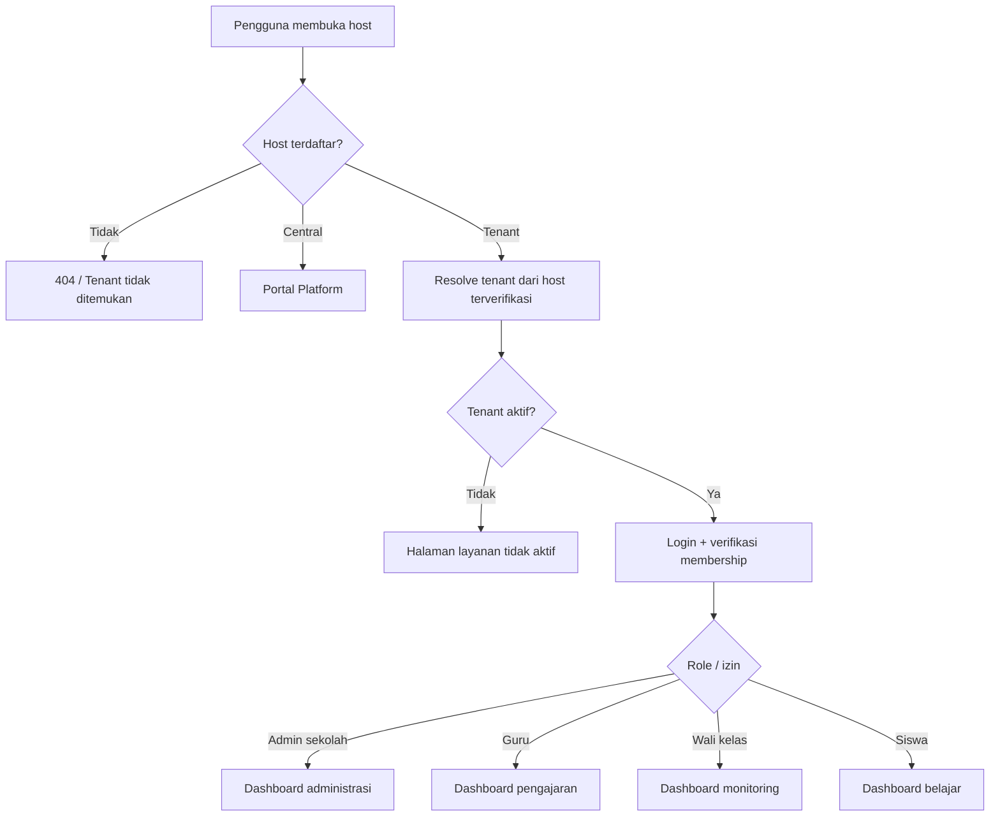
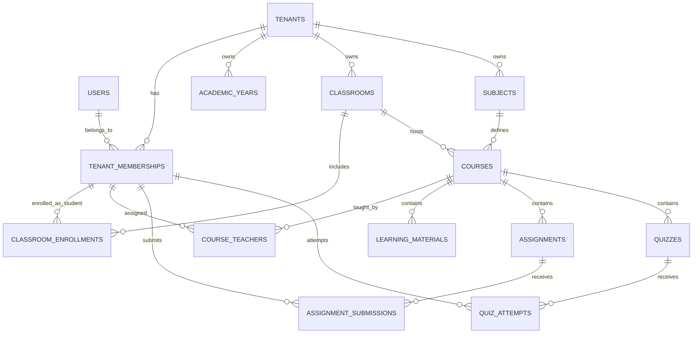

# PRD MASTER — LMS SaaS Multi-Sekolah

**Nama produk:** LMS SaaS Multi-Sekolah (nama merek belum ditetapkan)  
**Versi dokumen:** 1.0 — Draft baseline  
**Tanggal:** 5 November 2026  
**Pemilik produk:** Tim pengembang LMS  
**Target pengguna:** SMP/sederajat di Indonesia; rancangan memungkinkan perluasan jenjang pendidikan  
**Metode pengembangan:** Local-first, iteratif, berbasis milestone dan acceptance criteria  
**Bahasa utama antarmuka:** Bahasa Indonesia  
**Status:** PRD awal; keputusan terbuka ditandai eksplisit, bukan dianggap sudah disetujui.

> **Tujuan dokumen:** menjadi sumber acuan produk yang konsisten bagi pemilik produk, desainer, pengembang, QA, dan AI coding assistant (termasuk Codex). PRD ini menentukan *apa* yang dibangun, *mengapa*, batasan produk, aturan bisnis, standar penerimaan, serta arsitektur acuan. Detail implementasi akhir dipecah menjadi ADR, ERD, spesifikasi API, dan task sprint.

---

## 0. Status Keputusan

Gunakan status di bawah agar keputusan yang belum disetujui tidak diperlakukan sebagai fakta.

| Status | Keputusan | Catatan |
|---|---|---|
| **TERKONFIRMASI** | Produk adalah **SaaS untuk banyak sekolah sejak awal** | Bukan LMS single-school yang diubah belakangan. |
| **TERKONFIRMASI** | Pengembangan **dimulai di komputer lokal** | Tidak membutuhkan VPS atau domain publik untuk mulai coding. |
| **TERKONFIRMASI** | SMP Negeri 10 Semarang menjadi **contoh kebutuhan awal** | Bukan pernyataan adanya kerja sama resmi atau izin memakai data aslinya. |
| **REKOMENDASI** | **Modular monolith** dengan multi-tenancy | Menjaga biaya dan kompleksitas awal terkendali. |
| **REKOMENDASI** | Satu database PostgreSQL dengan data tenant terisolasi (*shared DB, tenant-scoped tables*) | Gunakan pengamanan tenant berlapis; dievaluasi ulang bila profil risiko/kontrak berubah. |
| **REKOMENDASI** | Laravel 13 + PHP 8.3+; Blade, Livewire, Alpine.js, Tailwind CSS | Konfirmasi kompatibilitas seluruh paket sebelum mengunci versi di ADR. Laravel 12 menjadi opsi fallback bila perlu. |
| **REKOMENDASI** | Redis, Docker Compose, penyimpanan objek kompatibel S3 | Gunakan MinIO atau emulator serupa untuk lokal; R2/S3 dapat digunakan di produksi. |
| **REKOMENDASI** | Satu *tenant* = satu sekolah dalam MVP | Multi-sekolah per yayasan/organisasi menjadi fitur berikutnya. |
| **REKOMENDASI** | Satu identitas akun global dapat mempunyai keanggotaan di beberapa tenant | Role berbeda untuk setiap sekolah; desain otorisasi wajib memakai konteks tenant. |
| **BELUM DIPUTUSKAN** | Nama produk, domain, identitas visual, paket harga | Jangan hard-code nama merek, harga, atau domain ke business logic. |
| **BELUM DIPUTUSKAN** | Integrasi pembayaran, SSO, Dapodik, rapor, custom domain | Di luar MVP kecuali ada persetujuan perubahan lingkup. |

## 1. Ringkasan Eksekutif

Produk adalah platform **Learning Management System berbasis SaaS** yang memungkinkan banyak sekolah mengelola pembelajaran digital menggunakan satu aplikasi terpusat. Setiap sekolah mempunyai lingkungan tersendiri berupa profil sekolah, tahun ajaran, guru, siswa, kelas, mata pelajaran, materi, tugas, kuis, nilai, serta kebijakan akses; data sekolah A tidak dapat terbaca oleh sekolah B.

Platform menyediakan dua konteks operasional terpisah:
1. **Platform / Central SaaS:** pemilik layanan mengatur tenant, paket, batas penggunaan, pengaktifan layanan, dan kesehatan operasional platform.
2. **Tenant / Sekolah:** sekolah mengatur struktur akademik dan aktivitas pembelajaran secara mandiri, dalam batas langganannya.

Produk dimulai sebagai **web responsif yang ramah HP**, tanpa keharusan membuat aplikasi Android/iOS native. Produk tidak langsung menggantikan seluruh SIAKAD, sistem rapor resmi, atau sistem administrasi keuangan sekolah.

### 1.1 Permasalahan yang Diselesaikan

- Materi, tugas, dan hasil belajar tersebar dalam banyak kanal, menyulitkan guru dan siswa.
- Guru perlu memonitor progres dan memberikan umpan balik secara terstruktur.
- Sekolah membutuhkan LMS yang dapat diaktifkan tanpa membangun dan mengelola aplikasi sendiri.
- Pengembang memerlukan satu codebase yang dapat melayani banyak sekolah tanpa mencampur data.

### 1.2 Proposisi Nilai

- Sekolah: onboarding lebih cepat, biaya layanan lebih terprediksi, dashboard administrasi mandiri.
- Guru: membuat kelas pembelajaran, mengunggah materi, menilai tugas/kuis, melihat aktivitas siswa.
- Siswa: satu tempat untuk materi, tenggat, ujian, dan umpan balik.
- Penyedia: satu sistem yang dapat dikembangkan, dimonitor, dan diperbarui secara terpusat.

## 2. Sasaran, KPI, dan Non-Goals

### 2.1 Sasaran Produk

1. Mendukung sedikitnya tiga tenant simulasi di lokal sebelum pilot sekolah sungguhan.
2. Memungkinkan admin sekolah mengonfigurasi sekolah dan mengimpor/membuat akun guru dan siswa.
3. Menuntaskan alur end-to-end **guru membuat materi/tugas → siswa mengerjakan → guru menilai → siswa melihat hasil**.
4. Menuntaskan alur **guru membuat kuis → siswa mengerjakan → submit → penilaian objektif otomatis → hasil sesuai kebijakan publikasi**.
5. Memastikan akses antar-sekolah terisolasi dan diuji otomatis.
6. Menyediakan kontrol operasional bagi super admin untuk status tenant dan paket layanan.

### 2.2 KPI Pilot (target awal, bukan janji SLA komersial)

| Area | Ukuran keberhasilan |
|---|---|
| Onboarding | Sekolah simulasi aktif, admin sekolah dapat login, konfigurasi awal selesai tanpa modifikasi kode. |
| Pembelajaran | Minimal satu mata pelajaran, satu materi, satu tugas, dan satu kuis dituntaskan oleh akun dummy tiap sekolah. |
| Tenant isolation | 100% test kasus akses silang kritis ditolak. |
| Aktivitas guru | Guru berhasil memberi nilai serta komentar dan siswa yang benar dapat melihatnya. |
| Responsivitas | Alur utama dapat dijalankan pada layar ponsel dan desktop. |
| Performa | Target uji awal p95 halaman utama ≤ 2 detik pada skenario uji 100 pengguna serentak; direvisi berdasarkan infrastruktur dan hasil uji. |
| Stabilitas | Tidak ada bug severity kritis/tinggi yang belum ditangani saat pilot data nyata. |

### 2.3 Di Luar Cakupan MVP

- Sistem rapor resmi atau pengganti Dapodik/SIAKAD.
- Pembayaran online otomatis atau marketplace sekolah.
- Aplikasi mobile native, meeting video bawaan, live-streaming, proctoring berbasis webcam.
- Pengawasan antikecurangan yang mengklaim dapat mencegah kecurangan sepenuhnya.
- AI tutor, rekomendasi adaptif, gamifikasi, forum kompleks.
- Integrasi pihak ketiga tanpa perjanjian, penilaian privasi, dan kebutuhan yang terverifikasi.
- Registrasi mandiri siswa di luar kontrol sekolah.

## 3. Segmentasi, Persona, dan Role

### 3.1 Persona

| Persona | Kebutuhan utama |
|---|---|
| Platform Super Admin | Membuat dan mengelola tenant, paket, aktivitas sistem, status layanan. |
| Admin Sekolah | Mengatur profil sekolah, tahun ajaran, rombel, mata pelajaran, akun, penugasan guru. |
| Guru | Mengelola course, materi, tugas, kuis, nilai siswa yang diajarnya. |
| Wali Kelas | Memantau kelas yang menjadi tanggung jawabnya dengan hak akses terbatas. |
| Siswa | Mengakses materi, mengerjakan tugas/kuis, melihat hasil yang dipublikasikan. |
| Orang tua/wali siswa | **Pasca-MVP:** melihat perkembangan anak melalui persetujuan dan pemetaan yang sah. |

### 3.2 Model Identitas dan Keanggotaan

- `users` adalah identitas login global; `tenant_memberships` mengaitkan pengguna dengan sekolah tertentu.
- Seorang pengguna dapat memiliki satu atau lebih membership; status dan perannya **berlaku per tenant**.
- Siswa tidak wajib mempunyai alamat email pribadi; dukung login menggunakan identitas/username yang diterbitkan sekolah. Aturan aktivasi dan reset kredensial harus aman.
- Guru dapat mengajar beberapa sekolah jika memiliki membership sah di masing-masing sekolah.
- Role bisa digabung sesuai penugasan (misalnya guru sekaligus wali kelas); hak akses final merupakan kombinasi role + tenant aktif + kepemilikan resource.
- Otorisasi tidak boleh hanya didasarkan pada role, melainkan juga `tenant_id`, membership aktif, penugasan guru, dan hubungan siswa terhadap kelas/course.

### 3.3 Matriks Hak Akses Ringkas

Simbol: **P** = penuh dalam lingkup perannya, **T** = terbatas, **—** = tidak boleh.

| Fitur | Platform Super Admin | Admin Sekolah | Guru | Wali Kelas | Siswa |
|---|---|---|---|---|---|
| Kelola tenant/paket | P | — | — | — | — |
| Kelola profil sekolah, tahun ajaran | — | P | — | — | — |
| Kelola akun dan rombel sekolah | — | P | — | T (pantau) | — |
| Buat & kelola course/mapel | — | P | T (course sendiri) | T (sesuai penugasan) | — |
| Terbitkan materi | — | T (administratif) | P (course sendiri) | T (jika juga guru) | — |
| Buat tugas/kuis | — | T (administratif) | P (course sendiri) | T (jika juga guru) | — |
| Kirim tugas/kuis | — | — | — | — | P (milik sendiri) |
| Nilai/umpan balik | — | T (sesuai kebijakan) | P (course sendiri) | T (monitor kelas) | T (lihat milik sendiri) |
| Lihat data pembelajaran sekolah lain | — | — | — | — | — |

**Aturan super admin:** tidak memiliki hak default untuk membaca isi tugas, jawaban ujian, file privat, atau data pribadi siswa. Jika diperlukan dukungan terdelegasi, harus ada otorisasi khusus, alasan, masa berlaku, persetujuan sesuai kontrak, dan audit trail.

## 4. Arsitektur Produk dan Navigasi

### 4.1 Dua Area Terpisah

**Central Application** (contoh hostname `admin.platform.test`): login staf platform, tenant directory, provisioning, paket dan entitlement, penggunaan agregat yang sesuai kebutuhan operasional, audit layanan, tiket dukungan.

**Tenant Application** (contoh `smpn10.platform.test`): login sekolah, dashboard sesuai role, manajemen akademik, pembelajaran, ujian, hasil, pengaturan tenant.

Hostname contoh hanya untuk lokal; file `hosts` Windows tidak mendukung wildcard otomatis. Gunakan konfigurasi host eksplisit atau DNS resolver lokal. Jangan mengasumsikan `*.test` langsung berfungsi tanpa setup.

### 4.2 Alur Navigasi



## 5. Kebutuhan Fungsional

Setiap fitur di bawah memiliki ID tetap untuk backlog dan QA. Prioritas **P0** = wajib MVP, **P1** = iterasi setelah MVP, **P2** = lanjutan.

### 5.1 SaaS Central Management

| ID | Prioritas | Kebutuhan | Kriteria penerimaan inti |
|---|---|---|---|
| SAAS-001 | P0 | Super admin dapat membuat tenant dengan kode/slug dan profil dasar. | Slug unik; provisioning idempotent; tenant dapat diakses hanya setelah aktif. |
| SAAS-002 | P0 | Status tenant: `pending`, `active`, `suspended`, `archived`. | Perubahan status tercatat; suspended menolak aktivitas baru sesuai kebijakan. |
| SAAS-003 | P0 | Super admin menetapkan paket secara manual. | Entitlement dibaca server-side; tidak bisa dilampaui lewat request buatan. |
| SAAS-004 | P0 | Tenant onboarding menghasilkan akun admin sekolah. | Kredensial disampaikan lewat proses aktivasi/reset aman, bukan disimpan plaintext. |
| SAAS-005 | P0 | Branding dasar (nama sekolah, logo, warna aksen). | Perubahan hanya berpengaruh pada tenant terkait. |
| SAAS-006 | P1 | Pemakaian dan batas paket (akun aktif, storage, fitur). | Perhitungan jelas, tenant scoped, ada peringatan limit. |
| SAAS-007 | P1 | Trial dan tanggal berlaku layanan. | Masa percobaan, grace period, read-only, dan suspend sesuai state machine. |
| SAAS-008 | P2 | Invoice dan pembayaran otomatis. | Status transaksi diverifikasi dari gateway, bukan hanya callback/redirect klien. |
| SAAS-009 | P2 | Custom domain sekolah. | Kepemilikan domain diverifikasi; TLS dan mapping domain aman. |

**Kebijakan awal suspend:** pengguna sekolah tidak bisa membuat/mengubah konten setelah layanan berakhir; kebijakan read-only sementara dan akses ekspor perlu ditetapkan secara kontraktual. Jangan langsung menghapus data.

### 5.2 Autentikasi, Role, dan Keamanan Akun

| ID | Prioritas | Kebutuhan | Kriteria penerimaan inti |
|---|---|---|---|
| AUTH-001 | P0 | Login, logout, ubah password, reset password. | Password di-hash; rate limit login; tidak membocorkan keberadaan akun. |
| AUTH-002 | P0 | Membership per sekolah dan assignment role. | Sesi pada tenant A tidak otomatis memberi akses ke tenant B. |
| AUTH-003 | P0 | Menu dan aksi berdasarkan policy/permission. | UI disembunyikan dan endpoint tetap menolak akses ilegal. |
| AUTH-004 | P0 | Aktivasi akun oleh sekolah dan penonaktifan. | Akun nonaktif kehilangan akses; sesi dicabut sesuai kebijakan. |
| AUTH-005 | P1 | MFA untuk admin platform/admin sekolah. | Diuji termasuk recovery yang aman. |
| AUTH-006 | P1 | Audit aktivitas sensitif. | Catat aktor, tenant, tindakan, waktu, target; minimalkan PII pada log. |

### 5.3 Manajemen Akademik Sekolah

| ID | Prioritas | Kebutuhan | Kriteria penerimaan inti |
|---|---|---|---|
| ACAD-001 | P0 | Profil sekolah dan pengaturan dasar. | Hanya admin tenant berizin dapat mengubah. |
| ACAD-002 | P0 | Tahun ajaran dan semester. | Satu periode aktif sesuai aturan sekolah; histori tetap tersedia. |
| ACAD-003 | P0 | Rombongan belajar/kelas (mis. 7A, 7B). | Nama rombel unik per sekolah dan periode. |
| ACAD-004 | P0 | Daftar mata pelajaran. | Mapel dikelola per sekolah; tidak bercampur lintas tenant. |
| ACAD-005 | P0 | Data guru/siswa dan membership. | Input manual dan impor CSV terverifikasi; hasil impor dapat dilihat. |
| ACAD-006 | P0 | Penempatan siswa dalam rombel. | Tidak ada relasi lintas tenant; historis perpindahan tidak hilang. |
| ACAD-007 | P0 | Penugasan guru untuk course/kelas-mapel. | Hanya guru yang ditugaskan dapat memodifikasi konten pengajaran. |
| ACAD-008 | P1 | Perpindahan kelas dan promosi tahun ajaran. | Data hasil lama terarsip, tidak tercampur ke periode baru. |
| ACAD-009 | P1 | Dashboard wali kelas. | Hanya melihat kelas yang ditugaskan; detail tetap dibatasi. |

### 5.4 Course dan Materi Pembelajaran

Definisi **course** MVP: satu pelaksanaan mata pelajaran untuk rombel tertentu pada tahun ajaran/semester, dengan satu atau lebih guru pengampu.

| ID | Prioritas | Kebutuhan | Kriteria penerimaan inti |
|---|---|---|---|
| LMS-001 | P0 | Guru membuat/mengelola unit atau topik pada course miliknya. | Urutan unit dapat diubah; akses diverifikasi. |
| LMS-002 | P0 | Unggah materi teks, PDF, gambar, tautan, atau tautan video eksternal. | Validasi MIME/ukuran; file privat; tidak mengeksekusi upload. |
| LMS-003 | P0 | Draft/publish materi dengan waktu terbit opsional. | Siswa hanya melihat konten terbit dan course yang diikuti. |
| LMS-004 | P0 | Siswa melihat daftar course dan materi yang berhak diakses. | Tidak dapat membuka course sekolah/kelas lain melalui URL langsung. |
| LMS-005 | P1 | Progress baca/selesai materi. | Status dapat diaudit, bukan ukuran tunggal pemahaman. |
| LMS-006 | P2 | Konten SCORM/xAPI dan materi interaktif lanjutan. | Hanya setelah kebutuhan nyata dan evaluasi kompatibilitas. |

### 5.5 Tugas, Pengumpulan, dan Penilaian

| ID | Prioritas | Kebutuhan | Kriteria penerimaan inti |
|---|---|---|---|
| TASK-001 | P0 | Guru membuat tugas berisi instruksi, lampiran, tanggal buka/tenggat, dan bobot opsional. | Tugas hanya tersedia pada course yang ditetapkan. |
| TASK-002 | P0 | Siswa mengirim jawaban teks dan/atau file. | Hanya siswa terdaftar, dalam rentang kebijakan; lampiran privat. |
| TASK-003 | P0 | Status pengumpulan: belum mengirim, terkirim, terlambat, dinilai. | Status berdasarkan waktu server, bukan jam perangkat. |
| TASK-004 | P0 | Guru memberi nilai dan komentar. | Hanya guru berhak; perubahan nilai tercatat. |
| TASK-005 | P0 | Siswa melihat nilai/umpan balik yang sudah diterbitkan. | Tidak bisa melihat milik siswa lain. |
| TASK-006 | P1 | Rubrik penilaian dan resubmission. | Ada revisi/versioning pengumpulan dan kebijakan yang jelas. |

**Aturan default:** satu pengumpulan aktif per siswa per tugas; file revisi baru dapat didukung pada P1. Rentang nilai dan kebijakan keterlambatan ditetapkan per tugas/course, dengan validasi server.

### 5.6 Kuis dan Ujian

| ID | Prioritas | Kebutuhan | Kriteria penerimaan inti |
|---|---|---|---|
| QUIZ-001 | P0 | Guru membuat kuis dengan soal pilihan ganda tunggal dan isian/esai sederhana. | Soal terhubung tenant dan course yang benar. |
| QUIZ-002 | P0 | Atur jadwal buka/tutup, durasi, jumlah percobaan (default 1), publish. | Validasi waktu dengan server; zona waktu sekolah dikonfigurasi. |
| QUIZ-003 | P0 | Siswa memulai attempt yang sah. | Tidak dapat memulai setelah ditutup atau melebihi batas attempt. |
| QUIZ-004 | P0 | Jawaban tersimpan secara berkala dan dapat dipulihkan ketika koneksi terputus. | Autosave idempotent, timestamp server, tidak ada duplikasi attempt. |
| QUIZ-005 | P0 | Submit manual atau finalisasi ketika waktu habis. | Status attempt terkunci; nilai objektif dihitung dengan benar. |
| QUIZ-006 | P0 | Guru menilai esai secara manual. | Akses guru dibatasi pada course; nilai dapat diaudit. |
| QUIZ-007 | P0 | Publikasi hasil sesuai kebijakan guru. | Siswa hanya melihat hasil miliknya setelah dipublikasikan. |
| QUIZ-008 | P1 | Bank soal, randomisasi, berbagai tipe soal, analisis butir. | Tidak mengubah nilai historis ketika bank soal diperbarui. |

**Aturan penting ujian:** penyimpanan jawaban di client hanya bersifat sementara; server adalah sumber kebenaran. Batas akhir ujian dihitung dari waktu server. Peristiwa jaringan terputus, tab ganda, dan submit berulang harus punya perilaku terdokumentasi. Soal/jawaban kunci tidak dikirim ke client sebelum waktunya. Tidak mengklaim pencegahan kecurangan sempurna.

### 5.7 Dashboard, Notifikasi, dan Laporan

| ID | Prioritas | Kebutuhan | Kriteria penerimaan inti |
|---|---|---|---|
| DASH-001 | P0 | Dashboard siswa: course, materi terbaru, tugas mendatang, kuis, nilai terbit. | Semua data hanya untuk siswa yang login. |
| DASH-002 | P0 | Dashboard guru: course aktif, tugas belum dinilai, aktivitas. | Hanya course yang diajarkan. |
| DASH-003 | P0 | Dashboard admin sekolah: jumlah pengguna/kelas/course dan aktivitas agregat. | Tanpa data tenant lain. |
| DASH-004 | P0 | Dashboard super admin: tenant, status, paket, kesehatan teknis agregat. | Tanpa konten pribadi siswa secara default. |
| NOTIF-001 | P1 | Notifikasi dalam aplikasi untuk tugas baru, tenggat, hasil. | Per tenant dan user; tidak mengirim informasi sensitif ke tenant lain. |
| REPORT-001 | P1 | Rekap pengumpulan, nilai, progres per course/kelas. | Filter dan ekspor tetap mematuhi otorisasi. |
| REPORT-002 | P1 | Ekspor CSV/PDF untuk pemilik data berwenang. | File ekspor berumur terbatas, dilindungi akses dan tercatat. |

## 6. Alur Pengguna End-to-End

### 6.1 Onboarding Sekolah

1. Staf platform membuat tenant berstatus `pending` beserta slug unik.
2. Sistem memvalidasi slug/hostname, membuat profil default, paket dan entitlement awal.
3. Staf platform menetapkan admin sekolah; sistem mengirim tautan aktivasi aman melalui kanal yang disepakati.
4. Tenant diaktifkan (`active`); admin sekolah login dan melengkapi profil serta tahun ajaran.
5. Admin sekolah membuat rombel, mapel, guru, siswa, serta penugasan.
6. Sistem menjalankan checklist kesiapan dan menampilkan status onboarding.

**Failure path:** provisioning gagal → transaksi dibatalkan/diulang aman, log teknis tersedia, tenant tidak dibiarkan setengah aktif.

### 6.2 Guru Mengelola Pembelajaran

1. Guru login di hostname sekolah dan melihat course yang ditugaskan.
2. Guru membuat topik, materi, tugas, atau kuis; menyimpan draft.
3. Guru memublikasikan konten untuk siswa yang terdaftar.
4. Guru melihat pengumpulan dan memberi penilaian/umpan balik.
5. Guru memublikasikan hasil jika kebijakan memerlukan persetujuan publikasi.

### 6.3 Siswa Belajar dan Mengerjakan

1. Siswa login memakai identitas dari sekolah.
2. Sistem menampilkan daftar course milik siswa pada tenant tersebut.
3. Siswa membaca materi dan melihat tugas/kuis yang tersedia.
4. Siswa mengirim tugas atau memulai attempt kuis sesuai aturan.
5. Siswa melihat tanda terima/status pengumpulan, lalu nilai ketika dipublikasikan.

### 6.4 Suspensi dan Pengakhiran Tenant

1. Sistem memberi peringatan kedaluwarsa kepada pihak sekolah yang berwenang.
2. Bila masuk masa tenggang, akses mengikuti kebijakan kontrak (misalnya read-only).
3. Jika suspend, sesi dan operasi mutasi dibatasi; data **tidak dihapus otomatis**.
4. Ekspor/offboarding dijalankan berdasarkan hak akses, kontrak, dan kebijakan retensi.
5. Penghapusan permanen melewati prosedur terverifikasi dan audit.

## 7. Desain Data Konseptual

### 7.1 Global/Central Tables

- `tenants` — `id`, `public_ulid`, `slug`, `name`, `status`, `timezone`, metadata.
- `tenant_domains` — domain/hostname valid terverifikasi yang terhubung ke tenant.
- `users` — identitas login global dan kredensial, bukan data akademik langsung.
- `tenant_memberships` — `tenant_id`, `user_id`, status, tanggal bergabung, identitas lokal opsional.
- `roles`, `permissions`, `membership_roles` — role berbasis membership tenant; role platform terpisah.
- `plans`, `plan_features`, `tenant_subscriptions`, `tenant_entitlements` — paket, izin fitur, kuota dan periode.
- `platform_audit_logs` — audit akses dan perubahan sistem platform.

### 7.2 Tenant-Scoped Tables (Wajib Memiliki Isolasi Tenant)

- `academic_years`, `semesters`
- `classrooms`, `classroom_enrollments`
- `subjects`, `courses`, `course_teachers`, `course_enrollments` (bila perlu terpisah dari rombel)
- `student_profiles`, `teacher_profiles` (per tenant; pengenal siswa minimum yang diperlukan)
- `course_sections`, `learning_materials`, `material_attachments`
- `assignments`, `assignment_submissions`, `submission_attachments`, `assignment_grades`
- `quizzes`, `quiz_questions`, `quiz_options`, `quiz_attempts`, `quiz_answers`, `quiz_grades`
- `tenant_audit_logs`, `notifications`, `uploaded_files`

### 7.3 Prinsip ID dan Relasi

- Gunakan `BIGINT` internal untuk primary key dan **ULID publik** saat resource perlu dibagikan lewat URL/API. ULID bukan mekanisme otorisasi.
- Seluruh tabel tenant-owned menyimpan `tenant_id` atau mempunyai pembatasan tenant yang setara, terukur, dan teruji.
- Setiap foreign key lintas entity tenant harus memastikan `tenant_id` child sama dengan parent; gunakan **composite foreign key** `(tenant_id, parent_id)` bila cocok, beserta indeks unik yang diperlukan.
- Terapkan unique constraint berdasarkan konteks, seperti `(tenant_id, academic_year_id, classroom_code)`.
- Data transaksi belajar yang sudah dinilai tidak dihapus secara cascade sembarangan; gunakan kebijakan arsip/soft delete atau pembatasan penghapusan sesuai kebutuhan audit.
- Jangan menggunakan nilai `tenant_id` dari form/browser sebagai sumber kebenaran; tenant berasal dari server-verified host + membership.
- Enforce izin akses dari backend (policy/service), bukan hanya query frontend.

### 7.4 Ilustrasi ERD Ringkas



**Catatan:** ERD ini konseptual. Detail indeks, constraint, lifecycle soft delete, storage metadata, serta authorization matrix diwujudkan dalam dokumen ERD dan ADR terpisah sebelum migrasi.

## 8. Isolasi Tenant dan Aturan Keamanan Wajib

Keamanan multi-tenant adalah persyaratan produk **P0 dan release blocker**.

1. **Tenant resolver:** hanya menerima hostname yang telah didaftarkan dan diverifikasi. Unknown host harus ditolak. `X-Tenant-ID` atau `tenant_id` dari client tidak boleh mengesahkan akses.
2. **Membership validation:** setelah autentikasi, validasi keanggotaan aktif pada tenant yang di-resolve dan perizinan per resource.
3. **Database isolation:** semua operasi tenant-scoped melewati mekanisme scope yang wajib; tidak ada query tenant-owned tanpa pembatasan. Pertimbangkan PostgreSQL RLS sebagai *defense in depth* setelah proof-of-concept operasional, dengan peran DB yang tidak dapat bypass RLS.
4. **Relational integrity:** foreign key komposit atau validasi invariant untuk menolak relasi kelas, mapel, jawaban, dan file dari tenant berbeda.
5. **Cache:** kunci data tenant mengandung identitas tenant dan parameter relevan; tidak pernah menyimpan hasil otorisasi lintas tenant pada cache bersama tanpa namespace.
6. **Queue/background jobs:** pekerjaan membawa identitas tenant hasil validasi server, memulihkan konteks tenant saat dieksekusi, dan memvalidasi kembali resource serta izin.
7. **Files:** gunakan storage private, namespace tenant dan izin pemilik file; download melalui pemeriksaan otorisasi atau signed URL berumur pendek.
8. **Rate limits and quotas:** terapkan limit untuk IP, akun, tenant, dan endpoint; cegah tenant yang menghabiskan sumber daya bersama (*noisy neighbor*).
9. **Sessions:** periksa risiko cookie lintas subdomain dan session fixation; jangan membiarkan switching host mengakibatkan switching hak tanpa autentikasi/otorisasi ulang yang benar.
10. **Audit:** login administratif, perubahan membership, akses dukungan, perubahan nilai, perubahan paket, ekspor data, dan offboarding dicatat.
11. **PII:** minimalkan NISN, tanggal lahir, nomor HP, foto, dan data orang tua; kumpulkan hanya bila diperlukan dan dasar pemrosesannya jelas.
12. **Tidak ada backdoor:** super admin tidak memiliki kemampuan membaca data siswa secara universal tanpa jalur akses yang eksplisit, terotorisasi, dan diaudit.

**Wajib diuji:** pengguna tenant A tidak boleh GET/POST/PATCH/DELETE resource tenant B, termasuk dengan mengganti ID, upload path, cached key, websocket channel (jika ada), atau menjalankan job yang dipalsukan.

## 9. Privasi, Data Anak, dan Tata Kelola Sekolah

LMS untuk siswa SMP akan memproses data anak; ini membutuhkan kontrol khusus. UU No. 27 Tahun 2022 menggolongkan data anak sebagai data pribadi spesifik (Pasal 4) dan mengatur persetujuan orang tua dan/atau wali untuk pemrosesan data pribadi anak (Pasal 25). Persyaratan pelaksanaan dan pembagian tanggung jawab perlu ditinjau secara hukum pada saat kerja sama dengan sekolah.

### 9.1 Persyaratan Operasional

- Tentukan peran **pengendali** dan **prosesor data pribadi** dalam perjanjian sekolah–penyedia SaaS; jangan berasumsi modelnya otomatis sama untuk semua sekolah.
- Siapkan kebijakan privasi, perjanjian layanan, lampiran pemrosesan data, dan prosedur permintaan hak subjek data yang relevan.
- Definisikan alur persetujuan/otorisasi yang relevan bagi data anak bersama sekolah dan penelaah hukum, termasuk bukti dan retensinya.
- Impor data siswa nyata hanya setelah otorisasi sah; selama pengembangan lokal, **gunakan data sintetis/dummy**.
- Pastikan lingkungan staging tidak memakai database produksi secara mentah.
- Tetapkan aturan retensi, ekspor, penghapusan, pencabutan akses, penanganan insiden, serta akses vendor/dukungan.
- Enkripsi data saat transit (HTTPS) dan at-rest sesuai ancaman dan infrastruktur; sandi disimpan menggunakan password hashing aman.
- Jangan memasukkan data siswa ke log debug, analytics pihak ketiga, prompt AI, atau layanan eksternal tanpa penilaian kebutuhan dan otorisasi.
- Lakukan peninjauan hukum dan kebijakan pengadaan terutama bila melayani sekolah negeri.

## 10. Kebutuhan Non-Fungsional (NFR)

| ID | Area | Target/kebijakan awal |
|---|---|---|
| NFR-001 | Aksesibilitas | Target **WCAG 2.2 AA** untuk alur utama; keyboard navigation, label form, kontras, fokus terlihat, pesan error jelas. |
| NFR-002 | Perangkat | Responsive, mobile-first; alur belajar siswa usable di ponsel Android kelas menengah. |
| NFR-003 | Bahasa | Bahasa Indonesia default; arsitektur string siap lokalisasi, tanpa wajib menyediakan bahasa kedua pada MVP. |
| NFR-004 | Performa | Target pilot p95 halaman umum ≤ 2 detik pada skenario staging terdokumentasi; bukan jaminan semua jaringan. |
| NFR-005 | Beban ujian | Load test serentak termasuk start, autosave, submit, grading; target jumlah concurrency ditetapkan berdasar kebutuhan dan hasil benchmarking. |
| NFR-006 | Keandalan | Operasi submit/autosave idempotent; respons jelas jika jaringan putus; ada retry yang terkendali. |
| NFR-007 | Ketersediaan | Target operasional awal setelah produksi 99,5% per bulan, belum menjadi SLA kontraktual tanpa validasi biaya/infrastruktur. |
| NFR-008 | Backup | Backup terenkripsi dan teruji. Target awal RPO ≤ 1 jam dan RTO ≤ 8 jam, **bergantung desain backup dan hasil drill** sebelum dinyatakan siap produksi. |
| NFR-009 | Pemantauan | Structured logs, request ID, tenant ID terverifikasi (tanpa data sensitif), metrik error/latency/queue. |
| NFR-010 | Keamanan | CSRF, XSS protection, injection prevention, secure headers, upload validation, secret management, policy tests. |
| NFR-011 | Deployment | CI lint, test, migration checks, build, backup checkpoint; rollback aplikasi diuji dan tidak sembarang rollback migrasi data. |
| NFR-012 | Penghapusan | Data deletion hanya menurut prosedur hukum/kontrak; backup dan log mengikuti retensi masing-masing. |
| NFR-013 | Integrity | Nilai, penilaian, attempt ujian, dan perubahan izin punya jejak audit yang relevan. |

## 11. Arsitektur Teknis Acuan

### 11.1 Prinsip

- **Modular monolith:** satu aplikasi Laravel, satu deployment utama; batas modul jelas di source code.
- **Server-rendered UX:** Blade + Livewire + Alpine.js; JavaScript khusus untuk timer/autosave saat dibutuhkan.
- **PostgreSQL:** relational source of truth; gunakan transaksi pada operasi kritis.
- **Redis:** cache, queue, rate limiting sesuai konfigurasi; jangan menyimpan source of truth nilai hanya di Redis.
- **Object storage private:** pengelolaan file di luar public web root, dengan metadata di database.
- **Scheduler & worker:** queue worker dan scheduler terpisah dari web request.
- **No premature microservices:** pemecahan layanan baru dibenarkan jika bottleneck terbukti.

### 11.2 Pembagian Modul Kode (konseptual)

```text
app/
  Domains/
    Platform/           # tenants, plans, subscriptions, entitlements
    Identity/           # users, memberships, roles, permissions
    Academic/           # years, classrooms, subjects, enrollments
    Learning/           # courses, materials, assignments
    Assessment/         # quizzes, attempts, grading
    Reporting/          # dashboard, reports
    Notifications/      # notifications and channels
  Support/
    Tenancy/            # tenant resolver, context, scope/invariants
    Files/              # authorization-aware file access
    Audit/              # activity and security logging
  Http/
    Middleware/
      ResolveTenant.php
      EnsureActiveMembership.php
      EnsureTenantActive.php
resources/
  views/
    platform/
    tenant/
tests/
  Feature/
    Tenancy/
    Auth/
    Academic/
    Learning/
    Assessment/
  Unit/
docs/
  prd/
  adr/
  erd/
  api/
```

Nama direktori rekomendasi, bukan kebutuhan framework. Jangan membuat paket internal berlapis terlalu dini; utamakan dependensi modul satu arah dan testable services.

### 11.3 Integrasi dan API

- MVP memakai web Laravel; API publik **belum wajib**.
- Jika AJAX/API internal digunakan, tetap wajib melewati autentikasi, policy, dan tenant resolution yang sama.
- Kontrak response untuk upload, assignment submission, quiz autosave, dan quiz finalization harus didokumentasikan sebelum implementasi.
- Jika integrasi eksternal datang kemudian, gunakan token dengan scope tenant, rotasi credential, idempotency, dan audit.

### 11.4 Versi Runtime

Rekomendasi versi dasar pada penyusunan PRD: Laravel 13 (tersedia sejak Maret 2026) dengan PHP 8.3+. Lakukan *dependency compatibility spike* untuk Livewire, paket tenancy/permissions, PostgreSQL, dan pengujian aplikasi sebelum membuat lockfile. Jika ada ketidakcocokan yang penting, buat ADR tertulis untuk fallback Laravel 12 dengan mempertimbangkan masa dukungan keamanan. **Jangan upgrade framework secara diam-diam di tengah sprint.**

## 12. Pengembangan Lokal (Windows)

### 12.1 Docker Compose (rekomendasi)

Layanan minimal:

```text
web/nginx         : reverse proxy aplikasi
app/php           : Laravel runtime
postgres          : database
redis             : cache, queue, rate limiting
worker            : eksekusi job
scheduler         : penjadwalan
minio             : simulasi S3/private object storage
mailpit           : email lokal tanpa mengirim ke alamat sungguhan
```

**Catatan:** Docker Compose mengisolasi layanan, **bukan** otomatis mengamankan multi-tenant. Konfigurasi jaringan dan hostname `.test` harus diatur eksplisit. SMTP produksi dan storage produksi tetap memerlukan setup terpisah.

### 12.2 Data Seed Lokal

Buat dataset sintetis:

| Tenant | Admin | Guru | Siswa | Kelas |
|---|---:|---:|---:|---:|
| SMPN 10 Demo | 1 | 3 | 30 | 7A, 7B |
| SMPN 5 Demo | 1 | 2 | 20 | 7A |
| SMP Swasta Demo | 1 | 2 | 15 | 8A |

Seluruh nama siswa dan identitas **fiktif**. Akun demo hanya untuk development, bukan production seed.

### 12.3 Cabang dan Environment

- `local` → pengembangan developer.
- `testing/CI` → database terpisah dan seed sintetis otomatis.
- `staging` → mirror produksi tanpa data anak nyata, kecuali sudah memenuhi otorisasi dan kontrol.
- `production` → data nyata setelah seluruh release gates lolos.

## 13. Pengujian Wajib

### 13.1 Checklist Multi-Tenant (negative tests)

- [ ] Teacher A mencoba membuka `course`, `material`, `assignment`, `quiz` milik Tenant B → ditolak.
- [ ] Student A mengganti ID submission atau nilai Student B di tenant sama → ditolak.
- [ ] Admin Sekolah A mencoba melihat daftar siswa Tenant B → ditolak.
- [ ] Pengguna dengan membership nonaktif → ditolak walaupun masih mempunyai sesi lama.
- [ ] Data tenant B tidak muncul pada search, export, dashboard, notification, atau cache tenant A.
- [ ] Job tenant A tidak memproses file/grade/data tenant B.
- [ ] URL file privat A tidak bisa digunakan akun B.
- [ ] Host tenant tidak dikenal atau spoofed → ditolak.
- [ ] Relasi FK kelas/course/student lintas tenant gagal tersimpan.
- [ ] Pergantian tenant pada akun multi-membership tidak mengizinkan escalation.
- [ ] Status `suspended` menegakkan pembatasan layanan.
- [ ] Data seed dan tes tidak menggunakan data siswa nyata.

### 13.2 Checklist Belajar dan Ujian

- [ ] Materi draft tidak terlihat siswa.
- [ ] Tugas yang melewati tenggat mengikuti aturan keterlambatan yang benar.
- [ ] Submit tugas dua kali tidak menghasilkan duplikasi yang tidak sah.
- [ ] Nilai belum dipublikasikan tidak terlihat siswa.
- [ ] Kuis tidak bisa diakses di luar jadwal.
- [ ] Dua tab ujian tidak menghasilkan attempt ganda atau bypass durasi.
- [ ] Autosave tetap konsisten saat koneksi putus lalu pulih.
- [ ] Submit ulang tidak menggandakan nilai atau mengubah jawaban final.
- [ ] Ujian final tersimpan meskipun proses grading asinkron, dengan status yang jelas.
- [ ] Batas waktu menggunakan server; refresh halaman tidak mengulang timer.

### 13.3 Standar CI

Pada setiap pull request:
1. Lint/formatter (PHP Pint dan tool JS/CSS yang disepakati).
2. Static analysis pada batas yang realistis untuk proyek.
3. Unit + feature/integration tests termasuk negative tests multi-tenant.
4. Database migration test dari database kosong.
5. Build assets dan validasi konfig tanpa secret.
6. Dependency/security scanning dan secret scanning.

## 14. Paket Langganan dan Entitlement

### 14.1 Arah Model Bisnis

Model bisnis yang disarankan adalah **langganan per sekolah**, tahunan atau bulanan. Harga belum ditetapkan. Paket bukan hanya pembatasan visual UI; setiap tindakan yang dibatasi paket harus divalidasi pada backend.

| Contoh kapasitas | Starter | Standard | Enterprise |
|---|---|---|---|
| Jumlah siswa aktif | Dibatasi | Lebih besar | Kontraktual |
| Penyimpanan file | Kuota dasar | Kuota lebih tinggi | Kontraktual |
| Materi & tugas | Ya | Ya | Ya |
| Kuis/ujian | Dasar | Lanjutan | Lanjutan |
| Laporan | Dasar | Diperluas | Diperluas |
| Branding sekolah | Dasar | Lengkap | Lengkap |
| Dukungan | Standar | Prioritas | Berdasarkan kontrak |

**MVP:** super admin mengaktifkan paket secara manual; belum ada checkout atau gateway pembayaran. Angka kuota, harga, trial, dan batas peserta kuis diputuskan setelah benchmark biaya dan uji kebutuhan pasar.

### 14.2 Ketentuan Entitlement

- Entitlement diberi versi dan diperiksa pada endpoint/service layer.
- Ketika kapasitas terlampaui, tindakan yang menambah konsumsi dibatasi tanpa menghilangkan akses ke hasil belajar yang sudah ada.
- Paket tidak boleh menjadi alasan untuk menghapus data saat masa berlangganan habis.
- Perubahan paket tercatat dengan aktor, waktu, nilai lama-baru, dan alasan.

## 15. Prioritas Roadmap

### Milestone M0 — Fondasi Engineering

**Output:** repo, Docker Compose/local runtime, Laravel baseline, PostgreSQL/Redis, lint/test/CI, docs/ADR, demo seed.  
**Exit gate:** aplikasi jalan di lokal dan test suite CI hijau.

### Milestone M1 — Tenancy dan Identity (**P0 / blocker**)

**Output:** central admin, provisioning tenant, verified hostname, membership, role/policy, audit dasar, test isolasi tenant.  
**Exit gate:** tiga sekolah dummy aktif dan seluruh negative test tenant kritis lulus.

### Milestone M2 — Administrasi Sekolah (**P0**)

**Output:** profil sekolah, tahun ajaran, semester, rombel, guru, siswa, mata pelajaran, course assignment, import CSV sederhana.  
**Exit gate:** admin sekolah menyelesaikan konfigurasi kelas tanpa akses database manual.

### Milestone M3 — Materi dan Tugas (**P0**)

**Output:** topik/materi, file privat, publikasi, tugas, submit siswa, penilaian, dashboard dasar.  
**Exit gate:** satu alur guru-siswa end-to-end selesai pada setiap tenant dummy.

### Milestone M4 — Kuis/Ujian (**P0**)

**Output:** soal, jadwal, attempt, autosave, submit, penilaian otomatis/manual, publish hasil.  
**Exit gate:** seluruh uji waktu, reconnect, double submit, dan otorisasi lulus.

### Milestone M5 — SaaS Operasional dan Pilot (**P0/P1 selektif**)

**Output:** plan/entitlement manual, onboarding rapih, branding, monitoring, backups, security hardening, load test, dokumentasi dukungan.  
**Exit gate:** hasil pilot dengan data dummy atau data nyata yang sudah disahkan, pengukuran performa, dan review risiko selesai.

### Milestone M6 — Monetisasi dan Ekspansi (**P1/P2**)

**Output:** trial otomatis, billing, payment gateway, laporan lanjutan, notifikasi, wali murid, custom domain, integrasi prioritas yang disetujui.  
**Exit gate:** hanya dikerjakan berdasar validasi pelanggan dan feasibility.

## 16. Backlog Sprint Perdana yang Dapat Diberikan ke Codex

| Urutan | Task | Dependensi | Definition of Done |
|---|---|---|---|
| 1 | Inisialisasi Laravel + compose + env examples | — | Boot lokal satu perintah, README jelas, tidak ada secret di repo. |
| 2 | Baseline auth + users + platform identity | 1 | Login/logout + tests dasar. |
| 3 | Migration tenants, domains, memberships, roles | 2 | FK/unique/index + migration test. |
| 4 | Host-based tenant resolver & middleware | 3 | Host invalid ditolak, tenant valid terbaca. |
| 5 | Tenant-aware policies, context, query rules | 4 | Test akses silang CRUD negatif hijau. |
| 6 | Provisioning dan tenant status | 5 | Buat tenant dummy idempotent + audit. |
| 7 | School admin dashboard + profil sekolah | 6 | Tenant A/B branding dan data terisolasi. |
| 8 | Seed tiga tenant + test cross-tenant otomatis | 3–7 | Dapat direproduksi di CI. |

**Larangan:** jangan mengerjakan quiz/exam sebelum fondasi tenant + membership + authorization cukup kuat dan teruji.

## 17. Aturan Pengembangan untuk AI Codex

Dokumen ini adalah *master product scope*. Simpan juga dalam repo pada `docs/prd/PRD_MASTER_LMS_SAAS.md` dan rujuk melalui file petunjuk proyek.

1. **Jangan mengubah keputusan terkonfirmasi** tanpa permintaan pengguna.
2. **Jangan menganggap rekomendasi sebagai final** bila ada tanda BELUM DIPUTUSKAN; buat ADR ketika dibutuhkan.
3. **Tiap fitur harus menyebutkan ID requirement** dan acceptance criteria yang diuji.
4. **Jangan membuat model tenant-owned tanpa desain isolasi** (`tenant_id`, FK, policy, query filtering, job/cache/file scope).
5. **Jangan menulis otorisasi hanya di frontend.** Gunakan policy/gate/backend service untuk setiap aksi.
6. **Jangan mengakses tenant dari parameter klien sebagai sumber otorisasi.** Verifikasi hostname + membership + izin resource.
7. **Migrasi database bersifat additive dan aman**, terutama setelah produksi; penghapusan kolom/data memerlukan rencana migrasi.
8. **Kode harus modular, kecil, diuji, dan punya error handling**, bukan satu controller/service raksasa.
9. **Tulis test negatif bersamaan dengan fitur**, khususnya tenant isolation dan object ownership.
10. **Tidak boleh menggunakan data siswa nyata** pada seed, demo, screenshot, log debug, maupun prompt AI tanpa otorisasi yang sah.
11. **Jangan menambah paket atau integrasi eksternal** tanpa mengecek kompatibilitas dan izin; dokumentasikan alasannya.
12. **Jangan mengubah versi runtime secara spontan.** Simpan versi di ADR dan lockfile.
13. **Dokumentasikan kontrak API/aksi kritis** dan state machine ujian/subscription sebelum implementasi.
14. **Jangan memasukkan harga, limit, domain, nama merek, atau kebijakan sekolah ke hard-coded logic.** Gunakan konfigurasi/entitlement.
15. **Selalu tampilkan perubahan schema, pengaruh tenant, test, dan risiko** dalam ringkasan pull request.

### 17.1 Format Permintaan Implementasi Codex

```text
Konteks:
- Gunakan docs/prd/PRD_MASTER_LMS_SAAS.md sebagai product source of truth.
- Ikuti ADR dan ERD yang sudah disetujui.

Task:
- ID kebutuhan: [misalnya SAAS-001]
- Tujuan: [deskripsikan]
- Scope: [yang termasuk]
- Out-of-scope: [yang tidak termasuk]

Syarat teknis:
- Semua akses tenant harus berasal dari host terverifikasi + membership.
- Implementasikan authorization policy dan validasi tenant.
- Sertakan migration, indexes, tests positif & negatif, dan dokumentasi.
- Jangan mengubah keputusan arsitektur di luar task.

Output:
- File yang berubah
- Penjelasan keputusan & trade-off
- Cara menjalankan dan menguji
- Test yang lulus/gagal
- Risiko atau pertanyaan terbuka
```

## 18. Risiko dan Mitigasi

| Risiko | Dampak | Mitigasi |
|---|---|---|
| Kebocoran lintas tenant | Kritis | Layered authorization, FK tenant-aware, negative tests, audit, review security. |
| Lonjakan ujian serentak | Tinggi | Load test, autosave idempotent, queue, capacity plan, rate limits tepat. |
| Penggunaan data anak tanpa kontrol memadai | Kritis | Data minimization, kontrak, persetujuan/proses sah, privacy review, dummy data. |
| Scope creep ke SIAKAD lengkap | Tinggi | Fokus P0, backlog P1/P2, perubahan lewat versioned PRD. |
| Paket/langganan mengganggu kegiatan belajar | Tinggi | Grace period, kebijakan read-only, ekspor, komunikasi transisi. |
| Biaya storage dan bandwidth meningkat | Sedang–tinggi | Kuota, file validation, object storage, analytics penggunaan, video link eksternal awal. |
| Terlalu banyak teknologi | Sedang | Modular monolith, CI sederhana, hindari microservices. |
| Ketergantungan kepada satu developer/AI | Tinggi | README, ADR, tests, code review, runbook, reproducible environments. |

## 19. Keputusan Terbuka untuk Sesi Perancangan Berikutnya

Urutan pengambilan keputusan disarankan:

1. **Model akun siswa:** username yang diterbitkan sekolah vs email; proses aktivasi/reset tanpa email siswa.
2. **Struktur akademik:** apakah semua tenant mengikuti rombel/mapel standar atau butuh fleksibilitas kurikulum/jam pelajaran.
3. **Model peran ganda:** guru di beberapa sekolah, wali kelas yang juga guru, sekolah swasta dengan beberapa unit.
4. **Kebijakan langganan:** trial, grace period, kuota, paket, billing manual dulu.
5. **Kebijakan data:** retention, export, consent, perjanjian dengan sekolah, lokasi penyimpanan, penanganan insiden.
6. **Kapasitas pilot:** jumlah sekolah, siswa aktif, guru, concurrency kuis, bandwidth dan batas upload.
7. **Brand dan domain:** nama produk, domain utama, pola subdomain, halaman marketing.
8. **Kompatibilitas stack:** finalisasi Laravel/PHP/Livewire/tenancy/permissions melalui proof-of-concept.

## 20. Gate Sebelum Menggunakan Data Nyata atau Menjual SaaS

- [ ] Ada otorisasi resmi pihak sekolah untuk pilot dan mekanisme kontrak yang disepakati.
- [ ] Ada asesmen privasi/keamanan dan tata kelola data anak, termasuk dasar dan bukti persetujuan yang diperlukan.
- [ ] Semua test kritis isolasi tenant, auth, submission, dan grading lulus.
- [ ] Backup, restore, incident response, monitoring, dan akses admin diuji.
- [ ] Uji beban dilakukan pada kapasitas representatif, bukan hanya satu komputer developer.
- [ ] Terms of Service, Privacy Notice, ketentuan retensi/ekspor, paket/biaya dan batas layanan tersedia.
- [ ] Tidak ada akun dummy, credential default, debug mode, atau development mailer aktif di produksi.
- [ ] Penilaian, kuis, dan hasil belajar mempunyai audit dan mekanisme pemulihan yang dapat dijelaskan.
- [ ] Kesiapan aksesibilitas dan UX ponsel diuji bersama pengguna sasaran.

## 21. Referensi Perancangan

1. **UU Nomor 27 Tahun 2022 tentang Pelindungan Data Pribadi**, terutama Pasal 4 dan Pasal 25. JDIH Kementerian Komunikasi dan Digital: https://jdih.komdigi.go.id/produk_hukum/view/id/832/t/crc32/
2. **OWASP Multi Tenant Security Cheat Sheet**: https://cheatsheetseries.owasp.org/cheatsheets/Multi_Tenant_Security_Cheat_Sheet.html
3. **Laravel 13 Release Notes**: https://laravel.com/docs/13.x/releases
4. **W3C Web Content Accessibility Guidelines (WCAG) 2.2**: https://www.w3.org/TR/wcag/

---

## 22. Kontrol Versi Dokumen

| Versi | Tanggal | Perubahan |
|---|---|---|
| 1.0 | 2026-11-05 | Draft master awal: kebutuhan SaaS multi-sekolah, role, tenant isolation, modul MVP, arsitektur acuan, keamanan, roadmap, dan guardrails Codex. |

**Dokumen lanjutan yang disarankan dibuat secara terpisah, berurutan:**

1. `ADR_001_Tenancy_Identity_Architecture.md`
2. `ERD_Core_SaaS_Multi_Tenant_v1.md`
3. `PRD_Modul_Authentication_RBAC_v1.md`
4. `PRD_Modul_SaaS_Central_Tenant_Management_v1.md`
5. `PRD_Modul_Academic_Management_v1.md`
6. `PRD_Modul_Learning_Assignments_v1.md`
7. `PRD_Modul_Quiz_Exam_Grading_v1.md`
8. `ROADMAP_Backlog_Implementation_v1.md`

> **Prinsip akhir:** satu codebase, banyak sekolah, data benar-benar terisolasi, pengalaman guru dan siswa sederhana, dan pertumbuhan produk tidak mengorbankan keselamatan data anak.
