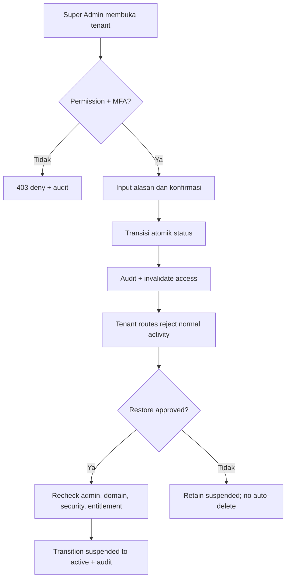

# PRD Modul SaaS Central & Tenant Management — LMS SaaS Multi-Sekolah

| Metadata | Nilai |
|---|---|
| ID dokumen | PRD-SAAS-CENTRAL-001 |
| Versi | 1.0 |
| Tanggal | 5 November 2026 |
| Status | **Proposed baseline — review dan persetujuan sebelum implementasi** |
| Prioritas | P0 M1 (tenant provisioning), P0/P1 M5 (operasi SaaS), P2 M6 (billing otomatis) |
| Dokumen induk | `PRD_Master_LMS_SaaS_Multi_Sekolah_v1.0.md` |
| Arsitektur induk | `ADR_001_Multi_Tenancy_Identity_Architecture_v1.0.md` |
| Skema induk | `ERD_Core_LMS_SaaS_v1.0.md` |
| Dokumen pasangan | `PRD_Modul_Authentication_RBAC_v1.0.md` |

> **Perhatian:** Sistem ini ditujukan bagi banyak sekolah sejak hari pertama. Semua aksi pusat mengikuti pemisahan privilege platform vs sekolah, shared PostgreSQL multi-tenant, serta tidak memberikan akses otomatis ke nilai, jawaban ujian, atau dokumen pribadi siswa. Rancangan detail adalah baseline usulan, bukan pernyataan fitur yang telah dibuat.

## 1. Visi, tujuan dan ruang lingkup

**Central SaaS** merupakan control plane bagi operator pemilik platform, bukan portal akademik. Fungsinya mengelola siklus hidup tenant sekolah, hostname, akun admin awal, paket layanan, kuota/entitlement, penggunaan agregat, audit operasional, dan kesiapan onboarding sekolah.

**Hasil bisnis yang diharapkan:** pemilik platform dapat menambah sekolah baru dengan aman, mengelola akses layanan dan kapasitas tanpa membuat deployment Laravel atau database terpisah, serta melihat kondisi platform tanpa mengekspos data anak.

### 1.1 Sasaran MVP

1. Platform Super Admin dapat membuat beberapa sekolah dari satu central dashboard.
2. Provisioning memiliki idempotency, validation, transactional consistency, dan audit.
3. Tenant baru berstatus `pending` dan tidak dapat dipakai hingga aktivasi eksplisit.
4. Sekolah memperoleh hostname default serta undangan admin awal yang aman.
5. Tenant berjalan pada codebase/shared DB yang sama; data antar-sekolah terisolasi.
6. Suspensi/arsip tidak langsung menghapus data dan tidak membuat sesi lama tetap berhak.
7. Paket dan entitlement dapat ditetapkan manual, tanpa bergantung pada payment gateway.

### 1.2 Non-goals MVP

Marketplace aplikasi, reseller/yayasan multi-tenant, automated checkout, invoice digital dan webhook payment gateway, public self-signup sekolah, custom domain/TLS otomatis, white-label penuh, kemampuan platform membaca data akademik tanpa grant, sistem helpdesk yang membuka sesi murid, hard deletion otomatis, restore per sekolah otomatis, tier-based enterprise isolation database-per-tenant.

### 1.3 Pemisahan kontrol bisnis dan teknis

| Domain | Ada di M1 | Ada di M5 | M6 / setelahnya |
|---|---|---|---|
| Tenant create, host mapping, status awal | Ya | Penyempurnaan ops | — |
| Admin sekolah pertama dan invitation | Ya | Monitoring onboarding | — |
| Host-only login & tenant resolver | Ya (melalui PRD Auth) | — | — |
| Paket/entitlement manual | Struktur dapat ditunda; **tidak** mengunci MVP auth | Implementasi P0 | — |
| Quota & usage summaries | Dummy/log metrik aman | Implementasi P1 selektif | — |
| Trial/grace-period policy | Tidak dipaksakan | Setelah kontrak disahkan | Opsional |
| Invoice/payment gateway | Tidak | Tidak | P2 |
| Custom domain | Domain default lokal | Domain default production | P2 |

**Kontrak M1/M5:** selama M1, tenant dummy dapat diaktifkan untuk pengujian tanpa sistem subscription penuh. Pada produk komersial, entitlement yang diperlukan harus benar-benar ditegakkan di server sebelum menerima pelanggan. Jangan membangun pemeriksaan paket palsu atau hardcoded seolah sudah ada pembayaran.

## 2. Persona dan akses

| Persona | Boleh | Tidak boleh |
|---|---|---|
| Platform Super Admin | CRUD-terbatas tenant, provision, activate/suspend, menetapkan plan, melihat usage agregat, audit platform | Membaca daftar siswa, nilai, jawaban ujian, file akademik secara default |
| Admin Sekolah | Melengkapi branding/profil sekolah, mengelola data anggota sendiri, melihat status paket dan kuota sendiri | Membuat tenant lain, mengubah status paket, mengatur masa aktif sendiri, membuka data sekolah lain |
| Teacher/Student | Melihat status layanan umum di sekolah sendiri | Membuka central dashboard, mengubah tenant status/plan |
| Internal operations (masa depan) | Peran granular sesuai perubahan ADR | Menggunakan role super_admin otomatis tanpa pengaturan |

Satu user yang kebetulan berperan admin sekolah **tidak** menjadi platform operator. `platform_staff` adalah entitas terpisah, host serta session juga dipisahkan.

## 3. Model tenant, hostname dan identitas sekolah

### 3.1 Aturan identitas tenant

- Satu sekolah = satu `tenants` record dan satu `public_ulid` untuk URL/API.
- `tenants.slug` unik secara global, lowercase ASCII, format usulan `^[a-z0-9][a-z0-9-]{1,38}[a-z0-9]$` (panjang 3–40), larang `--` dan kata reserved (`admin`, `api`, `www`, `support`, `billing`, `app`, `login`, `static`, `assets`). Nilai final menjadi config + validation service + test.
- `tenants.timezone` default `Asia/Jakarta`; valid IANA timezone dari whitelist atau validation resmi.
- `tenant_domains.hostname` unik global, `status='active'` hanya untuk host valid dan verified. Default domain diprovision internal; custom domain memerlukan verifikasi kepemilikan dan SSL kelak.
- **Never reassign hostname** dari satu tenant aktif ke tenant lain. Jika sudah dipakai atau pernah terkait histori sensitif, review prosedur pelepasan & karantina. Tidak ada operasi otomatis tenant A → B pada MVP.
- Data tenant owned selalu memiliki `tenant_id` dan FK komposit lintas tabel sesuai ERD v1.0.

### 3.2 State machine tenant

```mermaid
stateDiagram-v2
    [*] --> pending: create tenant
    pending --> active: onboarding ready + central approval
    pending --> archived: cancel onboarding (controlled)
    active --> suspended: operator decision
    suspended --> active: restore approved
    suspended --> archived: formal offboarding
    active --> archived: formal offboarding + approval
    archived --> [*]: retained; no automatic deletion
```



| Status | Tenant app | Central actions | Keamanan/data |
|---|---|---|---|
| `pending` | Blokir login sekolah umum dan pembelajaran | Perbaiki onboarding, kirim undangan, activate/abort | Tidak ada fallback ke tenant lain |
| `active` | Akses sesuai membership, role, resource dan entitlement | Monitor, update metadata, suspend | Normal isolation & audit |
| `suspended` | Halaman status; blok mutasi, login normal sesuai kebijakan yang ditetapkan | Review, restore atau offboard | Existing sessions tidak boleh tetap melakukan mutasi |
| `archived` | Blok akses normal | Akses audit/ekspor terbatas sesuai izin dan kontrak | Tidak langsung delete; reaktivasi bukan tombol biasa |

**Belum diputuskan:** grace/read-only serta proses legal retention, export, dan reactivation tenant archived. Untuk MVP, *fail closed*: tidak ada akses sekolah normal pada suspended/archived dan tidak ada penghapusan otomatis. Jangan menambahkan grace period secara asumsi.

### 3.3 Domain & lingkungan lokal

```text
CENTRAL    admin.platform.test
TENANT A   smpn10.platform.test
TENANT B   smpn05.platform.test
TENANT C   smpswasta.platform.test
```

Contoh host bersifat ilustratif. Pada Windows, file `hosts` memerlukan entri per hostname; Docker web server reverse proxy harus menerima host. Host pusat harus diset di allowlist. Jangan pakai wildcard cookie `.platform.test`; setiap host memakai cookie sesi host-only. Domain produksi belum diputuskan.

## 4. Requirement P0: Tenant Directory & Provisioning

### 4.1 SAAS-01 — Tenant Directory (P0/M1)

**Aktor:** Platform Super Admin.

**Tampilan:** daftar tenant dengan pencarian nama/slug, status, hostname utama, tanggal dibuat, status onboarding, plan (jika M5 sudah aktif), dan timestamp operasi terakhir. **Tidak** memuat daftar siswa/rekap nilai individual.

**Aksi:** lihat detail, buat tenant, edit profil minimum, suspend/restore/arsip sesuai state & permission. Kolom `status` atau `plan` tidak diubah langsung dari tabel; harus melalui action service terdokumentasi.

**Acceptance:** 3 tenant dummy tampil, pagination server-side, filter tidak menampilkan PII, semua aksi terotorisasi dan teraudit; tenant host tidak boleh bisa memanggil central route.

### 4.2 SAAS-02 — Create Tenant / Provisioning (P0/M1)

**Input form minimum:** `school_name`, `slug`, `timezone`, kontak admin sekolah untuk undangan (`display_name`, `email` opsional / kanal aktivasi terverifikasi), keterangan internal opsional, `idempotency_key` dibuat server/form untuk mencegah double submit.

**Validasi:**

- Nama sekolah wajib, panjang dibatasi, HTML disanitasi saat output.
- Slug unik dan sesuai rules §3.1; collision hostname dan reserved words ditolak.
- Host default dihasilkan server dari slug + basis domain terkonfigurasi; **jangan** menerima hostname arbitrer dari browser pada MVP.
- Timezone valid; admin calon pengguna melalui flow undangan pada PRD Auth; email bila dipakai wajib format sah dan diverifikasi.
- Tidak menerima `tenant_id`, role platform, package price, atau status aktif langsung dari browser sebagai hak yang dapat dipercaya.

**Step provisioning atomik (single DB, M1):**

1. Super Admin login di host pusat, lolos MFA jika production, memiliki `platform.tenants.create`.
2. Validasi payload, idempotency key (per actor+action+key), slug dan host. Tulis `platform_audit_logs` untuk attempt/result dengan request ID.
3. Dalam DB transaction: buat `tenants(status=pending)`, buat `tenant_domains(status=active, verified_at` internal untuk default hostname, `is_primary=true`), buat invitation admin awal atau catat pending assignment yang aman, buat default settings **hanya bila skema disahkan**.
4. Commit; jadwalkan notifikasi/penyerahan activation token **setelah commit**, via outbox/job idempotent. Jangan mengirim email sebelum transaksi commit.
5. Kembalikan halaman detail tenant pending + onboarding checklist. **Jangan auto active.**
6. Jika duplicate submit: return resource provisioning yang sama, bukan membuat dua tenant. Jika slug/host race: database UNIQUE constraint menolak, UI menampilkan konflik yang wajar; operasi tidak menghasilkan half-tenant.

**Catatan keamanan:** untuk calon admin yang sudah memiliki `users` di tenant lain, gunakan invitation verified tanpa auto-link via nama/email, sesuai PRD Auth. Jalur undangan harus dapat dibatalkan jika tenant batal dibuat.

**Failure/compensation:** DB transaction rollback bila tahap DB gagal; notifikasi yang gagal **boleh** diretry setelah commit tanpa membuat ulang tenant; status tetap `pending`, tampilkan pengiriman undangan gagal, audit alasan aman. Jangan menyimpan token plaintext di log. Jika memakai external side effects pada iterasi berikutnya, terapkan outbox/saga dengan retry/compensation eksplisit.

### 4.3 SAAS-03 — Admin Pertama & Aktivasi Sekolah (P0/M1)

**Alur:**

1. Tenant `pending` dan hostname sudah di-reserve.
2. Super Admin memilih calon school admin dan memulai undangan aman.
3. Calon admin mengaktifkan akun/membership pada host tenant melalui one-time token, memilih password jika akun baru, dan menyelesaikan verifikasi identitas.
4. Central memeriksa readiness checklist; jika semua P0 terpenuhi, operator memicu **Activate Tenant** secara eksplisit.
5. Setelah status `active`, admin sekolah login dan mengelola tahun ajaran, kelas, mata pelajaran, guru, siswa.

**Readiness checklist minimal:**

- Tenant slug dan primary domain unik, domain aktif/verified.
- Setidaknya satu `school_admin` dengan membership `active` dan user global aktif.
- Undangan admin pertama sudah dikonsumsi/diterima, bukan sekadar terkirim.
- Konfigurasi dasar timezone ada; baseline keamanan middleware/schema dan audit aktif.
- Untuk pilot berdata nyata: perjanjian dan kebijakan data, backup/restore, MFA operator, dan pemeriksaan pre-production terselesaikan. Ini gate operasional, bukan boolean front-end yang dapat diakali.

**Perhatian flow pending:** karena login normal tenant `pending` diblok, **rute aktivasi saja** boleh diakses secara terbatas menggunakan token tenant-bound, bukan membebaskan seluruh portal pending. Route harus memiliki middleware guest purpose-limited, throttling, dan deny untuk dashboard sampai tenant active.

**Edge cases:** calon admin membatalkan undangan, salah domain, link dipakai ulang, expired, duplicate member, user disabled, tenant suspended saat activation. Aktivasi tidak boleh menyiasati status tenant atau memberi hak platform.

### 4.4 SAAS-04 — Edit Tenant Metadata (P0/M1)

- Fields awal: `name`, timezone dan metadata kontak internal secukupnya. **Slug dan hostname immutable secara default setelah aktif**; jika penggantian diperlukan, proses terpisah dengan redirect plan/approval, bukan edit mass assignment.
- Perubahan penting harus audit before/after sanitized; perubahan timezone tidak mengubah timestamp tersimpan di DB (UTC) dan tidak secara otomatis memindahkan jadwal ujian yang sudah dibuat.
- Jangan mengubah `tenant_id` record akademik karena rename sekolah.

### 4.5 SAAS-05 — Transition Status (P0/M1)

- Hanya platform staff berpermission `platform.tenants.transition`, gunakan explicit action `activate`, `suspend`, `restore`, `archive`; setiap aksi memerlukan alasan dan confirmation UI.
- Semua transisi memakai DB transaction, compare-and-swap/status precondition, row lock atau optimistic locking untuk mencegah race, audit append-only.
- Suspensi memblokir login normal dan operasi mutasi, memicu invalidasi sesi/authorization; ongoing queued jobs untuk tenant suspended harus diperiksa ulang sebelum eksekusi.
- `archive` mensyaratkan checklist offboarding, alasan, bukti otorisasi, dan kebijakan retensi (sebelum production); tidak ada hard delete otomatis.
- Untuk `active → suspended`, pilih status page netral tanpa rincian billing atau data internal kontrak kepada siswa.

## 5. Requirement M5: Paket, Subscription, Entitlement

### 5.1 SAAS-06 — Plan Catalog (P0/M5)

Tabel mengikuti ERD: `plans(code,name,status,description)` dan `plan_features(plan_id,feature_key,is_enabled,limit_value)`. Paket awal manual; tidak mematok harga, domain, atau jumlah murid di kode. Paket bisa `active/retired` (retired tidak dijual lagi, histori subscription tetap ada).

**Feature keys usulan** (ditetapkan satu katalog server dan versioned seed):

| Key | Tipe | Arti |
|---|---|---|
| `lms.materials` | boolean | Materi pembelajaran |
| `lms.assignments` | boolean | Tugas/pengumpulan |
| `lms.quizzes` | boolean | Kuis & ujian |
| `capacity.members_active` | integer | Jumlah membership aktif |
| `capacity.storage_bytes` | integer bytes | Penyimpanan file privat yang terpakai |
| `capacity.upload_max_bytes` | integer bytes | Maksimum file tunggal, tetap dibatasi policy server |
| `capacity.quiz_concurrency` | integer | Batas tenant-level concurrent quiz ops bila didukung |

**Semantik:** `is_enabled=false` berarti tidak dapat digunakan; `limit_value=NULL` **tidak otomatis unlimited** kecuali definisi key menyatakan unlimited. Unlimited butuh explicit feature metadata/policy. Kuota bukan cara membatasi kewenangan membaca data sekolah lain.

### 5.2 SAAS-07 — Manual Subscription (P0/M5)

- Operator memilih plan active, tanggal mulai/akhir, alasan/status; record pada `tenant_subscriptions` sesuai ERD, setiap tenant maksimal satu subscription `active` (partial unique DB index).
- Tanggal harus konsisten `starts_at < ends_at` jika `ends_at` terisi, timezone display jelas.
- Assign/renew/retire/transition harus dicatat pada platform audit; tidak boleh membuang histori subscription.
- Jika plan berubah saat jam pelajaran, hasil lama tidak dihapus. Fitur yang jadi tidak tersedia memiliki perilaku *view archived vs blocked new writes* yang harus ditetapkan sebelum production.
- **Status tenant dan subscription berbeda:** tenant `active` belum tentu langganan valid; middleware entitlement memberi keputusan terpisah. Sebaliknya subscription active tidak boleh otomatis membuka tenant `suspended`.
- Di M1/dev tanpa modul subscription, feature gating lokal bersifat simulasi eksplisit; jangan mengklaim paket terpasang atau memproses pembayaran.

### 5.3 SAAS-08 — Entitlement & Feature Gates (P0/M5)

- Per tenant, cek `tenants.status`, `tenant_subscriptions.status + starts_at/ends_at`, `plan_features` dan `tenant_entitlements` (override P1) di **backend** setiap aksi privileged.
- Sumber data katalog feature dikontrol platform; pembatasan kuota race-safe (atomic counter/reservation atau DB validation), tidak hanya query count di frontend.
- Cache entitlement harus key dengan `tenant_id`, plan/version, dan invalidation saat plan berubah; jangan campur antartenant.
- Usage diukur per tenant, jangan menghitung `users` global untuk kapasitas siswa: hitung membership aktif pada tenant terkait. Guru yang sama di dua sekolah dihitung sesuai membership masing-masing.
- Jika Redis/down, tentukan fail-safe behavior per fitur dan uji; operasi berisiko (upload/ujian melebihi kuota) fail closed tanpa menghapus histori.

### 5.4 SAAS-09 — Suspension sebab komersial (P1/M5)

- Tidak ada auto-suspend akibat expiry sebelum status grace/read-only, pemberitahuan, kontrak, dan proses sengketa ditetapkan.
- Sesudah kebijakan disahkan, job penjadwalan memeriksa tanggal dengan idempotency, audit dan notifikasi. Jangan menjalankan `DELETE` data saat subscription expired.
- Masa simpan, mekanisme ekspor, dan penghapusan harus memiliki SOP legal/kontrak khusus untuk data anak.

## 6. Dashboard Super Admin

### 6.1 SAAS-10 — Information architecture

```text
Central (admin.platform.test)
  /login
  /dashboard
  /tenants
    /tenants/create
    /tenants/{public_ulid}
    /tenants/{public_ulid}/onboarding
    /tenants/{public_ulid}/domains
    /tenants/{public_ulid}/subscription  [M5]
    /tenants/{public_ulid}/usage         [M5]
    /tenants/{public_ulid}/audit
  /plans                               [M5]
  /audit                               [M1]
  /system/health                       [M5]
  /account/security
```

**Central dashboard (P0/M1):** total tenant, tenant pending, active, suspended, archived, tenant baru dalam periode, undangan admin pertama belum diterima (agregat), error provisioning terakhir (tanpa payload rahasia), dan aksi cepat tambah sekolah. Hitungan dihasilkan dari record yang sah, bukan angka dummy dalam production.

**M5:** distribusi plan, tenant mendekati kuota, tren penggunaan agregat, kinerja queue/worker dan storage, periode subscription. Beri indikator **terakhir diperbarui** untuk metrik yang tidak realtime; jangan mengklaim realtime jika data di-refresh batch.

### 6.2 Wireframe informasi (teks)

```text
+-----------------------------------------------------------------------+
| LMS SaaS Admin        Dashboard   Sekolah   Paket   Audit   Akun       |
+-----------------------------------------------------------------------+
| [Total sekolah] [Aktif] [Menunggu] [Ditangguhkan]                       |
|                                                                       |
| Sekolah Terbaru                         Status provisioning            |
| - SMPN 10  | pending  | Lihat          - pending admin activation     |
| - SMPN 05  | active   | Lihat          - domain check passed         |
|                                                                       |
| [ + Tambah sekolah ]                 [ Lihat audit platform ]          |
+-----------------------------------------------------------------------+
```

Contoh pada wireframe menggunakan data sintetis. Detail halaman sekolah berisi: identitas sekolah, primary hostname, status, ringkasan onboarding, admin awal (hanya metadata yang diperlukan), plan (jika tersedia), penggunaan agregat, transisi status berizin, dan audit.

### 6.3 Prinsip privasi dashboard

- **Tidak ada** default panel nama siswa, daftar nilai, soal, jawaban ujian, file submission, atau aktivitas individu anak.
- Metrik agregat `active_membership_count`, jumlah course, penggunaan storage, error rate diizinkan sebatas kebutuhan operasional; untuk kelompok sangat kecil, lakukan penilaian risiko reidentifikasi sebelum drill-down.
- Search tenant berdasarkan metadata sekolah, bukan global search PII siswa.
- Data plan & billing hanya terlihat di platform staff berwenang dan admin sekolah miliknya sesuai kontrak.

### 6.4 SAAS-11 — Audit Viewer (P0/M1)

Filter aktor, target tenant, waktu, jenis event, hasil; pagination server-side. Audit bersifat append-only, akses `platform.audit.view`, retensi ditetapkan sebelum production. Jangan mengekspos password, secret, token activation, session ID, email sensitif, atau isi record siswa dalam metadata.

## 7. Detail workflow pengguna

### 7.1 Alur provisioning end-to-end

```mermaid
sequenceDiagram
    actor O as Super Admin
    participant C as Central Web
    participant S as ProvisioningService
    participant DB as PostgreSQL
    participant Q as Queue/Outbox
    actor A as Admin Sekolah
    O->>C: Buat tenant + admin awal
    C->>S: Validate + authorize + idempotency
    S->>DB: BEGIN; tenant pending; domain; invitation; audit
    DB-->>S: COMMIT
    S->>Q: enqueue post-commit notification
    S-->>C: Tenant pending + checklist
    Q-->>A: Invitation via verified channel
    A->>C: Activate on tenant host (purpose-limited route)
    C->>DB: Verify one-time token & activate membership
    O->>C: Review readiness and activate tenant
    C->>S: transition pending -> active
    S->>DB: status change + audit (atomic)
    C-->>O: Tenant active
```

**Failure branches:** slug duplicate → 409 form conflict; delivery failure → pending/retry without duplicate; invitation expired → rotate token, revoke old; readiness incomplete → 422 with checklist items; request duplicate → return previous operation result.

### 7.2 Alur suspend & restore



### 7.3 Sekolah menyelesaikan onboarding akademik

Sesudah aktif, admin sekolah membuat tahun ajaran, semester, kelas, mapel, guru, siswa dan course menggunakan modul akademik tersendiri. Central hanya menampilkan checklist agregat kemajuan seperti `tahun_ajaran_ada`, `ada_rombel`, `ada_guru` tanpa membuka isi data yang tidak diperlukan. Ini integrasi M2, **bukan syarat tenant provisioning M1**.

## 8. API / service contract (berorientasi command)

Semua mutasi central melalui command service; URL REST berikut adalah ilustrasi implementasi setelah otorisasi:

| Method/path | Permission | Input minimum | Output & catatan |
|---|---|---|---|
| `GET /tenants` | `platform.tenants.view` | q, status, page | Paginated tenant metadata |
| `POST /tenants` | `platform.tenants.create` | school_name, slug, timezone, admin invitation, idempotency key | 201 pending, atau resource existing untuk retry |
| `GET /tenants/{ulid}` | `platform.tenants.view` | ULID publik | Detail administratif |
| `PATCH /tenants/{ulid}` | `platform.tenants.update` | allowed metadata | Immutable slug unless separate workflow |
| `POST /tenants/{ulid}/activate` | `platform.tenants.transition` | reason, expected_status | Check readiness + audit |
| `POST /tenants/{ulid}/suspend` | `platform.tenants.transition` | reason, expected_status | Revoke access, no deletion |
| `POST /tenants/{ulid}/restore` | `platform.tenants.transition` | reason, expected_status | Recheck readiness/entitlement |
| `POST /tenants/{ulid}/archive` | `platform.tenants.transition` | reason, checklist proof | Controlled offboarding |
| `POST /tenants/{ulid}/admin-invitations` | `platform.tenants.update` | admin candidate verified channel | Reinvite/replace initial admin |
| `POST /tenants/{ulid}/subscriptions` | `platform.plans.assign` | plan, dates, reason | M5, manual subscription, auditable |
| `GET /tenants/{ulid}/usage` | `platform.tenants.view` + usage permission (future) | period | M5 aggregate only |
| `GET /audit` | `platform.audit.view` | actor, action, tenant, period | Sanitize metadata |

Central action **tidak** menerima tenant-impersonation flags (`as_tenant`, `bypass_policy`, `admin_mode`) dan tidak mengembalikan academic data. Errors: 401 guest, 403 insufficient privilege, 404 unknown ULID, 409 invalid transition/conflict, 422 validation/readiness, 429 throttled, 503 infrastructure unavailable with safe retry.

## 9. Data model & delta ERD

### 9.1 Tabel EXISTING dari ERD v1.0

| Tabel | Kegunaan |
|---|---|
| `tenants` | Record sekolah, slug, name, status, timezone |
| `tenant_domains` | Hostname, kind, status, verified_at, is_primary |
| `users`, `platform_staff` | Operator platform dan akun admin awal |
| `tenant_memberships`, `membership_roles`, `roles` | Admin sekolah aktif dengan role school_admin |
| `plans`, `plan_features` | Katalog paket dan batas (M5) |
| `tenant_subscriptions` | Riwayat langganan manual (M5) |
| `tenant_entitlements` | Override paket P1 |
| `platform_audit_logs` | Audit proses provisioning/status/subscription |
| `tenant_audit_logs` | Audit aktivitas keanggotaan tenant |

### 9.2 **Usulan delta ERD v1.1** — perlu persetujuan sebelum migration

| Usulan | Kolom minimal | Constraint/keamanan | Kapan |
|---|---|---|---|
| `tenant_provisioning_requests` | `id`, `actor_user_id`, `idempotency_key_hash`, `payload_digest`, `tenant_id` nullable, `status`, `failure_code`, `created_at`, `completed_at` | Unique `(actor_user_id,idempotency_key_hash)`; retry payload berbeda ditolak; jangan simpan token/plain PII | M1 |
| `tenant_status_history` (opsional jika audit platform cukup) | `id`, `tenant_id`, `from_status`, `to_status`, `reason_code`, `actor_user_id`, `created_at` | Immutable, FK tenant/user, bukan tempat data siswa | Review M1 |
| `tenant_settings` | `tenant_id`, `logo_object_key` nullable, `accent_color` nullable, `onboarding_json` terbatas | Tenant scoped, file private/signed public asset policy; brand setting tenant-specific | M1/M5 |
| `provisioning_outbox` (opsional) | `event_id`, `tenant_id`, `event_type`, `payload_ref`, `status`, `attempts`, timestamps | At-least-once delivery dedup + no secret in logs; boleh gunakan job afterCommit jika durability memadai untuk M1 | Review M1 |
| `tenants.version` / transition locking strategy | int/timestamp monotonic | Hindari race saat status berubah; bisa memakai `SELECT ... FOR UPDATE` tanpa kolom baru | Review M1 |
| `plan_features.feature_key` catalog metadata | tipe/semantik batas (mis. `feature_definitions` jika dibutuhkan) | Definisi NULL/unlimited harus eksplisit, jangan menyisipkan tipe berbeda tanpa skema | M5 |

**Ketergantungan kritis:** `account_invitations` adalah proposal pada PRD Auth. Flow SAAS-02/03 harus menggunakannya setelah revisi ERD disahkan, bukan membuat tabel invitation kedua dengan nama lain. `platform_audit_logs` sudah ada; jangan duplikasi menjadi `audit_events` tanpa alasan jelas.

### 9.3 Constraint dan integritas wajib

- `tenants.slug UNIQUE`, `tenants.public_ulid UNIQUE`.
- `tenant_domains.hostname UNIQUE`, `(tenant_id,id)` unique bila menjadi parent komposit; satu primary active domain per tenant via partial unique index.
- Foreign key terhadap tenant harus valid; app tidak boleh membuat `tenant_domains` yang merujuk tenant lain akibat request metadata.
- `tenant_subscriptions`: max satu `status=active` per tenant sesuai ERD, validasi rentang tidak saling konflik sesuai kebijakan; subscription historical tidak dihapus.
- Update role/school-admin tetap melalui membership tenant-scoped; tidak ada `users.role=school_admin`.
- `public_ulid` bukan izin; portal pusat tetap periksa role/permission sebelum membuka resource.

## 10. Audit, observability dan operasional

### 10.1 Event katalog

| Event | Actor | Tenant ID | Metadata aman |
|---|---|---|---|
| `tenant.create.requested/succeeded/failed` | Platform staff | optional saat request | slug (bila aman), request_id, result code |
| `tenant.domain.reserved/verified/revoked` | Platform staff/service | wajib jika ada | host, type, status; hindari secret DNS |
| `tenant.admin_invited/activated` | Platform staff / user terkait | wajib | membership public ID/status, **bukan invitation token** |
| `tenant.transitioned` | Platform staff | wajib | from/to, reason code, expected_status |
| `tenant.subscription.assigned/renewed/retired` | Platform staff | wajib | plan code, timestamps, old/new status |
| `tenant.branding.updated` | School admin | wajib | changed field names, bukan file contents |
| `tenant.entitlement.override_changed` | Platform staff | wajib | feature key, old/new values, reason |

**Audit append-only**, tidak bisa dihapus dari UI Super Admin; retention dan export policy harus disetujui sebelum data nyata. Log terstruktur harus berisi request ID, verified tenant context, latensi, nama action, outcome, tidak mengandung password, token atau data murid.

### 10.2 Monitoring & alert (M5)

- Proses provisioning gagal berulang atau webhook/notifikasi stuck.
- Tenant status berubah di luar action service resmi (deteksi audit delta).
- 401/403/404 berulang pada cross-tenant path (jangan mencatat isi record siswa).
- Query berat, queue backlog, storage growth, error rate per tenant, rate limit/memori; alarm noisy neighbor agar satu sekolah tidak melumpuhkan sekolah lain.
- Dashboard menunjukkan freshness/staleness periode metrik, bukan angka live palsu.

### 10.3 Backup/offboarding

Backup database bersama tidak boleh diberikan mentah ke satu sekolah karena berisi data tenant lain. Restorasi per tenant memerlukan prosedur selektif khusus dan validasi isolasi. Data offboarding harus melalui kontrak, kebijakan retensi serta hukum perlindungan data anak; tidak ada purge otomatis MVP. Simulasi backup/restore wajib sebelum pilot real.

## 11. Keamanan dan privasi

- Central sessions host-only; server-permission protected; MFA operator wajib sebelum production berdata nyata.
- Tidak ada universal admin-bypass untuk query tenant-owned; support access terotorisasi granular berada di luar MVP.
- `tenant_id`/hostname dari JSON, headers custom, query params tidak pernah menjadi sumber otoritas; host resolver membaca host terverifikasi untuk aplikasi sekolah.
- Semua perubahan pada subscription/quota dinilai server-side dan dicatat; jangan percaya limit/perhitungan browser.
- Files, caches, queue, dashboard materialized views dan scheduled tasks wajib tenant-aware. Untuk job lintas tenant, filter tenant di service resmi dan audit action.
- Gunakan synthetic fixtures, jangan menulis data siswa sungguhan ke log, prompt Codex, screenshot atau repo.
- Wajib ada kebijakan tanggung jawab pengendali/pemroses data dan perjanjian penggunaan dengan sekolah sebelum pilot berisi data anak.

## 12. Matrik pengujian QA / acceptance

| ID | Modul | Test | Expected |
|---|---|---|---|
| SAAS-T01 | Directory | Non platform staff GET `/tenants` | 403/redirect aman |
| SAAS-T02 | Create | Slug/hostname duplikat | 409/422; tidak membuat tenant kedua |
| SAAS-T03 | Create | Klik submit dua kali sama idempotency key | 1 tenant dan 1 primary domain, return existing operation |
| SAAS-T04 | Create | Key sama dengan payload berbeda | Conflict, tidak overwrite data |
| SAAS-T05 | Create | Inject `status=active` / `tenant_id` client | Ditolak/diabaikan secara aman; tetap pending |
| SAAS-T06 | Transaction | Gagal membuat domain/invitation | Rollback tanpa half-tenant; atau job retry post-commit aman |
| SAAS-T07 | Activation | Admin invitation belum diterima | Tenant tidak dapat diaktifkan |
| SAAS-T08 | Activation | Pending admin activation page | Hanya purpose-limited route tersedia, dashboard tenant tertutup |
| SAAS-T09 | Activation | Link admin expired/reused/cross-tenant | Gagal dan teraudit tanpa eskalasi |
| SAAS-T10 | Transition | `active -> suspended` | Session/queue tenant tidak dapat mutasi baru |
| SAAS-T11 | Transition | Concurrent suspend/restore dengan state lama | Hanya satu transisi valid tercatat |
| SAAS-T12 | Offboarding | Archive active tanpa checklist/approval | Ditolak |
| SAAS-T13 | Privacy | Platform staff menebak ULID nilai siswa | 403/404; tidak mendapatkan academic data |
| SAAS-T14 | Domain | Unknown host dan revoked host | Tidak resolve tenant |
| SAAS-T15 | Plan | 2 subscription active di tenant sama | PostgreSQL partial unique menolak |
| SAAS-T16 | Entitlement | School admin mengirim payload naikan kuota | Tidak mengubah entitlement |
| SAAS-T17 | Isolation | Usage metrics dari tenant A dan B | Tidak saling tercampur |
| SAAS-T18 | Audit | Create/transition/reassign plan | Audit actor, action, time, target, request ID; no token/PII |
| SAAS-T19 | Error delivery | Notification job di-retry | Tidak mengirim token lama, tidak menduplikasi tenant/account |
| SAAS-T20 | Local | 3 tenant, 1 central host, 1 codebase | Semua host bekerja dengan cookie dan data terpisah |

### 12.1 Test fixture dan acceptance stage

**Synthetic dataset:** tiga sekolah bernama dummy, satu berstatus `pending`, satu `active`, satu `suspended`; dua slug mirip; satu admin calon belum aktif; satu staff pusat; satu guru yang menjadi anggota dua tenant (dari PRD Auth); beberapa plan untuk M5.

**Gate M1 (tenant provisioning siap)**: SAAS-T01 s.d. T14, T18–T20 yang relevan lulus pada PostgreSQL lokal; tenant inactive tidak membuka pembelajaran; migration constraints dan auth policy lulus.

**Gate M5 (operasi SaaS siap)**: SAAS-T15 s.d. T18 dan monitoring/reporting tambahan; entitlement server-side enforce; nilai plan tidak hard-coded; backup/restore drill dan security review lulus.

## 13. UI/UX dan rincian layar

| Layar | Komponen | State/error penting |
|---|---|---|
| Central Login | Email, password, MFA, bantuan recovery | Unknown user generik, locked/throttled, invalid MFA |
| Dashboard | KPI card sederhana, recent tenants, alerts, quick create | Loading/empty/refresh timestamp; data agregat saja |
| Tenant Directory | Search, filter status, pagination, row actions | Empty state, no permission, conflicting status |
| Create School | Step 1 identitas sekolah; step 2 admin awal; review | Duplicate slug, timezone invalid, invitation channel unavailable |
| Tenant Detail | Overview, domain, admin, onboarding, audit, subscription tabs | Disable aksi transisi yang invalid; server tetap check |
| Onboarding Checklist | Domain valid, admin activated, security readiness, activate CTA | Pending blocked with explicit reason |
| Transition Dialog | Type action, status before/after, reason required, confirmation | 409 stale state, audit success/error |
| Plans (M5) | List plans, detail features, assign dialog | Retired plan not assignable, validation dates |
| Usage (M5) | Aggregate per-tenant metrics and period | Stale metric notice, never student details |
| Audit | Filters, time range, actor/action, pagination | No secret in metadata, central-only |

Desain mobile-responsive untuk admin, tetapi workflow operator utama desktop-first. Gunakan label jelas, fokus keyboard, error inline, dan konfirmasi terpisah untuk suspend/archive. Jangan membuat tombol `Delete School` pada MVP.

## 14. Struktur layanan & kode yang disarankan

```text
app/
  Modules/Platform/{Controllers,Livewire,Actions,Policies,Services,DTO}
  Modules/Tenancy/{Models,Domain,Services,Resolver,Context,Events}
  Modules/Subscriptions/{Models,Services,Entitlements}    # M5
  Modules/Identity/                                     # dari PRD Auth
routes/{central.php,tenant.php}
database/{migrations,seeders}
tests/Feature/{Platform,Tenancy,Subscriptions}
tests/Unit/{Provisioning,Entitlements}
docs/{prd,adr,erd}
```

**Class/service contracts:** `ProvisionTenant`, `ApproveTenantActivation`, `TransitionTenantStatus`, `InviteInitialSchoolAdmin`, `AssignTenantSubscription`, `EntitlementResolver`, `TenantUsageAggregator`. Semua command memvalidasi actor di service, menggunakan transaction/idempotency/audit. Tidak mengandalkan tombol UI atau static `Tenant::current()` tanpa context lifecycle yang dibuktikan.

## 15. Sprint implementasi yang cocok untuk Codex

1. **CENTRAL-S1 (M1)** — tenant model+domain/constraints, central host isolation, platform staff auth (integrasi PRD Auth).
2. **CENTRAL-S2 (M1)** — directory/detail/create form + provisioning service idempotent DB transaction + negative tests.
3. **CENTRAL-S3 (M1)** — initial school admin invitation (reuse Auth-S5), pending activation route, readiness gate, transition pending→active.
4. **CENTRAL-S4 (M1)** — suspend/restore/archive protections, audit, session invalidation, worker checks, concurrency tests.
5. **CENTRAL-S5 (M5)** — plans/plan_features and manual subscription service, partial unique constraints, catalog tests.
6. **CENTRAL-S6 (M5)** — entitlement resolver, cache invalidation, usage summaries, quotas/rate limits, privacy tests.
7. **CENTRAL-S7 (M5)** — central ops dashboard/alerts, backup/restore runbook, pre-production security gate.
8. **CENTRAL-S8 (M6, bukan MVP)** — billing/payment integration & custom domains hanya setelah ADR/PRD baru.

**Definition of Done:** semua aksi central bisa ditelusuri ke requirement, permission dan test; tidak ada tenant half-provisioned setelah retry; tidak ada privilege platform menembus nilai siswa; dokumentasi schema dan changes tetap sinkron dengan ADR/ERD.

## 16. Risiko dan keputusan yang belum final

| Risiko / keputusan | Default aman | Pembuktian sebelum produksi |
|---|---|---|
| Subscription expire dan grace | Tidak ada auto-suspend/purge dari tanggal tanpa policy | Kontrak, pemberitahuan, read-only vs blocked action |
| Bootstrap plan sebelum M5 | Untuk data dummy M1 boleh tanpa subscription | Pada customer production gate entitlement harus aktif |
| Rekonsiliasi undangan dari tenant pending | Activation route purpose-limited | Security tests untuk cross-host invitation |
| Satu admin aktif terakhir hilang | Prevent action; central supervised replacement | Recovery SOP + audit |
| Domain rename/transfer | Tidak diizinkan otomatis | ADR + migrasi session/cookie/DNS aman |
| Idempotency storage/outbox | Proposed delta ERD | Tetapkan tabel dan failure semantics sebelum coding |
| Data removal/retention | No hard delete on suspend/archive | Legal review dan school agreement |
| Full RLS | Spike M1, belum presumed active | PostgreSQL permission tests jika diterapkan |
| Branding | Domain-scoped settings minimum | Upload validation dan serving asset aman |
| CDN / production scaling | Tidak dibutuhkan untuk local MVP | Load test concurrency/quotas sebelum rollout |

## 17. Prompt terarah untuk Codex

```text
Kerjakan hanya CENTRAL-S<n> sesuai PRD_Modul_SaaS_Central_Tenant_Management_v1.0.md.
Baca PRD Master, ADR-001, ERD v1.0, PRD Authentication & RBAC, dan PRD SaaS Central.
Tidak ada public school self-registration, automatic billing, atau custom domain di MVP.
Gunakan Laravel modular monolith + shared PostgreSQL, host-only sessions.
Tenant dibuat pending, diaktifkan setelah admin pertama valid dan readiness gate lewat.
Jangan mengimplementasikan tabel proposal delta ERD sampai v1.1 disetujui.
Wajib policy platform, idempotency, DB transaction, audit, negative cross-tenant tests.
Buat response berisi: file berubah, schema/constraint, flow, automated tests, risiko, open decisions.
Gunakan data dummy; tidak ada data murid nyata di seed/log.
```

## 18. Referensi

- Internal: PRD Master v1.0, ADR-001 v1.0, ERD Core v1.0, PRD Auth/RBAC v1.0.
- OWASP Multi-Tenant Security Cheat Sheet: https://cheatsheetseries.owasp.org/cheatsheets/Multi_Tenant_Security_Cheat_Sheet.html
- Laravel 13 Authorization: https://laravel.com/docs/13.x/authorization
- Laravel 13 Rate Limiting: https://laravel.com/docs/13.x/rate-limiting
- Laravel 13 Authentication: https://laravel.com/docs/13.x/authentication
- PostgreSQL Partial Indexes: https://www.postgresql.org/docs/current/indexes-partial.html
- PostgreSQL Row Security: https://www.postgresql.org/docs/current/ddl-rowsecurity.html

## 19. Riwayat versi

| Versi | Tanggal | Perubahan |
|---|---|---|
| 1.0 | 2026-11-05 | Baseline tenant provisioning, central dashboard, tenant lifecycle, entitlement, audit, QA dan delta ERD. |
